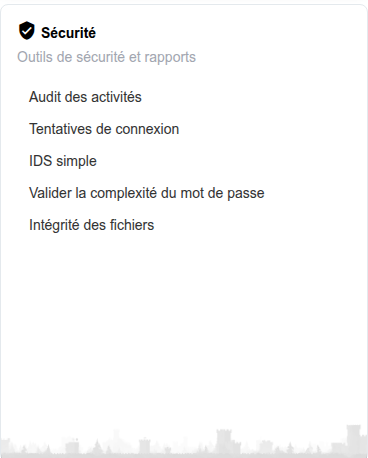

# Sécurité

Le bloc **Sécurité** du tableau de bord d'administration regroupe les outils intégrés de surveillance et d'audit de la sécurité de la plateforme. Il est distinct des [Paramètres de sécurité](../platform-settings/security-settings.md), qui configurent la *politique* de sécurité (règles de mot de passe, CAPTCHA, en-têtes de sécurité HTTP, etc.) — ce bloc fournit les *rapports et outils* qui surveillent la plateforme afin de détecter les activités suspectes et les modifications indésirables.

Le bloc a été introduit dans Chamilo 2.0 avec quatre outils, puis étendu dans Chamilo 3.0 par un cinquième, **Intégrité des fichiers**.

## Accéder au bloc Sécurité

Depuis le panneau d'administration, le bloc **Sécurité** apparaît aux côtés des autres blocs du tableau de bord (Utilisateurs, Cours, Gestion de la plateforme, Système, etc.). Cliquez sur l'un de ses liens pour ouvrir l'outil correspondant.

## Contenu du bloc

* **[Audit des activités](activities-audit.md)** — Parcourir les événements administratifs et de plateforme importants (utilisateur, cours, session et autres modifications) par type d'événement
* **[Tentatives de connexion](login-attempts.md)** — Examiner les tentatives de connexion échouées et réussies, avec des graphiques et un journal consultable
* **[IDS simple](simple-ids.md)** — Consulter les requêtes signalées par le système de détection d'intrusion intégré et léger de Chamilo
* **[Vérificateur de robustesse des mots de passe](password-strength-checker.md)** — Analyser les utilisateurs actifs afin de détecter les mots de passe correspondant à une liste de mots de passe couramment utilisés
* **[Intégrité des fichiers](file-integrity.md)** *(nouveau dans Chamilo 3.0)* — Détecter les ajouts, modifications, suppressions ou changements de permissions inattendus dans les fichiers installés

## Flux de signalement confidentiel supplémentaire

[Signalement confidentiel](confidential-reporting.md) est une fonctionnalité facultative de signalement et d'enquête, contrôlée par des permissions. Elle est distincte des cinq outils de surveillance destinés aux administrateurs listés ci-dessus.

## Qui peut y accéder

Les cinq outils requièrent un accès **Administrateur du portail**. Les actions d'analyse, de pause et de redéfinition de la ligne de base de l'intégrité des fichiers requièrent en outre un accès **Administrateur global**, et la mise en pause des alertes ou l'établissement d'une nouvelle ligne de base exige de saisir à nouveau votre propre mot de passe — voir [Intégrité des fichiers](file-integrity.md#actions) pour plus de détails.