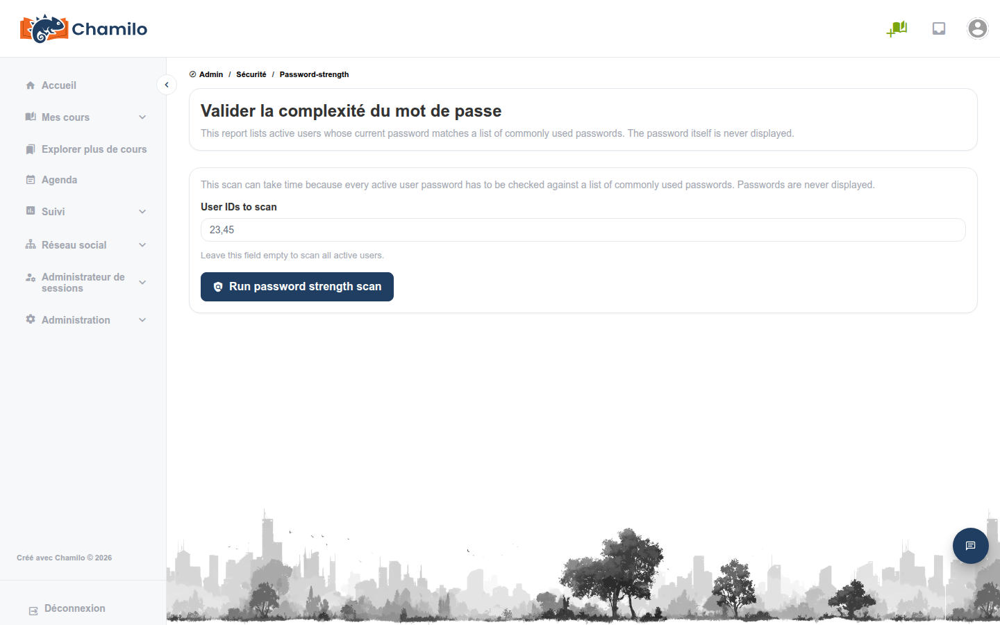

# Vérificateur de robustesse des mots de passe

Le vérificateur de robustesse des mots de passe analyse les empreintes de mots de passe stockées des utilisateurs actifs par rapport à une courte liste de mots de passe couramment utilisés (`123456`, `password`, `qwerty123`, et similaires). Il n'affiche ni ne transmet jamais les mots de passe eux-mêmes — uniquement si le mot de passe actuel d'un utilisateur correspond à l'un des candidats connus comme faibles.

## Accéder au vérificateur de robustesse des mots de passe

Depuis le panneau d'administration, cliquez sur **Sécurité > Vérificateur de robustesse des mots de passe**.

## Exécuter une analyse

* Laissez **Identifiants d'utilisateurs à analyser** vide pour analyser tous les utilisateurs actifs, ou saisissez une liste d'identifiants d'utilisateurs séparés par des virgules pour vérifier un sous-ensemble
* Cliquez sur **Lancer l'analyse de robustesse des mots de passe**

L'analyse s'exécute de manière asynchrone en arrière-plan afin de ne pas figer la page, en affichant la progression en direct (utilisateurs vérifiés jusqu'à présent, sur le total, et nombre de mots de passe faibles trouvés). Comme chaque mot de passe candidat doit être vérifié par rapport à l'empreinte de chaque utilisateur sélectionné, l'analyse de tous les utilisateurs sur une plateforme de grande taille peut prendre un certain temps — la liste des candidats est volontairement courte afin de limiter ce coût.

## Agir sur les résultats

Une fois l'analyse terminée, les utilisateurs signalés sont listés avec deux actions disponibles, soit par utilisateur, soit en action groupée pour tous les utilisateurs sélectionnés :

* **Demander un changement de mot de passe** (icône d'enveloppe) — Envoie à l'utilisateur un e-mail lui demandant de changer son mot de passe
* **Forcer la réinitialisation du mot de passe** (icône de réinitialisation) — Invalide immédiatement le mot de passe actuel de l'utilisateur et lui envoie un nouveau mot de passe par e-mail

Les deux actions revérifient les utilisateurs sélectionnés par rapport à la liste des mots de passe faibles avant d'agir, de sorte qu'une requête obsolète ou altérée ne puisse pas servir à réinitialiser un compte qui n'a plus de mot de passe faible.

## Désactivation des comptes aux mots de passe faibles

Une fois que l'analyse a identifié les comptes aux mots de passe faibles, les administrateurs autorisés peuvent désactiver un compte éligible individuellement ou sélectionner plusieurs comptes et utiliser **Désactiver les comptes sélectionnés**. Confirmez l'action avant de poursuivre. L'outil conserve également les actions de remédiation existantes de réinitialisation de mot de passe.

Le vérificateur limite les analyses et les mesures de remédiation à l'URL d'accès applicable. Il ne permet pas aux administrateurs de désactiver leurs propres comptes ni d'autres comptes administratifs par ce processus. Un compte désactivé nécessitera un processus de réactivation autorisé approprié avant que la personne puisse se reconnecter. Voir [PR de désactivation des mots de passe faibles n° 9373](https://github.com/chamilo/chamilo-lms/pull/9373).

## Illustration du château des mots de passe

La page de sécurité inclut une démonstration localisée du **château des mots de passe** ; l'écran de changement de mot de passe utilise également le guide visuel. Elle illustre les caractéristiques progressives de robustesse des mots de passe, mais il s'agit d'une **illustration**, et non d'un substitut à la validation réelle de la politique de mots de passe. Le mot de passe de démonstration n'est ni soumis ni stocké par le visualiseur. Continuez à appliquer la politique de mots de passe configurée plutôt que de vous fier uniquement à l'image. Voir [PR du château des mots de passe n° 9447](https://github.com/chamilo/chamilo-lms/pull/9447).

## Utilisation recommandée

* Exécutez cette analyse périodiquement, en particulier après une importation groupée d'utilisateurs (les comptes importés sont parfois livrés avec des mots de passe par défaut simples)
* Associez-la aux paramètres **Exigences minimales de syntaxe des mots de passe** et **Intervalle de rotation des mots de passe** dans [Paramètres de sécurité](../platform-settings/security-settings.md) afin d'empêcher la définition de mots de passe faibles dès le départ, plutôt que de les détecter uniquement après coup