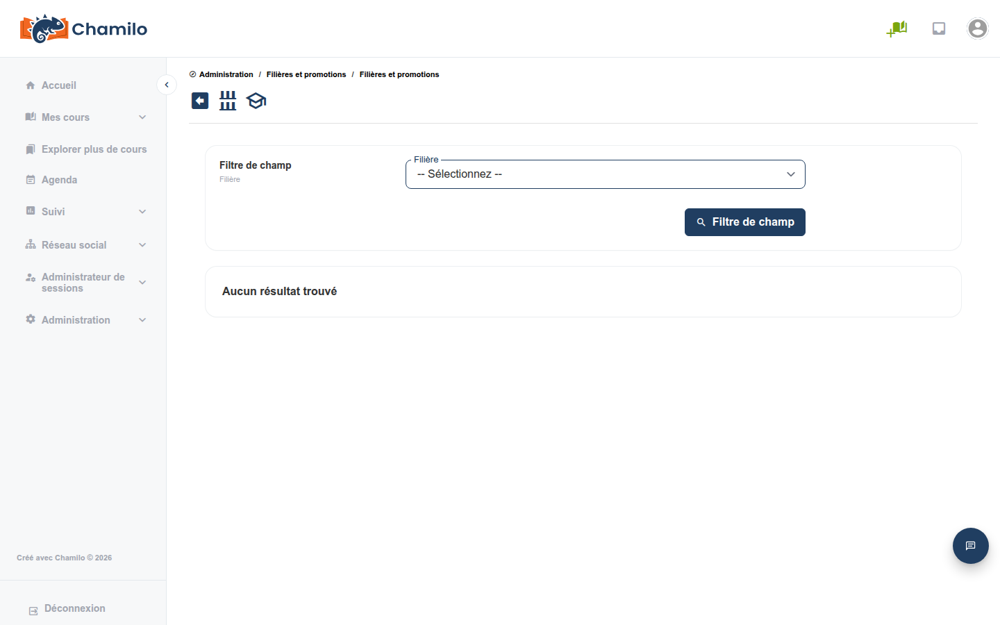

# Carrières et promotions

Chamilo inclut un système de gestion des carrières qui vous permet de définir des parcours de formation et de suivre la progression des apprenants dans des programmes structurés.

## Carrières

Une **carrière** représente un parcours de formation structuré — une séquence d'étapes de formation qu'un apprenant suit pour atteindre un objectif professionnel.

### Création d'une carrière

1. Depuis le panneau d'administration, accédez à **Carrières**
2. Cliquez sur **Créer une carrière**
3. Saisissez un **nom** et une **description**
4. Enregistrez

## Promotions

Une **promotion** représente une cohorte ou un groupe d'apprenants progressant dans une carrière. Il s'agit d'un groupe de personnes suivant le même parcours professionnel au même moment.

### Association aux sessions

Après avoir créé une promotion, vous y associez des sessions. Cela définit la séquence de formation qu'un apprenant doit accomplir.

Vous pouvez ensuite dupliquer des promotions afin de faciliter la création de la promotion suivante avec des copies des mêmes sessions, de sorte que votre prochaine promotion puisse être constituée instantanément.

### Création d'une promotion

1. Accédez à **Promotions**
2. Cliquez sur **Créer une promotion**
3. Saisissez un **nom** et une **description**
4. Associez-la à une **carrière**
5. Affectez des **sessions** à la promotion
6. Enregistrez

## Comment cela s'articule

* Une **carrière** définit le parcours (par ex. « Certification développeur junior »)
* Une **promotion** représente une cohorte (par ex. « Promotion de mars 2026 »)
* Les **sessions** de la promotion dispensent le contenu de formation proprement dit

## Conseils

* **À utiliser pour les programmes structurés** — Les carrières et les promotions sont particulièrement utiles pour les programmes de formation en plusieurs étapes, dans lesquels les apprenants progressent selon une séquence définie
* **Suivre l'achèvement** — Utilisez les outils de rapports pour suivre la progression des promotions dans leurs parcours de carrière