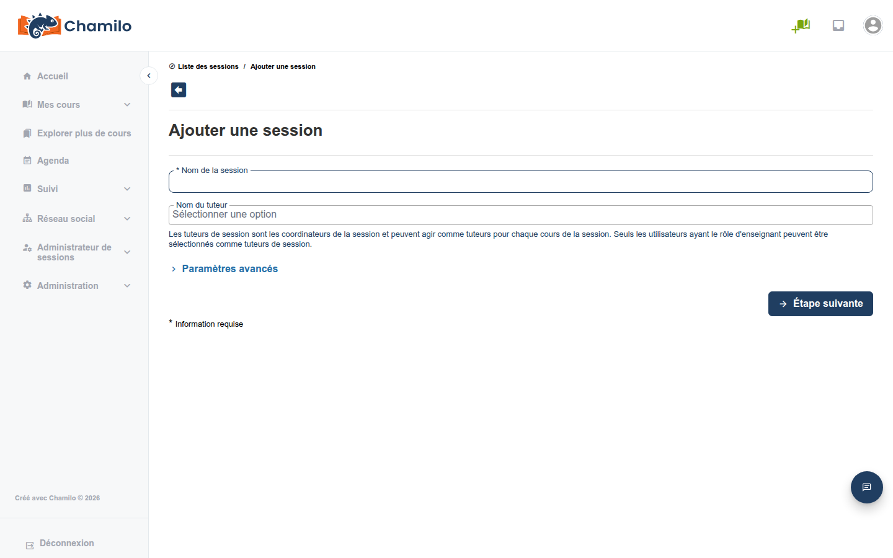
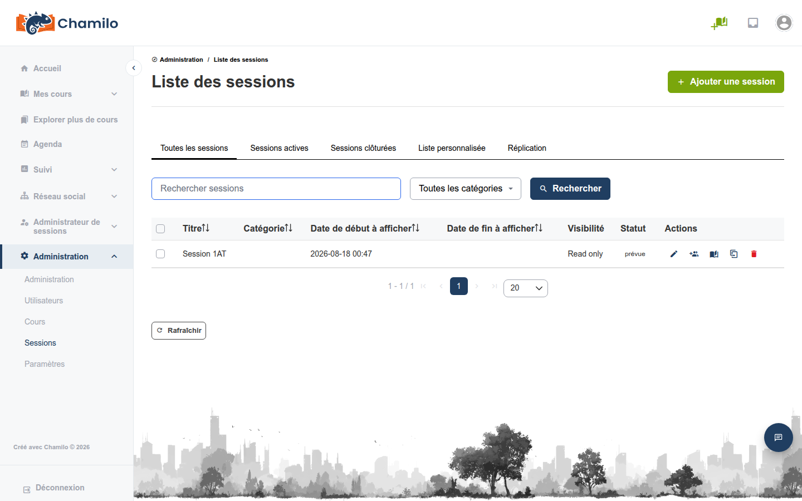
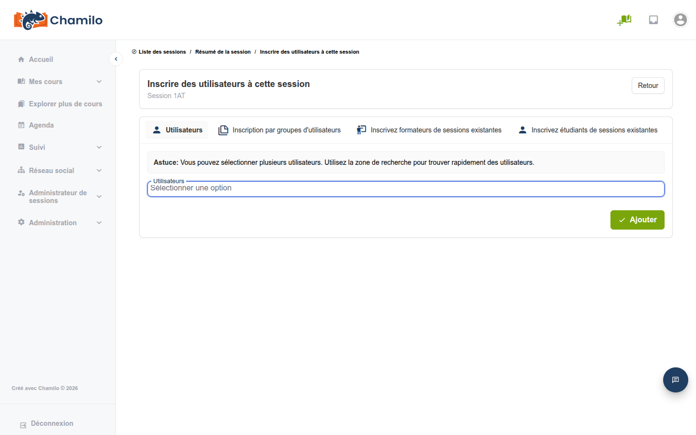

# Gestion des sessions

## Création d'une session

1. Depuis le panneau d'administration, cliquez sur **Créer une session**
2. Renseignez les détails de la session :
   * **Nom de la session** — Un nom descriptif (par ex. « Intégration printemps 2026 »)
   * **Dates de début et de fin** — Période pendant laquelle la session se déroule (facultatif — les sessions peuvent être ouvertes sans date de fin). Il existe 3 ensembles de dates : dates d'affichage, dates de limitation de l'accès des apprenants et dates de limitation de l'accès des tuteurs
   * **Tuteur de session** — La personne qui supervise l'ensemble de la session
   * **Catégorie** — Affecter à une catégorie de session pour l'organisation
   * **Visibilité** — Contrôler l'accès et le comportement d'affichage dans les listes
3. **Ajouter des cours** — Sélectionnez un ou plusieurs cours à inclure dans la session
4. **Inscrire des apprenants** — Ajoutez des utilisateurs individuels ou des classes d'utilisateurs
5. **Affecter des tuteurs de cours** — Pour chaque cours, affectez un enseignant (tuteur de cours)
6. Enregistrer

## Dates de session

Les sessions prennent en charge une configuration flexible des dates :

| Date | Objectif |
|------|---------|
| **Début/fin d'affichage** | Moment où la session apparaît dans les listes des apprenants |
| **Début/fin d'accès** | Moment où les apprenants peuvent réellement accéder au contenu de la session |
| **Début/fin d'accès des tuteurs** | Moment où les tuteurs peuvent accéder à la session (commence souvent avant et se termine après l'accès des apprenants) |

Cela vous permet de préparer la session avant l'arrivée des apprenants et de maintenir l'accès des tuteurs ouvert après la fin de la session pour la notation et les rapports.

## Liste des sessions

La liste des sessions affiche toutes les sessions avec :

* Nom de la session
* Dates de début et de fin
* Statut (active, à venir, passée)

Utilisez la recherche et les filtres pour trouver des sessions par nom, date, catégorie ou statut.

## Modification d'une session

Cliquez sur une session pour la modifier :

* Modifier les dates, le nom ou la catégorie
* Ajouter ou retirer des cours
* Modifier les tuteurs de cours
* Ajouter ou retirer des apprenants
* Consulter les données de suivi de la session

## Inscription des utilisateurs

Vous pouvez inscrire des utilisateurs à une session de la manière suivante :

* **Inscription individuelle** — Recherchez et ajoutez des utilisateurs individuels
* **Inscription par classe** — Ajoutez une classe entière (groupe d'utilisateurs prédéfinis) en une seule fois
* **Import CSV** — Téléversez un fichier contenant les affectations utilisateur-session

## Accès aux sessions

Les apprenants accèdent à leurs sessions via **Mes sessions** dans la barre latérale. Les sessions sont organisées en :

* **Sessions en cours** — Actuellement actives
* **Sessions passées** — Terminées
* **Sessions à venir** — Pas encore commencées

## Inscription via l'API

Les systèmes externes peuvent utiliser l'[API d'inscription des étudiants aux sessions](../../developer-guide/api/session-students.md) pour lister les identifiants des apprenants, ajouter des apprenants sélectionnés ou retirer des apprenants sélectionnés. Ces routes exigent les permissions d'administrateur de la plateforme et préservent les autres inscriptions lorsqu'une nouvelle liste d'identifiants est soumise.

## Conseils

* **Planifiez les dates avec soin** — Assurez-vous que les dates d'accès des tuteurs s'étendent au-delà des dates des apprenants afin que les tuteurs puissent préparer la session et assurer le suivi
* **Utilisez les classes pour les inscriptions récurrentes** — Si vous inscrivez fréquemment les mêmes groupes, créez des classes et affectez-les aux sessions
* **Gardez les sessions organisées** — Utilisez des catégories et des conventions de nommage claires pour une gestion aisée