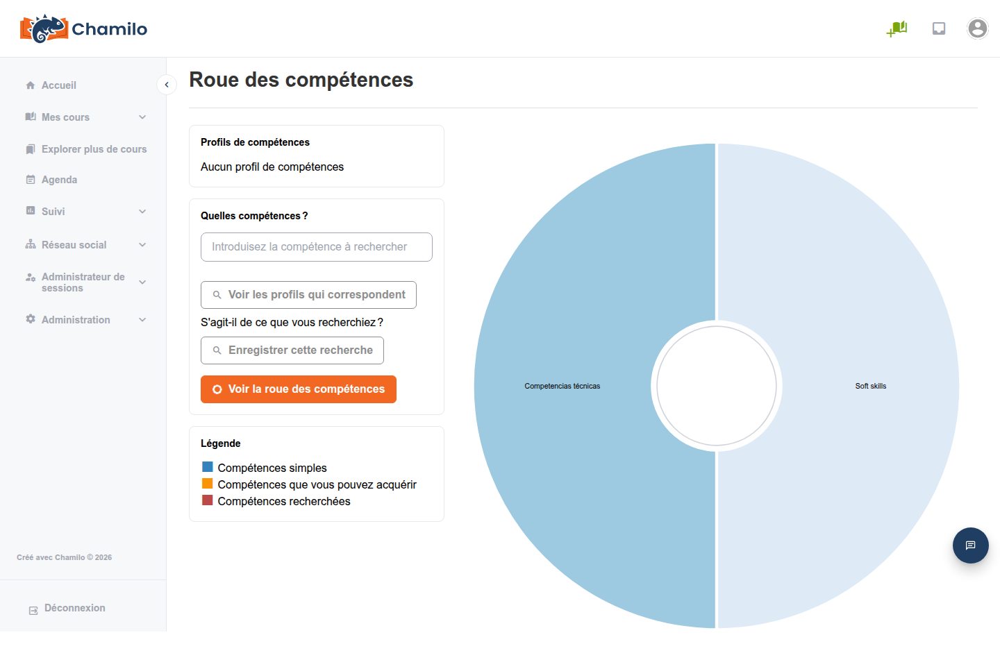

# Roue des compétences

La Roue des compétences est un diagramme zoomable, en forme de roue, de l'ensemble de l'arbre des compétences — une alternative visuelle à la consultation de la liste plate dans [Gestion des compétences](managing-skills.md).

## Accéder à la Roue des compétences

Depuis le panneau d'administration, cliquez sur **Compétences > Roue des compétences**.

## Ce qu'elle affiche

Chaque segment de la roue est une compétence, extensible vers ses compétences enfants. Un segment indique si la compétence est liée à un carnet de notes (voir [Compétences et évaluations](skills-assessments.md)) et, lors de la consultation d'un utilisateur spécifique, si cet utilisateur l'a déjà acquise.

Cliquez sur un segment pour zoomer dessus et révéler ses compétences enfants ; cliquez sur le cercle central pour dézoomer. L'explorateur moderne affiche également la hiérarchie actuelle sous forme de fil d'Ariane, afin de pouvoir remonter dans ses branches.

### Explorer et trouver des compétences (3.1)

La roue mise à jour utilise un **explorateur de style 3D** adaptatif, avec un effet de profondeur lorsque vous déplacez le pointeur sur le diagramme. Il s'agit d'une visualisation de la hiérarchie des compétences, et non d'un ensemble distinct de compétences.

* Ouvrez **Quelles compétences recherchez-vous ?** pour effectuer une recherche par nom de compétence. Vous pouvez sélectionner plusieurs compétences, puis utiliser **Afficher la roue des compétences** pour localiser une compétence sélectionnée dans la hiérarchie.
* Appuyez sur `/` ou **Ctrl+K** (sous macOS, **Cmd+K**) lorsque vous ne saisissez pas de texte dans un champ de formulaire pour ouvrir la boîte de dialogue de recherche.
* Utilisez le **Mode focus** pour une vue agrandie de la roue ; **Esc** quitte le mode focus. La commande **Aide** explique la navigation et la légende.
* Sélectionnez une compétence pour ouvrir son inspecteur contextuel, avec le code de la compétence, sa description, la hiérarchie parente et les cours ou évaluations permettant de l'acquérir, lorsqu'ils sont disponibles.

L'inspecteur de détail de la compétence propose **Modifier**, **Créer une compétence enfant** et **Ajouter la compétence au profil de recherche** aux administrateurs autorisés et aux responsables RH. Après la création ou la modification d'une compétence depuis la roue, l'interface revient au contexte de la roue plutôt que de vous renvoyer vers une liste sans rapport.

Faites un clic droit sur un segment pour ouvrir ses détails : description, compétence parente et cours (le cas échéant) qui l'attribuent. Depuis cette boîte de dialogue, les administrateurs peuvent également modifier la compétence, créer une compétence enfant sous celle-ci ou l'ajouter à la recherche de profil décrite ci-dessous.

Les administrateurs et les utilisateurs ayant le rôle de responsable des ressources humaines disposent également ici d'une recherche de profils : les compétences peuvent être regroupées en « profils » (ensembles de compétences attendues pour un rôle ou une fiche de poste donnés), et cette page permet de rechercher les utilisateurs dont les compétences acquises correspondent à un profil donné — utile pour identifier qui est prêt pour un rôle, ou où se situent les lacunes au sein d'une équipe.

### Utiliser les profils de compétences

La commande **Profils de compétences** est disponible pour les administrateurs et les responsables RH. Ouvrez-la pour trouver les profils enregistrés et rechercher les utilisateurs dont les compétences y correspondent. Vous pouvez également sélectionner plusieurs compétences dans la boîte de dialogue de recherche et choisir **Rechercher les correspondances de profil** ou **Enregistrer cette recherche**. Ces actions de gestion des profils sont restreintes par rôle ; tous les utilisateurs qui consultent la roue ne les voient pas.

Cette amélioration de l'interface a été implémentée dans la [PR #9201](https://github.com/chamilo/chamilo-lms/pull/9201).