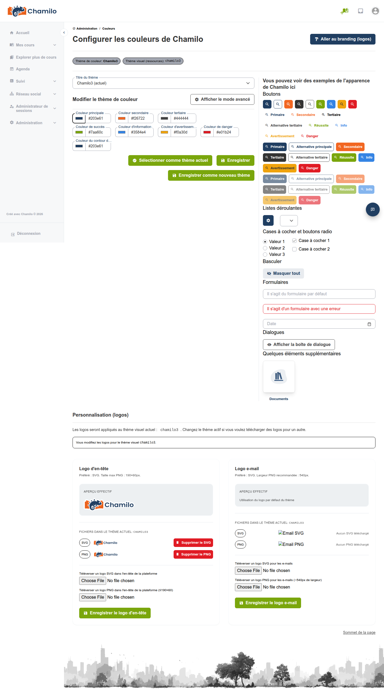

# Thèmes de couleurs

Chamilo 2.0 introduit un système de thèmes de couleurs qui permet de personnaliser l'apparence visuelle de la plateforme.

## Fonctionnement des thèmes

Les thèmes de couleurs définissent la palette utilisée dans l'interface de Chamilo — couleurs principales, couleurs d'accentuation, arrière-plans et couleurs de texte. Un thème est associé à une URL d'accès : dans un portail à URL unique, il devient de fait le thème global, et dans une configuration multi-URL, chaque URL peut avoir le sien.

## Application d'un thème

1. Depuis le panneau d'administration, accédez à **Thèmes de couleurs**
2. Parcourez les thèmes disponibles
3. Sélectionnez un thème et cliquez sur **Appliquer**
4. Le thème est immédiatement appliqué à la plateforme

## Arrière-plans de page

Certaines pages affichent une image décorative en bas, répétée horizontalement : **Mes cours** et **Mes sessions** (un paysage), les pages **Administration** (un paysage urbain), les pages **Gestion des sessions** (des champs) et le **Réseau social** (un paysage marin). Chaque thème visuel fournit ces images.

Sur la page des thèmes de couleurs, la section **Arrière-plans de page** affiche l'image de chacun de ces emplacements dans le thème visuel actif. Pour chacun, vous pouvez :

* **La remplacer** — Cliquez sur **Choisir un fichier**, sélectionnez une image PNG, JPEG ou WebP de 2 Mo au maximum, puis cliquez sur **Téléverser**. L'image est affichée sur 180 pixels de hauteur et répétée sur toute la page ; une bande large dont les bords se rejoignent donne donc le meilleur résultat.
* **La masquer** — Cliquez sur **Masquer** pour retirer l'image de ces pages, et sur **Afficher** pour la rétablir. Masquer une image téléversée la conserve pour plus tard.
* **Restaurer l'image du thème** — Supprime l'image téléversée, après confirmation, et affiche à nouveau l'image fournie par le thème.

Comme les logos, ces images appartiennent au thème visuel actif : dans une configuration multi-URL, chaque URL disposant de son propre thème possède ses propres images. Évitez de les modifier dans le thème `chamilo` par défaut, dont les images constituent les valeurs par défaut de tous les autres thèmes.

Les images téléversées sont stockées dans le répertoire du thème (`var/themes/<theme>/images/bg-<place>-custom.<extension>`, ou le stockage distant des thèmes), à côté d'un fichier `page-backgrounds.json` qui enregistre les choix. Pour remplacer une image directement sur le serveur, placez plutôt un fichier nommé `images/bg-landscape.png` (ou `bg-cityscape.png`, `bg-fieldscape.png`, `bg-seascape.png`) dans le répertoire du thème actif : il est utilisé lorsqu'aucune image n'a été téléversée depuis la page. Les navigateurs conservent ces images pendant un jour ; un fichier remplacé sur le serveur peut donc mettre ce délai à s'afficher, tandis qu'une image téléversée s'affiche immédiatement.

## Thèmes par URL

Dans une configuration multi-URL, chaque URL d'accès peut avoir son propre thème de couleurs. Cela permet à différents portails d'avoir des identités visuelles distinctes tout en partageant la même installation de Chamilo.

## Importation, exportation et maintenance des thèmes de couleurs

Les administrateurs du portail peuvent gérer des paquets ZIP de thèmes de couleurs réutilisables depuis l'interface de configuration des thèmes de couleurs :

1. Sélectionnez un thème existant et choisissez **Exporter le thème ZIP** pour télécharger un paquet.
2. Pour importer un paquet, choisissez **Importer un thème de couleurs ZIP**, indiquez un **Nom du nouveau thème**, sélectionnez le fichier ZIP et confirmez. Le contrôle de téléversement accepte les fichiers ZIP de moins de 10 Mo.
3. Utilisez **Renommer le thème** pour modifier le nom d'affichage d'un thème sans changer son slug technique.
4. Utilisez **Supprimer le thème** uniquement pour un thème personnalisé non utilisé. Les thèmes intégrés et les thèmes référencés par la plateforme sont protégés contre la suppression.

Les importations en double et les archives non valides sont rejetées. Vérifiez l'utilisation du thème sur les URL d'accès avant de supprimer des ressources personnalisées ; les scénarios multi-portails méritent des tests supplémentaires. Voir [PR n° 9404 sur les paquets de thèmes de couleurs](https://github.com/chamilo/chamilo-lms/pull/9404).

## Conseils

* **Harmonisez avec votre marque** — Choisissez ou personnalisez un thème qui correspond aux couleurs de la marque de votre organisation
* **Testez la lisibilité** — Après avoir appliqué un thème, vérifiez que le texte reste lisible sur les couleurs d'arrière-plan, en particulier dans les situations de fort contraste
* **Tenez compte de l'accessibilité** — Assurez un contraste de couleurs suffisant pour les utilisateurs présentant des déficiences visuelles