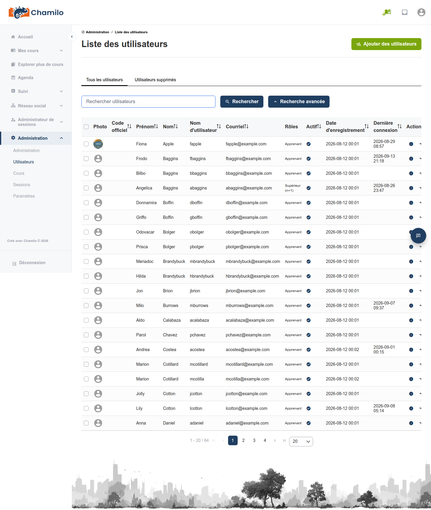
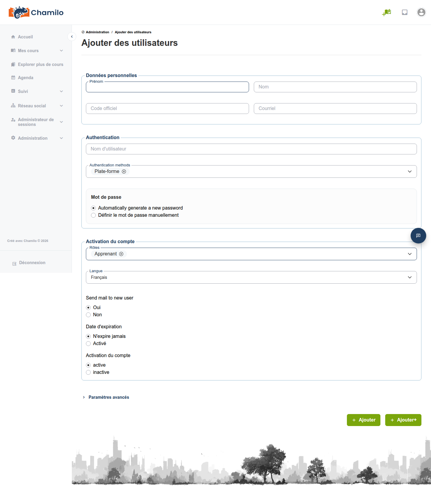
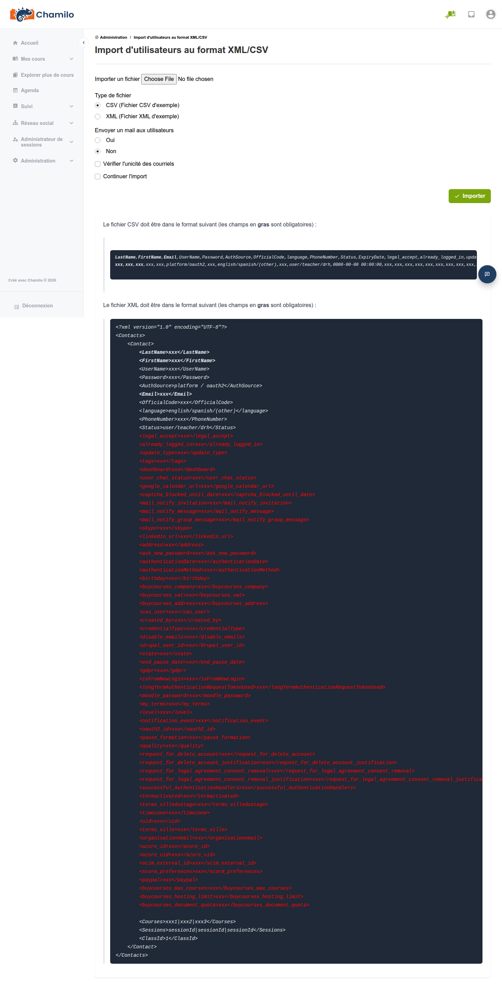

# Gestion des utilisateurs

Cette page traite des tâches quotidiennes de création, de modification et de gestion des comptes utilisateurs.

## Liste des utilisateurs

Depuis le panneau d'administration, cliquez sur **Liste des utilisateurs** pour voir tous les utilisateurs de la plateforme. La liste affiche :

* Avatar
* Nom
* Nom d'utilisateur
* Adresse e-mail
* Rôles
* Statut actif/inactif
* Date d'inscription
* Date de dernière connexion

Utilisez l'outil **Recherche avancée** pour trouver des utilisateurs précis par nom, e-mail, rôle ou d'autres critères.

## Création d'un utilisateur

1. Cliquez sur **Ajouter un utilisateur** dans le panneau d'administration
2. Renseignez les champs obligatoires :
   * **Prénom** et **Nom**
   * **E-mail** — Doit être unique sur la plateforme
   * **Nom d'utilisateur** — L'identifiant de connexion (doit être unique)
   * **Mot de passe** — Définissez un mot de passe initial
   * **Rôles** — Sélectionnez le ou les rôles de l'utilisateur sur la plateforme (étudiant, enseignant, administrateur, etc.)
   * **Langue** — La langue d'interface préférée de l'utilisateur
3. Renseignez éventuellement des champs supplémentaires :
   * Code officiel (p. ex. identifiant unique dans l'organisation)
   * Numéro de téléphone
   * Date d'expiration — Désactiver automatiquement le compte après une date
   * Statut actif/inactif
   * Champs de profil supplémentaires (s'ils sont configurés)
4. Enregistrez

## Importation d'utilisateurs

Pour une création en masse, vous pouvez importer des utilisateurs à partir d'un fichier :

1. Cliquez sur **Importer des utilisateurs** dans le panneau d'administration
2. Téléversez un fichier **CSV** ou **XML** contenant les données des utilisateurs
3. Faites correspondre les colonnes du fichier aux champs utilisateur de Chamilo
4. Choisissez le traitement des utilisateurs existants (mettre à jour ou ignorer)
5. Importez

Le fichier d'importation doit contenir au minimum des colonnes pour : le prénom, le nom, l'e-mail, le nom d'utilisateur et le mot de passe.

Remarque : la colonne **Statut** est l'ancien nom de **Rôle** et n'accepte que quelques valeurs, comme 1 pour enseignant et 5 pour étudiant. Un ajustement plus fin des rôles ne peut être effectué que manuellement par la suite, en modifiant l'utilisateur.

## Exportation d'utilisateurs

Cliquez sur **Exporter des utilisateurs** pour télécharger la liste des utilisateurs au format CSV ou XML. Vous pouvez filtrer les utilisateurs à exporter par rôle, date d'inscription ou d'autres critères.

## Modification d'un utilisateur

Cliquez sur le nom d'un utilisateur dans la liste des utilisateurs pour modifier son compte. Vous pouvez modifier :

* Les informations personnelles (nom, e-mail, téléphone)
* Les rôles
* Le mot de passe (réinitialisation)
* Le statut actif/inactif
* La date d'expiration
* Les champs de profil supplémentaires

## Suppression d'un utilisateur

Lors de la suppression d'utilisateurs (généralement des enseignants) qui ont créé du contenu sur la plateforme, le système peut vous empêcher de supprimer définitivement ces utilisateurs et afficher un message d'avertissement indiquant que l'utilisateur est encore associé à certaines ressources. Si vous confirmez la suppression, le système ne supprime pas le contenu lui-même, mais l'associe à un utilisateur neutre (que nous appelons le « Fallback user ») pour des raisons de cohérence des données.

Pour éviter cela, consultez les détails de l'utilisateur, supprimez chacun de ses cours un par un, puis supprimez l'utilisateur.

## Actions sur les utilisateurs

| Action | Description |
|--------|-------------|
| **Désactiver** | Désactive le compte d'un utilisateur sans le supprimer. L'utilisateur ne peut pas se connecter, mais ses données sont conservées. |
| **Activer** | Réactive un compte précédemment désactivé. |
| **Se connecter en tant que** | Se connecter à la plateforme en tant que cet utilisateur (emprunt d'identité). Utile pour le dépannage. |
| **Anonymiser** | Efface toutes les informations personnelles du compte, telles que définies par le RGPD de l'Union européenne. |
| **Supprimer** | Effectue une suppression logique du compte utilisateur. Utilisez l'onglet **Utilisateurs supprimés** pour supprimer définitivement le compte et les données associées. |

> **Se connecter en tant que** est une fonctionnalité puissante. Utilisez-la de manière responsable et uniquement à des fins d'assistance légitimes.

## Opérations par lots

Sélectionnez plusieurs utilisateurs dans la liste des utilisateurs pour effectuer des actions par lots :

* Activer ou désactiver plusieurs utilisateurs à la fois
* Supprimer plusieurs utilisateurs
* Affecter des utilisateurs à un cours ou à une session

## Fusion de comptes utilisateurs

L'action **Unifier** du rapport des utilisateurs en double (**Administration > Rapports > Utilisateurs en double**) fusionne les autres comptes d'un groupe de doublons dans le compte que vous conservez. Les comptes fusionnés sont supprimés logiquement, puis supprimés définitivement.

### Qui peut fusionner

* Seuls les administrateurs (`ROLE_ADMIN` ou `ROLE_GLOBAL_ADMIN`). Les administrateurs de session ne peuvent pas fusionner de comptes.
* Le compte que vous conservez et chaque compte qui y est fusionné doivent se trouver dans les URL d'accès que vous gérez : un administrateur global restreint à une arborescence de sous-portails ne peut fusionner que les utilisateurs de cette arborescence ; un administrateur simple, uniquement les utilisateurs de la ou des URL auxquelles il est inscrit. Les doublons hors de votre périmètre sont ignorés ; si aucun ne se trouve dans votre périmètre, l'action est refusée.
* Vous ne pouvez pas fusionner votre propre compte dans un autre.

### Ce qui est refusé

L'ensemble de l'opération est annulé (rien n'est fusionné) avec un message explicite lorsque :

* le compte à fusionner détient un rôle administratif (administrateur, administrateur global, administrateur de session) que le compte à conserver ne détient pas : les rôles ne sont jamais transférés, de sorte que le privilège disparaîtrait silencieusement ;
* le compte à fusionner est un **enseignant** (rôle enseignant ou responsable RH) et le compte à conserver est un **étudiant** (aucun des rôles enseignant, responsable RH ou administrateur). Le sens inverse (étudiant vers enseignant) et les fusions de même rôle restent autorisés.

### Ce qui est fusionné

Tout ce qui appartient à l'apprenant suit le compte conservé : inscriptions aux cours, sessions, classes et URL, progression dans les parcours d'apprentissage, tentatives d'exercices et suivi, résultats du cahier de notes et certificats, présences, forum, blog, wiki, boîte de dépôt, travaux, enquêtes (invitations et réponses des enquêtes non anonymes), tickets, messages, compétences, certificats/relevés, carrière, documents justificatifs, liens de ressources partagées (`resource_link.user_id`), attribution d'auteur (qui a créé ou modifié en dernier un élément) et journaux d'audit.

Lorsque les deux comptes possèdent une ligne pour le même élément (même cours, même parcours d'apprentissage, même évaluation, même vote de cours...), la ligne du compte conservé l'emporte et la ligne du compte fusionné est supprimée (ou, lorsque d'autres données en dépendent, laissée sur le compte fusionné). Les réponses à une enquête à laquelle les deux comptes ont répondu ne sont pas combinées : seules celles du compte conservé sont conservées.

### Ce qui n'est jamais fusionné

Les identifiants et les données privées restent sur le compte fusionné (supprimé), de sorte que l'identité d'une personne n'est jamais transmise à un autre compte : méthodes de connexion (`user_auth_source`), jetons et consentements OAuth, demandes de réinitialisation de mot de passe, abonnements push et clés API, conversations avec le tuteur IA et le bot d'assistance, blocs du tableau de bord, modèles utilisateur, recherches enregistrées et abonnements aux événements de notification. Les réponses aux enquêtes anonymes ne sont jamais modifiées. Le nom d'utilisateur, l'adresse e-mail et le mot de passe du compte conservé ne sont jamais modifiés.

## Conseils

* **Utiliser l'import CSV pour les inscriptions massives** — Lors de l'intégration de nombreux utilisateurs au début d'un programme de formation, préparez un fichier CSV et importez-le en masse
* **Définir des dates d'expiration** — Pour les utilisateurs temporaires (participants à un atelier, utilisateurs d'essai), définissez une date d'expiration afin de désactiver automatiquement leurs comptes
* **Désactiver plutôt que supprimer** — Lorsqu'un utilisateur quitte, désactivez d'abord son compte. Cela préserve ses dossiers de formation. Ne supprimez que si vous êtes certain que les données ne sont plus nécessaires.