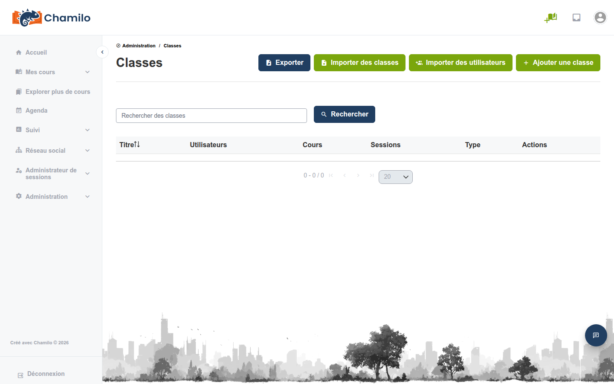

# Classes / Groupes d'utilisateurs

Les classes du panneau d'administration sont des groupes à l'échelle de la plateforme, utilisés pour organiser les utilisateurs à des fins de gestion. Elles se distinguent des groupes de cours (créés par les enseignants au sein d'un cours).

> Les groupes d'utilisateurs et les [Classes](../../admin-guide/sessions/classes.md) partagent la même interface. La seule différence réside dans le paramètre **type de groupe** : choisissez « Classe » pour créer une classe (utilisée pour l'inscription groupée aux sessions), ou « Groupe d'utilisateurs » pour des groupes plus sociaux qui peuvent disposer de leur propre espace dans le réseau social interne. Consultez [Classes](../../admin-guide/sessions/classes.md) pour plus de détails sur l'inscription aux sessions.

## Création d'un groupe

1. Depuis le panneau d'administration, accédez à **Classes**
2. Cliquez sur **Ajouter des classes**
3. Saisissez un **titre** et une **description** facultative
4. Cochez **Groupe social** s'il s'agit d'un groupe social. Laissez décoché s'il s'agit d'une classe.
5. Ajoutez une URL de référence optionnelle ainsi qu'une image/un logo.
6. Choisissez les **permissions** du groupe :
   * **Ouvert** — Tout utilisateur peut rejoindre le groupe
   * **Fermé** — Les utilisateurs doivent être ajoutés par un administrateur
7. Cochez si vous souhaitez que les membres puissent quitter la classe par eux-mêmes.
8. Enregistrez.

## Ajout de membres

1. Ouvrez la liste des classes/groupes d'utilisateurs
2. Cliquez sur l'icône utilisateur **Inscrire des utilisateurs à la classe**
3. Recherchez des utilisateurs par nom, nom d'utilisateur ou adresse e-mail
4. Sélectionnez les utilisateurs à ajouter à l'aide des flèches situées à droite
5. Cliquez sur le bouton de confirmation pour enregistrer

## Cas d'usage

* **Organisation par département** — Regrouper les utilisateurs par département ou par équipe
* **Inscription groupée** — Ajouter tous les membres d'un groupe à un cours ou à une session en une seule fois
* **Communication ciblée** — Envoyer des annonces à des groupes spécifiques
* **Rapports** — Consulter la progression de la formation filtrée par groupe

## Gestion des groupes

* **Modifier** — Modifier le nom, la description ou la visibilité du groupe
* **Gérer les membres** — Ajouter ou retirer des membres
* **Supprimer** — Supprimer le groupe (ne supprime pas les comptes des membres)

## Ordre de tri des listes

L'assistant qui triait plusieurs listes appliquait le sens demandé à l'envers : choisir « croissant » dans un en-tête de colonne renvoyait d'abord la valeur la plus élevée, et « décroissant » la plus basse. Il suit désormais le sens demandé. Si vous aviez l'habitude de cliquer deux fois sur un en-tête pour obtenir l'ordre souhaité, le premier clic le fournit désormais.

Listes concernées (triées en cliquant sur un en-tête de colonne) :

* Liste **Administration > Classes / groupes d'utilisateurs** (colonnes titre, utilisateurs, cours, sessions et type)
* La liste des groupes d'utilisateurs de l'onglet **Classes** du cours
* Trois listes des pages d'accueil de cours (servies par `course_home.ajax.php`)

Inchangé : la cellule du jour de l'agenda, le bloc du prochain exercice du portail utilisateur (explicitement croissant, comme auparavant) et la grille **Exercices** de la session, dont les lignes sont ensuite retriées par la grille elle-même (ordre initial : le plus ancien en premier).