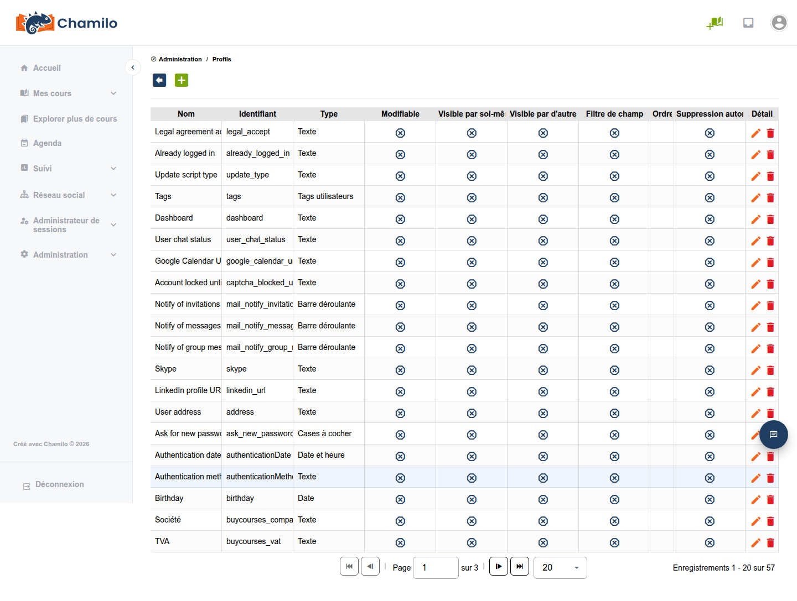

# Profilage des utilisateurs

Chamilo vous permet de définir des champs de profil personnalisés (champs supplémentaires) afin de recueillir des informations additionnelles sur les utilisateurs, au-delà du nom, de l'adresse e-mail et du rôle standard.

## Champs de profil supplémentaires

Les champs supplémentaires vous permettent de stocker des métadonnées propres à votre organisation, telles que :

* Identifiant employé
* Département
* Intitulé de poste
* Lieu/bureau
* Numéro de téléphone
* Identifiants personnalisés

## Création de champs supplémentaires

1. Depuis le panneau d'administration, accédez à **Champs supplémentaires** ou **Champs de profil**
2. Cliquez sur **Ajouter**
3. Configurez le champ :
   * **Nom** — Le titre du champ affiché aux utilisateurs
   * **Description** — Description facultative
   * **Texte d'aide** — À afficher sous le champ dans tout formulaire qui l'inclut
   * **Type de champ** — Texte, liste déroulante, date, case à cocher, etc.
   * **Libellé du champ** — Le nom interne du champ, pour l'intégration des plugins
   * **Valeurs possibles** — Si le champ est un sélecteur parmi ces valeurs
   * **Valeur par défaut** — Une valeur par défaut facultative
   * **Visible pour soi-même** — Indique si le champ est visible sur le profil de l'utilisateur par l'utilisateur lui-même
   * **Visible pour les autres** — Indique si le champ est visible pour les autres utilisateurs de la plateforme
   * **Modifiable** — Indique si l'utilisateur peut modifier lui-même son propre champ (ou si seuls les administrateurs le peuvent)
   * **Filtre** — Si le champ est de type sélecteur, indique s'il faut l'inclure comme filtre dans les pages d'administration (par exemple pour inscrire des utilisateurs à des cours ou des sessions)
   * **Ordre** — Si vous souhaitez gérer l'ordre d'affichage des champs, vous devrez attribuer un ordre numérique à chaque champ
   * **Supprimer lors de l'anonymisation** — Important pour les règles et lois relatives à la confidentialité : si l'utilisateur est anonymisé mais non supprimé, ce champ doit-il être considéré comme un détenteur potentiel de données permettant l'identification personnelle ?
4. Enregistrer

## Types de champs

Le moteur de champs supplémentaires prend en charge un large ensemble de types de saisie. Les plus courants sont les suivants :

| Type | Description |
|------|-------------|
| **Texte** | Un champ de saisie de texte sur une seule ligne |
| **Zone de texte** | Un champ de saisie de texte sur plusieurs lignes |
| **Bouton radio** | Un groupe de boutons radio à choix unique |
| **Liste déroulante / Liste déroulante multiple** | Une liste d'options prédéfinies (sélection unique ou multiple) |
| **Double sélection** | Deux listes déroulantes dépendantes (par exemple, pays → ville) |
| **Case à cocher** | Un interrupteur oui/non |
| **Date / Date et heure** | Sélecteur de date ou de date et heure |
| **Entier** | Un champ de saisie numérique |
| **Étiquette** | Plusieurs valeurs d'étiquette libres |
| **Fichier** | Champ de téléversement de fichier |
| **URL de vidéo** | Une URL pointant vers une vidéo |
| **Numéro de téléphone mobile** | Un champ de numéro de téléphone formaté |
| **Fuseau horaire** | Un sélecteur de fuseau horaire |
| **Profil social** | Un lien vers un profil de réseau social |
| **Séparateur** | Un séparateur visuel dans le formulaire (sans valeur) |

L'ensemble exact des types utilisables dépend de la version de Chamilo ; la liste déroulante des types de champs sur la page d'administration **Champs supplémentaires** fait foi.

## Utilisation des champs supplémentaires

Les champs supplémentaires apparaissent :

* Dans les formulaires de création (s'ils sont visibles pour soi-même) et de modification de l'utilisateur
* Sur les pages de profil utilisateur (s'ils sont visibles pour soi-même)
* Dans les importations d'utilisateurs (vous pouvez inclure les valeurs des champs supplémentaires dans les importations CSV)
* Dans les exportations et les rapports (filtrer ou regrouper selon les valeurs des champs supplémentaires)

## Conseils

* **Planifier avant de créer** — Définissez les informations dont vous avez besoin avant de créer des champs, car modifier les types de champs après la saisie de données peut poser problème
* **Utiliser des listes déroulantes pour la cohérence** — Lorsqu'un champ dispose d'un ensemble connu de valeurs possibles, utilisez une liste déroulante plutôt qu'un texte libre afin de garantir la cohérence des données
* **Utiliser pour les rapports** — Les champs supplémentaires sont utiles pour filtrer les rapports (par exemple, « afficher tous les utilisateurs du département X ayant terminé la formation Y »)