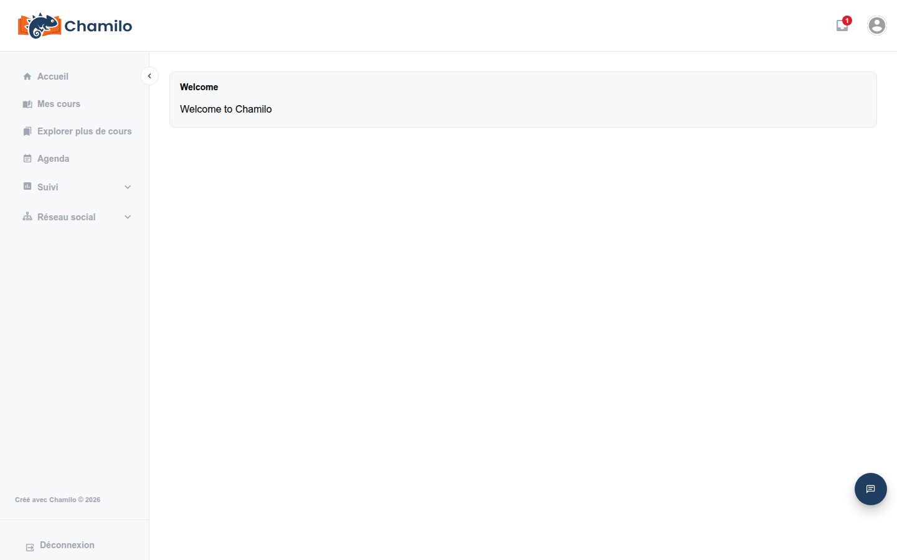
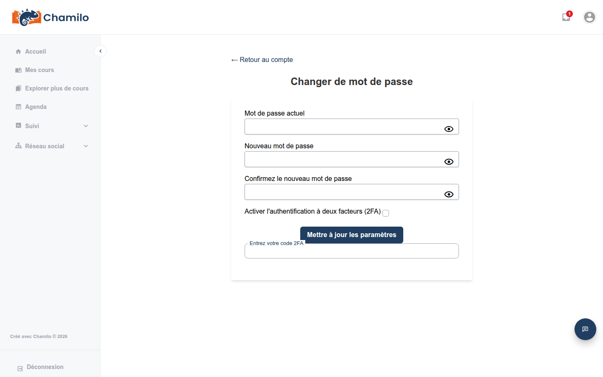

# Réinitialiser votre mot de passe

Si vous avez oublié votre mot de passe — ou si vous souhaitez simplement le modifier — voici comment procéder dans les deux situations : avant d'être connecté, et lorsque vous êtes déjà connecté.

## Avant d'être connecté

Sur la page de connexion, cliquez sur **Mot de passe oublié ?**. Si ce lien n'apparaît pas, votre administrateur a désactivé cette fonctionnalité — contactez-le directement pour retrouver l'accès.

1. Saisissez votre **nom d'utilisateur ou adresse e-mail** dans le seul champ du formulaire.
2. Si un défi CAPTCHA apparaît, résolvez-le (voir [CAPTCHA](captcha.md)).
3. Cliquez sur **Envoyer le message**.

La suite dépend de la manière dont votre administrateur a configuré cette fonctionnalité :

* **Vous recevez un lien par e-mail.** Cliquez dessus pour ouvrir un formulaire de réinitialisation du mot de passe comportant les champs **Mot de passe** et **Confirmer le mot de passe** — choisissez vous-même un nouveau mot de passe et validez. Ce lien est à usage unique et expire après un délai limité (une heure par défaut, bien que votre administrateur puisse modifier ce délai) ; s'il a expiré, la page de réinitialisation vous l'indique et vous devrez en demander un nouveau.
* **Vous recevez un nouveau mot de passe directement par e-mail.** Sur certaines plateformes, au lieu de vous laisser choisir votre propre mot de passe, le système en génère un pour vous et vous l'envoie par e-mail. Connectez-vous avec celui-ci, puis envisagez de le remplacer par un mot de passe plus facile à mémoriser (voir ci-dessous).

Si vous utilisez une authentification externe (authentification unique via votre établissement), les réinitialisations de mot de passe ne sont pas gérées par Chamilo — utilisez plutôt la procédure « mot de passe oublié » de votre établissement.

## Lorsque vous êtes connecté

Vous pouvez modifier votre mot de passe à tout moment, sans attendre de l'avoir oublié :

1. Ouvrez votre **menu de l'avatar** (coin supérieur droit) et cliquez sur **Mon profil**.
2. Cliquez sur **Modifier le mot de passe**.
3. Saisissez votre mot de passe actuel, puis votre nouveau mot de passe deux fois, et validez.

C'est la même page où vous pouvez activer l'[authentification à deux facteurs](two-factor-authentication.md), si votre plateforme la prend en charge — dans ce cas, vous verrez également ici une case à cocher « Activer l'authentification à deux facteurs », non représentée ci-dessus car elle n'est pas active sur toutes les plateformes.

## Conseils

* **Consultez votre dossier de courrier indésirable** si l'e-mail de réinitialisation n'arrive pas dans les minutes qui suivent.
* **Agissez rapidement sur les liens de réinitialisation** — ils expirent, et les plateformes fixent souvent cette expiration à une heure seulement.
* **Toujours bloqué ?** Si la réinitialisation en libre-service n'est pas activée ou ne fonctionne pas, l'administrateur de votre plateforme peut toujours réinitialiser votre compte manuellement.