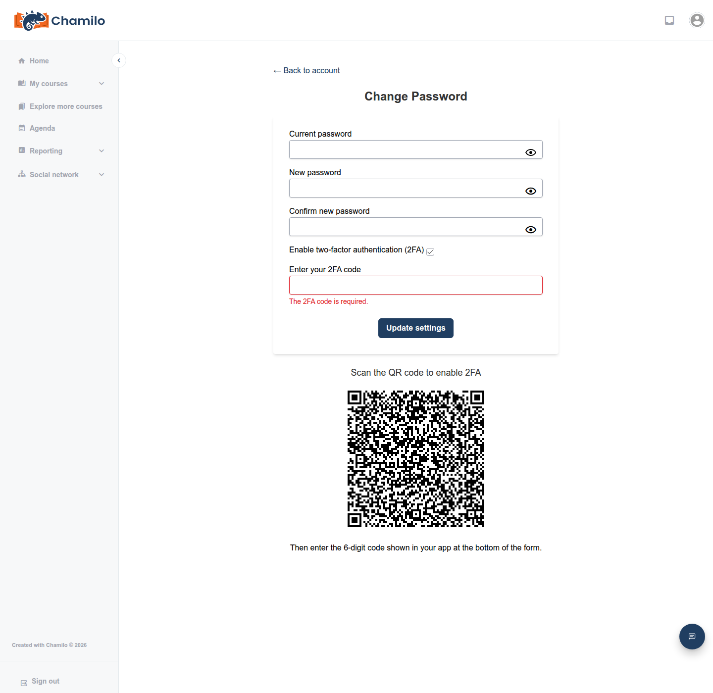

# Authentification à deux facteurs

L'authentification à deux facteurs (2FA) ajoute une seconde étape à la connexion — un code à 6 chiffres provenant d'une application sur votre téléphone, en plus de votre mot de passe — de sorte que la seule connaissance de votre mot de passe ne suffit pas pour accéder à votre compte.

Cette fonctionnalité n'apparaît que si votre administrateur l'a activée pour l'ensemble de la plateforme. Si vous ne la voyez pas sur votre page de compte, elle n'a pas été activée pour votre plateforme.

## Activation de la 2FA

1. Ouvrez votre **menu de l'avatar** et cliquez sur **Mon profil**.
2. Cliquez sur **Modifier le mot de passe**.
3. Saisissez votre **mot de passe actuel**, cochez la case **Activer l'authentification à deux facteurs (2FA)**, puis cliquez sur **Mettre à jour les paramètres**.
4. La page se recharge avec un code QR et le message « Scannez le code QR pour activer la 2FA. » Scannez-le avec une application d'authentification sur votre téléphone (toute application compatible TOTP convient, comme Google Authenticator, Microsoft Authenticator ou Authy).

5. Saisissez à nouveau votre mot de passe actuel, ainsi que le code à 6 chiffres que votre application affiche désormais, dans le champ **Code 2FA**, puis cliquez une nouvelle fois sur **Mettre à jour les paramètres**. Vous verrez une confirmation indiquant que la 2FA a été activée.

Cocher la case seule ne révèle pas le code QR — vous ne le voyez qu'après ce premier envoi, et vos champs de mot de passe sont effacés à chaque rechargement de la page ; vous devrez donc également saisir à nouveau votre mot de passe actuel lors de ce second envoi.

## Connexion avec la 2FA activée

Après avoir saisi votre nom d'utilisateur et votre mot de passe comme d'habitude, le formulaire de connexion affiche un champ supplémentaire **Code 2FA** sur le même écran — saisissez le code à 6 chiffres actuel de votre application d'authentification et validez (le bouton indique alors **Envoyer le code** au lieu de **Se connecter**).

## Si vous perdez l'accès à votre application d'authentification

Chamilo ne génère pas de codes de secours ni de récupération pour la 2FA. Si vous perdez l'appareil sur lequel se trouve votre application d'authentification, vous ne pourrez pas produire vous-même un code valide — contactez l'administrateur de votre plateforme, qui peut désactiver la 2FA sur votre compte afin que vous puissiez vous reconnecter et, si vous le souhaitez, la configurer sur un nouvel appareil.

## Désactivation de la 2FA

Retournez à **Modifier le mot de passe**, décochez **Activer l'authentification à deux facteurs (2FA)**, saisissez votre mot de passe actuel, puis validez.

## Conseils

* **Configurez-la avant d'en avoir besoin** — l'activation de la 2FA ne prend qu'une minute et protège réellement votre compte.
* **Gardez votre application d'authentification accessible** — la perdre signifie dépendre de votre administrateur pour vous reconnecter, puisqu'il n'existe pas de codes de secours.
* **Ne partagez pas vos codes 2FA** — toute personne disposant de votre mot de passe et d'un code valide peut se connecter à votre place.