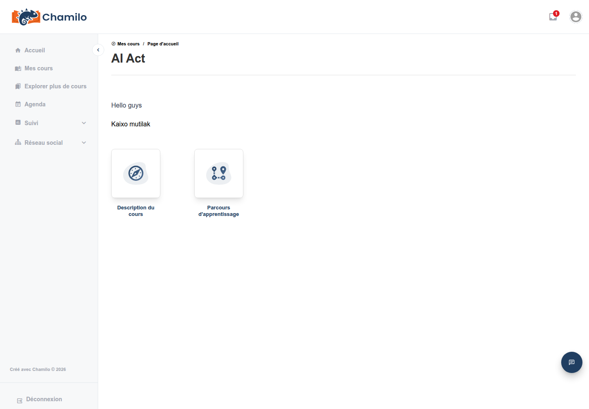
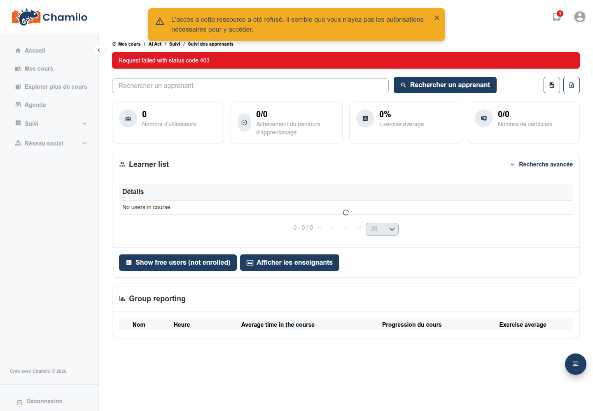

# S'orienter dans un cours

Une fois un cours ouvert, vous verrez sa page d'accueil avec une grille d'icônes d'outils. Cette page explique ce que chaque outil signifie pour vous en tant qu'apprenant, et renvoie vers l'endroit où la fonctionnalité sous-jacente est décrite plus en détail.

Seuls les outils que votre enseignant a rendus visibles aux apprenants apparaissent dans votre grille — votre enseignant peut voir des outils supplémentaires, masqués, qui ne vous sont pas affichés. Si un outil que vous attendez n'est pas présent, il est peut-être simplement masqué, ou désactivé pour l'ensemble du cours ; demandez à votre enseignant.

## La grille d'outils

| Outil | Icône | Ce que cela signifie pour vous | En savoir plus |
|------|------|------------------------|------------|
| Documents |  | Lire et télécharger les fichiers que votre enseignant a déposés | [Documents](../../teacher-guide/adding-content/documents.md) |
| Parcours d'apprentissage |  | Suivre une séquence guidée d'activités dans l'ordre, en suivant votre propre progression au fur et à mesure | [Parcours d'apprentissage](../../teacher-guide/adding-content/learning-paths.md) |
| Liens |  | Ouvrir les ressources externes sélectionnées par votre enseignant | [Liens](../../teacher-guide/adding-content/links.md) |
| Tests (Exercices) |  | Passer des quiz et des examens ; certains sont notés automatiquement, d'autres par votre enseignant | [Exercices](../../teacher-guide/assessing-learners/exercises.md) |
| Annonces |  | Lire les informations importantes publiées par votre enseignant | [Annonces](../../teacher-guide/adding-content/announcements.md) |
| Évaluations (Cahier de notes) |  | Consulter vos propres notes pour les activités notées du cours, ainsi que tout certificat que vous avez obtenu | [Cahier de notes](../../teacher-guide/assessing-learners/gradebook.md) |
| Glossaire |  | Consulter les termes clés définis pour le cours | [Glossaire](../../teacher-guide/adding-content/glossary.md) |
| Présences |  | Consulter votre propre présence enregistrée, si votre enseignant la suit | [Présences](../../teacher-guide/assessing-learners/attendance.md) |
| Progression du cours |  | Voir un résumé de votre avancement dans le cours | [Progression du cours](../../teacher-guide/additional-tools/course-progress.md) |
| Agenda |  | Voir les événements et les échéances propres au cours | — |
| Forum |  | Lire et publier dans des discussions en fils avec votre enseignant et vos camarades de classe | [Forums](../../teacher-guide/collaboration-and-communication/forums.md) |
| Dropbox |  | Échanger des fichiers en privé avec votre enseignant ou vos camarades de classe | [Dropbox](../../teacher-guide/additional-tools/dropbox.md) |
| Utilisateurs |  | Voir qui d'autre est inscrit au cours | — |
| Groupes |  | Travailler au sein d'un groupe plus restreint attribué par votre enseignant, avec ses propres outils partagés | [Groupes](../../teacher-guide/collaboration-and-communication/groups.md) |
| Chat |  | Envoyer des messages à votre enseignant ou à vos camarades de classe en temps réel | [Chat](../../teacher-guide/collaboration-and-communication/chat.md) |
| Travaux |  | Soumettre des fichiers ou du texte pour que votre enseignant les examine et les note | [Travaux](../../teacher-guide/assessing-learners/assignments.md) |
| Enquêtes |  | Répondre à des questionnaires, parfois de façon anonyme | [Enquêtes](../../teacher-guide/assessing-learners/surveys.md) |
| Wiki |  | Rédiger et modifier collaborativement des pages partagées | [Wiki](../../teacher-guide/collaboration-and-communication/wiki.md) |
| Carnet de notes |  | Conserver vos propres notes privées dans le cours | [Carnet de notes](../../teacher-guide/additional-tools/notebook.md) |
| Portfolio |  | Constituer une collection personnelle de travaux à présenter ou à soumettre | [Portfolio](../../teacher-guide/additional-tools/portfolio.md) |
| Rapports |  | Rien, pour vous — voir ci-dessous | — |

## Outils que vous ne verrez pas — et un qui ne fonctionnera pas

Quelques entrées existent uniquement pour que les enseignants et les administrateurs de cours configurent le cours lui-même — les paramètres du cours, la maintenance du cours (sauvegarde/importation/exportation), l’éditeur de la page d’accueil du cours et (sur la plupart des plateformes) l’outil Blog se trouvent dans un menu « Plus d’actions » qui n’apparaît qu’aux personnes disposant de droits de modification sur le cours. En tant qu’apprenant, vous ne verrez pas du tout ce menu.

La tuile **Rapports** est un cas particulier : elle apparaît bien dans votre grille, mais elle ouvre la vue de suivi de toute la classe destinée aux enseignants ; cliquer dessus vous affiche donc un message d’accès refusé plutôt que quelque chose d’utile :

Pas d’inquiétude — votre propre progression est disponible ailleurs : depuis **Ma progression** dans la barre latérale principale (voir [Comprendre l’interface](../getting-started/understanding-the-interface.md) et [Ma progression](../my-progress.md)), ainsi que depuis les outils **Progression du cours** et **Évaluations** ci-dessus, qui affichent tous deux vos propres données.

Si votre cours a les fonctionnalités d’IA activées, vous remarquerez peut-être aussi que l’option « analyseur IA » de l’enseignant (utilisée pour préentraîner le Tuteur IA sur le contenu propre du cours) est différente du chat **Tuteur IA** destiné aux apprenants — voir [Chatbot Tuteur IA](ai-tutor.md).

## Conseils

* **Un outil manquant ?** Demandez à votre enseignant — il est très probablement masqué ou désactivé plutôt que défectueux.
* **La description du cours et les annonces** peuvent être entièrement désactivées par votre enseignant ; dans ce cas, elles n’apparaîtront pour personne, enseignant compris.
* **Tout ici peut varier selon le cours** — votre enseignant décide quels outils sont actifs et visibles pour chaque cours individuellement.