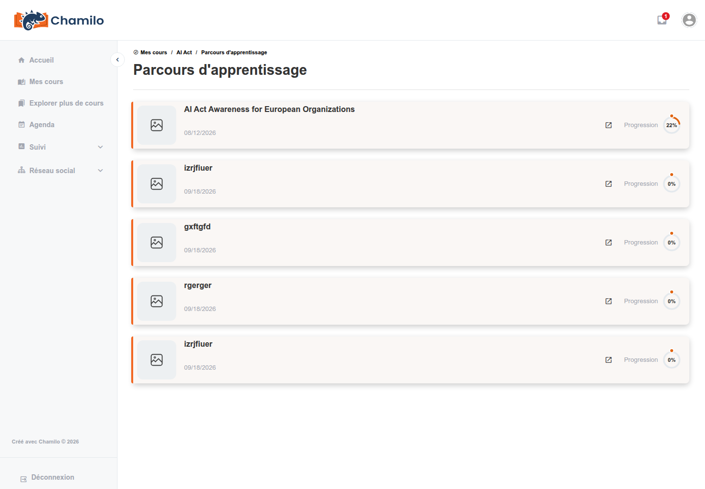

# Suivre un parcours d'apprentissage

Un **parcours d'apprentissage** vous guide à travers une séquence structurée d'activités — documents, tests, liens, et plus encore — dans un ordre défini par votre enseignant. Dans de nombreux cours, c'est l'outil principal (voire le seul) dont vous aurez réellement besoin, puisqu'il peut regrouper tout le reste à l'intérieur.

## Ouvrir un parcours d'apprentissage

Ouvrez l'outil **Parcours d'apprentissage**  depuis la page d'accueil du cours et cliquez sur l'un d'eux pour commencer. Si votre enseignant a activé le **lancement automatique**, le parcours d'apprentissage peut s'ouvrir automatiquement dès que vous entrez dans le cours.

## Avancer dans le parcours

À l'intérieur d'un parcours d'apprentissage, vous verrez :

* Une **liste d'éléments** (étapes) dans un panneau, organisés en sections que votre enseignant a pu regrouper comme des chapitres
* Le **contenu de l'élément en cours** dans la zone principale — un document, un test intégré, un lien, etc.

Au fur et à mesure que vous terminez les éléments, ils sont marqués d'une coche, et une **barre de progression** indique votre pourcentage d'achèvement global pour l'ensemble du parcours. Si vous quittez et revenez plus tard, vous reprenez exactement là où vous vous étiez arrêté — rien n'est perdu.

## Éléments verrouillés et prérequis

Certains éléments peuvent apparaître **verrouillés** tant que vous n'avez pas satisfait un prérequis défini par votre enseignant — généralement terminer un élément précédent, ou atteindre un score minimum à un test situé plus tôt dans le parcours. Si vous ne pouvez pas ouvrir une étape, vérifiez si une étape antérieure est encore inachevée.

## Tests et certificats dans un parcours

Un parcours d'apprentissage peut inclure un test comme l'une de ses étapes — le passer fonctionne de la même manière que décrit dans [Passer des tests](taking-tests.md). Certains parcours se terminent par une étape **certificat** : l'atteindre (après avoir satisfait les exigences de score éventuelles en cours de route) déclenche votre certificat d'achèvement, si votre enseignant en a configuré un pour le cours.

## SCORM et autres contenus importés

Certains éléments de parcours d'apprentissage ne sont pas créés directement dans Chamilo, mais importés sous forme de paquet **SCORM**, de paquet **CMI5/xAPI**, ou créés avec le plugin C-Studio. Ils se présentent et se comportent généralement comme tout autre contenu interactif — Chamilo suit votre progression et votre score de la même manière, même si le contenu lui-même a été conçu ailleurs.

## Assistant d'étude IA

Si votre administrateur a activé les assistants IA, les étapes de type document d'un parcours d'apprentissage peuvent proposer un **assistant d'étude IA**. Sélectionnez un passage dans le document et une petite action robot apparaît à côté de la sélection. Ouvrez-la, choisissez une **technique d'apprentissage** (par exemple la technique de Feynman, la carte mentale, la répétition espacée ou SQ3R), puis cliquez sur **Générer**.

Chamilo envoie le passage sélectionné et la technique au service d'IA configuré et affiche l'explication générée dans une boîte de dialogue. L'assistant vise à soutenir votre compréhension du contenu ; il ne modifie ni vos réponses, ni votre score, ni votre progression dans le parcours d'apprentissage.

## Conseils

* **Utilisez la barre de progression** pour évaluer ce qu'il reste du parcours.
* **Ne craignez pas de perdre votre place** — Chamilo mémorise exactement où vous en êtes dans un parcours entre les sessions.
* **Une étape verrouillée signifie généralement un travail inachevé plus tôt dans le parcours** — revenez en arrière et vérifiez plutôt que de supposer qu'un accès a été refusé par erreur.