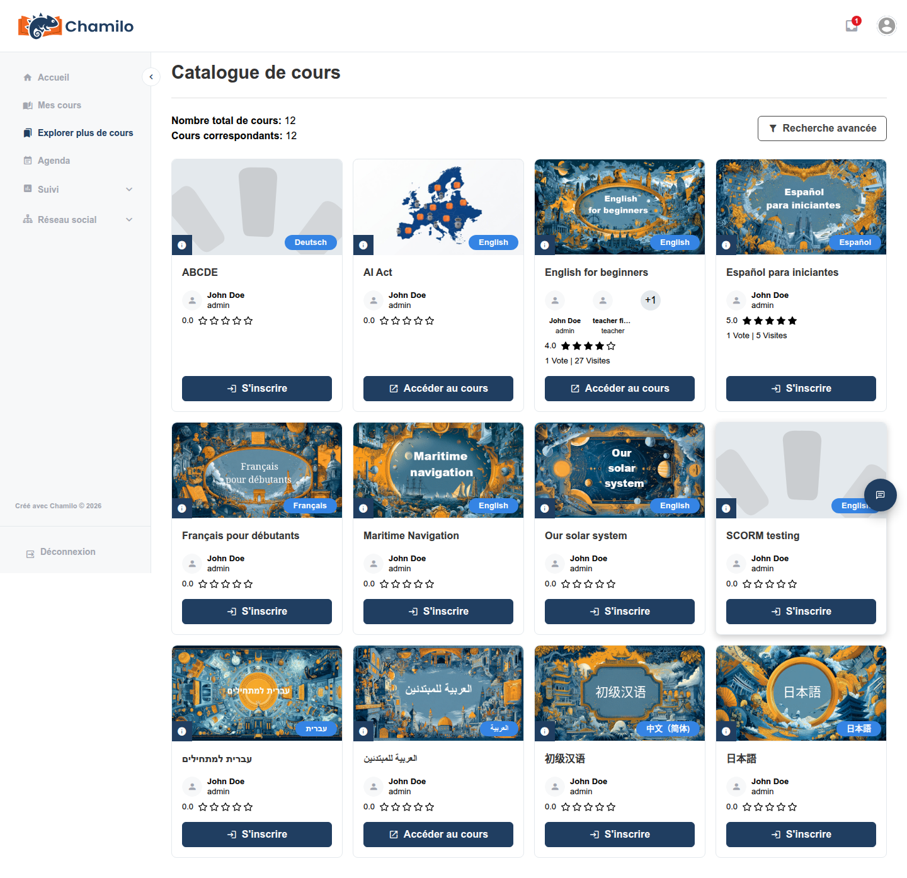

# S'inscrire à un cours

Avant de pouvoir accéder au contenu d'un cours, vous devez y être inscrit. Selon votre plateforme, cela peut se faire de plusieurs façons — la plupart ne nécessitent aucune action de votre part.

| Comment cela se produit | Ce que vous devez faire |
|-----------------|----------------------|
| Un administrateur vous inscrit | Rien — le cours apparaît dans **Mes cours** une fois l'inscription effectuée |
| Un enseignant vous inscrit manuellement | Rien — comme ci-dessus |
| Vous vous auto-inscrivez via le catalogue de cours | Parcourez **Explorer plus de cours**, puis cliquez pour rejoindre |
| Vous recevez une invitation à un cours par e-mail | Cliquez sur le lien ; inscrivez-vous si vous n'avez pas encore de compte |

## Vérifier vos cours

Cliquez sur **Mes cours** dans la barre latérale à tout moment pour voir tous les cours auxquels vous êtes actuellement inscrit. Si un cours attendu n'y figure pas, vous n'y êtes pas encore inscrit — utilisez l'une des méthodes ci-dessous, ou contactez votre enseignant ou administrateur.

## Auto-inscription via le catalogue de cours

Si la visibilité d'un cours le permet, vous pouvez vous y inscrire vous-même sans attendre personne d'autre :

1. Cliquez sur **Explorer plus de cours** dans la barre latérale pour ouvrir le catalogue de cours.
2. Parcourez ou recherchez le cours que vous souhaitez rejoindre.
3. Cliquez sur le cours pour ouvrir ses détails, puis cliquez sur le bouton pour le rejoindre.

Un cours auquel vous êtes déjà inscrit affiche **Accéder au cours** au lieu d'un bouton d'inscription.

Certains cours exigent un mot de passe pour l'auto-inscription — votre enseignant vous l'aura communiqué séparément le cas échéant. Si un cours ne propose aucun bouton pour le rejoindre, l'auto-inscription n'est pas ouverte pour celui-ci ; demandez à l'enseignant ou à un administrateur de vous y inscrire.

Si votre plateforme utilise des **sessions**, le même principe s'applique à **Mes sessions** — certaines sessions peuvent être ouvertes à l'auto-inscription via le catalogue, bien que cela soit plus souvent géré par un administrateur ou un tuteur de session, car s'inscrire à une session vous inscrit à tous les cours qu'elle contient.

## Accepter une invitation à un cours

Au lieu d'une fiche dans le catalogue, un enseignant peut vous envoyer une **invitation à un cours** par e-mail — c'est la seule méthode qui n'exige pas que vous disposiez déjà d'un compte sur la plateforme. L'ouverture du lien contenu dans l'e-mail :

* Préremplit et verrouille le champ e-mail du formulaire d'inscription avec l'adresse à laquelle vous avez été invité.
* Vous permet de vous inscrire même si l'auto-inscription générale est actuellement fermée sur la plateforme.
* Vous inscrit automatiquement au cours (ou à l'ensemble de la session, si le cours est ouvert dans une session) dès que vous terminez l'inscription, et vous connecte.

Le lien est à usage unique et expire au bout de 7 jours — s'il ne fonctionne plus, demandez à l'enseignant qui vous a invité d'en envoyer un nouveau. Consultez [Ce que voit la personne invitée](../../teacher-guide/assessing-learners/subscribing-users.md#what-the-invited-person-sees) pour plus de détails sur ce processus, et [Créer un compte](../getting-started/creating-an-account.md) pour l'apparence du formulaire d'inscription lui-même.

## Conseils

* **Consultez « Explorer plus de cours » avant de demander** — de nombreuses plateformes laissent l'auto-inscription aux cours ouverte, vous pouvez donc souvent rejoindre un cours immédiatement sans attendre personne.
* **Surveillez votre boîte de réception** — les invitations à un cours et les notifications d'approbation de compte arrivent par e-mail.
* **Vous n'arrivez toujours pas à accéder ?** Les méthodes d'inscription peuvent être restreintes ou désactivées à l'échelle de la plateforme ; si aucune des solutions ci-dessus ne fonctionne, votre enseignant ou administrateur peut toujours vous inscrire directement.