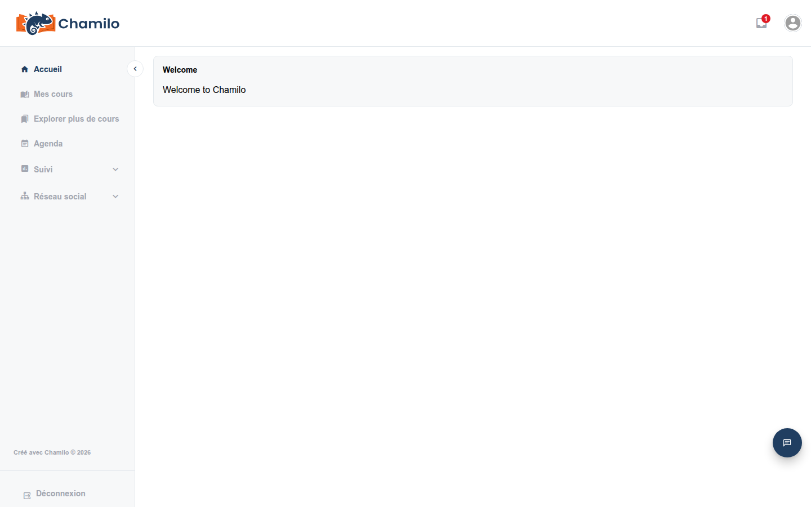

# Comprendre l'interface

Chamilo 3.0 dispose d'une interface claire et moderne, conçue pour simplifier la navigation. Cette page explique chaque partie de l'interface du point de vue de l'apprenant.

## La barre supérieure

La barre supérieure est toujours visible en haut de chaque page. Elle contient :

* **Logo de la plateforme** — Cliquez dessus pour revenir à la page d'accueil à tout moment.
* **Icône de la boîte de réception**  — Affiche vos messages. Un badge rouge indique les messages non lus. Cliquez pour ouvrir votre [boîte de réception](../inbox.md).
* **Icône de ticket d'assistance**  — Si elle est activée par votre administrateur, elle vous donne accès au système de tickets d'assistance. Toutes les plateformes ne l'activent pas ; vous pouvez donc ne voir que l'icône de la boîte de réception et votre avatar.
* **Votre avatar** — Une image circulaire dans le coin supérieur droit. Cliquez dessus pour ouvrir un menu déroulant :

* **Mon profil** — Modifiez vos informations personnelles, changez votre mot de passe et, si cette option est activée, configurez l'authentification à deux facteurs
* **Mes certificats** — Tous les certificats que vous avez obtenus, dans l'ensemble de vos cours
* **Mon relevé** — Si votre plateforme utilise les relevés, le [relevé](../account-and-security/my-transcript.md) des cours que vous avez terminés
* **Mes compétences** — Badges de compétences qui vous ont été attribués
* **Se déconnecter**

## La barre latérale

La barre latérale à gauche constitue votre navigation principale. Elle peut être réduite pour laisser plus d'espace à la zone de contenu. Cliquez sur la flèche de bascule située sur son bord droit pour la développer ou la réduire. Chamilo mémorise votre préférence.

La barre latérale contient les liens suivants (certains peuvent être masqués selon la configuration de votre plateforme) :

| Élément de menu | Icône | Description |
|-----------|------|-------------|
| **Accueil** |  | Revient au tableau de bord principal |
| **Mes cours** |  | Liste tous les cours auxquels vous êtes inscrit |
| **Mes sessions** |  | Liste vos sessions de formation (en cours, passées, à venir) |
| **Explorer d'autres cours** |  | Parcourez le catalogue de cours pour trouver de nouveaux cours et vous y inscrire vous-même |
| **Agenda** |  | Votre calendrier personnel et celui de vos cours |
| **Rapports** |  | Se développe vers **Progression** — votre propre aperçu [Ma progression](../my-progress.md) |
| **Réseau social** |  | Se développe vers le [réseau social](../social-network.md) et les liens associés, s'ils sont activés |
| **Visioconférence** |  | Accédez aux sessions vidéo en direct (si elles sont configurées) |

**Rapports** et **Réseau social** ne sont pas de simples liens : un clic les développe pour afficher une courte liste de sous-éléments directement dans la barre latérale :

* Sous **Rapports** : uniquement **Progression**, qui vous mène à [Ma progression](../my-progress.md).
* Sous **Réseau social** : **Accueil** (le mur social), **Messages** (un raccourci vers votre [boîte de réception](../inbox.md)), **Mes amis**, **Groupes sociaux** — et, regroupés ici de façon un peu inattendue, **Mes fichiers** (votre espace personnel de stockage de fichiers) et **Données personnelles** (une exportation des données personnelles que la plateforme détient à votre sujet). Ces deux derniers éléments ne sont pas vraiment des fonctionnalités « sociales » ; ils se trouvent simplement dans cette partie de la barre latérale.

Si votre compte dispose de rôles supplémentaires (par exemple, si vous enseignez également un cours), vous pouvez voir des éléments supplémentaires dans la barre latérale — comme **Administration** — qu'un compte réservé aux apprenants ne voit jamais.

Tout en bas de la barre latérale, vous trouverez une option **Se déconnecter** pour vous déconnecter rapidement lorsque vous avez terminé. Cette option est également disponible dans le menu déroulant de l'icône de votre avatar, dans le coin supérieur droit.
Si la plateforme est gérée par des méthodes d'authentification externes, ces options de déconnexion peuvent ne pas être disponibles.

## La zone de contenu principale

La zone centrale de l'écran affiche le contenu de la page en cours. En haut, vous verrez souvent un **fil d'Ariane** indiquant votre emplacement actuel dans la plateforme (par exemple : Accueil > Rock music > Documents). Utilisez le fil d'Ariane pour revenir à une page parente.

## La page d'accueil du cours

Lorsque vous entrez dans un cours, vous voyez la **page d'accueil du cours** :

* **Titre du cours** — Affiché de manière bien visible en haut
* **Introduction du cours** — Une description facultative en texte enrichi rédigée par votre enseignant
* **Grille d'outils** — Une grille d'icônes représentant les outils disponibles dans ce cours (Documents, Exercices, Forums, etc.)

Seuls les outils que votre enseignant a rendus visibles apparaissent dans cette grille — voir [S'orienter dans un cours](../courses/course-tools-overview.md) pour savoir à quoi sert chacun d'eux. Les commandes permettant de modifier le cours lui-même (prévisualiser en tant qu'étudiant, afficher/masquer des outils, les réordonner) n'apparaissent qu'aux enseignants et aux administrateurs de cours — vous ne les verrez pas dans un cours auquel vous êtes inscrit en tant qu'apprenant.

## Couleurs des icônes

Cette fonctionnalité est encore expérimentale et n'est pas entièrement aboutie dans Chamilo 3.0, mais nous essayons d'appliquer les règles suivantes à tous les boutons et icônes d'action de l'interface :

* **Vert** pour les actions de création. Cela inclut l'ajout, la création, l'importation, l'enregistrement et la copie de contenu.
* **Bleu** pour les actions de consultation. Cela inclut l'exportation, la consultation, la prévisualisation dans les listes ou les vues détaillées, la recherche et le téléchargement.
* **Orange** pour les actions de modification. Cela inclut la modification, le déplacement, la configuration, l'activation/la désactivation, le masquage et l'affichage.
* **Rouge** pour les actions de suppression. Cela inclut la suppression, le retrait et la désinscription.
* **Gris** pour les actions d'annulation. Il s'agit simplement de laisser les choses en l'état.

## Design adaptatif

Chamilo 3.0 s'adapte aux différentes tailles d'écran. Sur un appareil mobile ou dans une fenêtre de navigateur étroite :

* La barre latérale est masquée par défaut et peut être ouverte en appuyant sur l'icône de menu
* Les cartes de cours s'affichent sur une seule colonne au lieu d'une grille
* Les tableaux deviennent défilables horizontalement

Cela signifie que vous pouvez accéder à vos cours depuis un téléphone, une tablette ou un ordinateur, bien que l'interface puisse légèrement différer selon l'appareil.