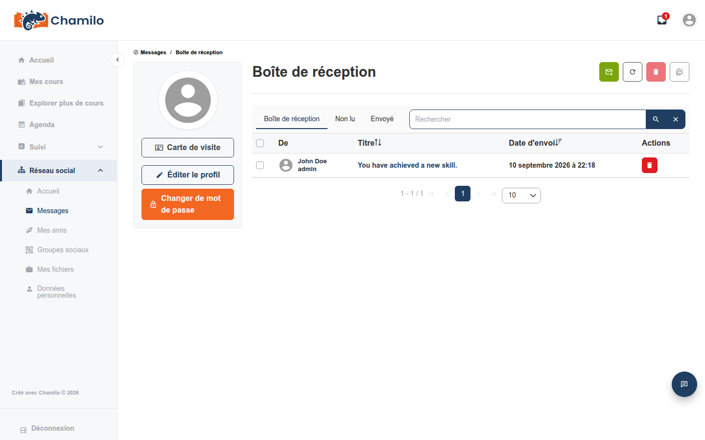

# Boîte de réception

La **Boîte de réception** est le système de messagerie privée de Chamilo — des messages asynchrones, semblables à des courriels, entre vous et les autres utilisateurs de la plateforme, indépendamment de tout cours particulier.

## Accéder à votre boîte de réception

Cliquez sur l’icône **Boîte de réception**  dans la barre supérieure. Un badge rouge indique le nombre de messages non lus. Si cette icône n’apparaît pas du tout, votre administrateur a désactivé la messagerie de la plateforme.

## Lire et répondre

Votre boîte de réception répertorie les messages reçus et indique ceux qui sont non lus. Ouvrez-en un pour le lire, puis utilisez **Répondre** pour répondre — vous pouvez inclure plusieurs destinataires dans une même réponse, ce qui est utile pour tenir un petit groupe de personnes informé sans créer de cours formel ni de groupe social.

## Répondre depuis le courriel

Si votre administrateur a activé les réponses par courriel pour les messages directs, le courriel de notification d’un message Chamilo comporte une adresse de réponse spéciale. Vous pouvez répondre depuis votre client de messagerie habituel ; Chamilo valide la réponse et l’ajoute à la même conversation dans votre boîte de réception.

Envoyez la réponse depuis la même adresse de courriel enregistrée sur votre compte Chamilo et rédigez votre réponse au-dessus du marqueur **Répondre au-dessus de cette ligne**. Toutes les notifications de la plateforme ne permettent pas de répondre — cette fonctionnalité s’applique aux notifications de messages directs lorsque l’administrateur a configuré le courrier entrant.

## Rédiger un nouveau message

Cliquez sur le bouton **nouveau message** , choisissez un ou plusieurs destinataires, rédigez un objet et un corps de message, puis envoyez. Comme pour une réponse, un nouveau message peut être adressé à plusieurs personnes à la fois.

## Insérer un graphique de fonction

Vous pouvez ajouter le graphique d’une fonction mathématique à un nouveau message de la boîte de réception ou à une réponse :

1. Dans l’éditeur de message, sélectionnez **Graphique** (l’action **Insérer un graphique**).
2. Saisissez une fonction de `x`, par exemple `x^3`, `sin(x)` ou `2*x+1`.
3. Sélectionnez **Insérer un graphique**, vérifiez le résultat dans votre message, puis envoyez-le.

L’expression peut utiliser `x`, des nombres, `pi`, `e`, des parenthèses, `+`, `-`, `*`, `/`, `^`, ainsi que les fonctions `sin`, `cos`, `tan`, `sqrt`, `abs`, `log` et `exp`. Utilisez `*` pour la multiplication et des parenthèses pour les arguments des fonctions. Les expressions sont limitées à 120 caractères. Le graphique affiche une fenêtre fixe d’environ **x = -3 à 3** et **y = -10 à 10** ; les valeurs situées en dehors de cette fenêtre ne sont donc pas affichées.

Les destinataires peuvent consulter le graphique généré dans le message de la boîte de réception. Cette fonctionnalité est distincte de la rédaction de [formules mathématiques en LaTeX](../teacher-guide/adding-content/math-formulas.md) ; elle trace des fonctions prises en charge plutôt que d’évaluer des scripts arbitraires ou un langage complet de calculatrice graphique. Voir [PR #9439](https://github.com/chamilo/chamilo-lms/pull/9439).

## Onglets et actions

Outre votre **Boîte de réception**, un onglet affiche uniquement vos messages **Non lus**, et un autre affiche les messages **Envoyés** — ce que vous avez envoyé, pour votre propre référence. Une zone de recherche vous permet de trouver un message par mot-clé. Les boutons situés au-dessus de la liste vous permettent de rédiger un nouveau message, d’actualiser, de supprimer les messages sélectionnés et de marquer les messages sélectionnés comme lus.

## État des notifications par courriel

Si votre administrateur a activé le suivi d’ouverture des courriels, la liste **Envoyés** peut afficher une date de **Notifications par courriel** pour les messages dont l’image de suivi de notification a été demandée. Il s’agit uniquement d’une indication que le courriel a peut-être été ouvert ; ce n’est pas la preuve qu’il a été lu.

## Étiquettes de message

Si votre plateforme utilise des étiquettes de message, vous verrez dans votre boîte de réception une liste d’étiquettes sur lesquelles vous pouvez cliquer pour filtrer les messages selon cette étiquette — pratique pour retrouver facilement les conversations liées à mesure que votre boîte de réception s’enrichit.

## Relation avec les autres fonctionnalités de messagerie

La boîte de réception est indépendante de l’outil [Chat](courses/using-the-chat-tool.md) du cours et du panneau de chat flottant utilisé pour la messagerie directe et le [Tuteur IA](courses/ai-tutor.md) — chacun constitue une fonctionnalité réellement distincte, même s’ils impliquent tous l’échange de messages. Le [Réseau social](social-network.md), s’il est activé, utilise cette même boîte de réception pour la messagerie privée plutôt que d’en disposer d’une propre.

## Conseils

* **Vérifiez le badge de l’icône Boîte de réception** — c’est le moyen le plus rapide de remarquer les nouveaux messages sans ouvrir la page.
* **Utilisez la boîte de réception pour tout ce qui n’est pas lié à un seul cours** — les discussions propres à un cours ont généralement leur place dans le Forum ou le Chat de ce cours.
* **Le lien « Messages » du Réseau social mène à cette même boîte de réception** — vous ne manquez pas une boîte aux lettres distincte si vous y accédez depuis cet endroit plutôt que depuis la barre supérieure.