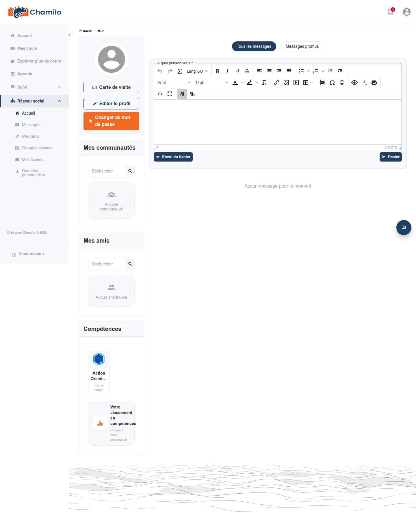

# Réseau social

Chamilo inclut un réseau social intégré permettant de se connecter avec d'autres utilisateurs de la plateforme — indépendamment de tout cours particulier. L'accès à cette fonctionnalité dépend entièrement de votre administrateur : elle est activée par défaut, mais peut être désactivée pour l'ensemble de la plateforme.

## Accès à la fonctionnalité

Cliquez sur **Réseau social**  dans la barre latérale pour le développer, puis cliquez sur **Accueil**. Si cette option n'apparaît pas du tout, votre administrateur l'a désactivée pour votre plateforme — il ne manque rien de votre côté.

La même section développée répertorie également **Messages**, **Mes amis**, **Groupes sociaux** — et, de façon un peu inattendue, **Mes fichiers** (votre espace de stockage personnel) et **Données personnelles** (un export des données personnelles que la plateforme détient à votre sujet). Ces deux derniers éléments ne sont pas des fonctionnalités sociales ; ils sont simplement regroupés dans cette partie de la barre latérale.

## Votre mur social

Une fois à l'intérieur, votre **mur** affiche un fil d'activité vous concernant ainsi que les personnes avec lesquelles vous êtes connecté. Vous pouvez publier des mises à jour et — si votre administrateur l'a activé — aimer ou ne pas aimer, et commenter, les publications de vos contacts.

## Se connecter avec d'autres personnes

Vous pouvez rechercher d'autres utilisateurs et leur envoyer une demande de connexion. En tant qu'**apprenant, vous ne pouvez vous connecter qu'avec d'autres apprenants** — vous ne pouvez pas envoyer de demande de connexion à un enseignant. Un enseignant, en revanche, peut vous en envoyer une. Sur certaines plateformes, votre administrateur configure les enseignants pour qu'ils apparaissent automatiquement comme amis de chaque apprenant, sans que l'une ou l'autre des parties ait à en faire la demande — si vous voyez des enseignants déjà listés comme contacts sans les avoir sollicités, c'est pour cette raison.

## Messagerie depuis le réseau social

Les publications et les connexions constituent le volet social ; l'envoi d'un message privé à quelqu'un est géré par la [Boîte de réception](inbox.md) distincte de la plateforme — le réseau social y renvoie plutôt que de disposer de son propre système de messagerie séparé.

## Chat flottant et appels vidéo

Le panneau de chat flottant est une fonctionnalité de messagerie en temps réel distincte de la [Boîte de réception](inbox.md) et de l'outil Chat propre à un cours. Sélectionnez un contact en ligne pour discuter directement.

Si votre administrateur a activé le chat vidéo et que votre navigateur prend en charge WebRTC, un contact en ligne peut également afficher **Démarrer un appel vidéo**. Les appels sont individuels : un appel entrant peut être **Accepté** ou **Refusé**, et pendant l'appel vous pouvez couper le microphone, activer ou désactiver la caméra, ou raccrocher. Votre navigateur peut demander l'autorisation d'accéder à la caméra et au microphone.

Si l'action vidéo n'est pas affichée, la fonctionnalité peut avoir été désactivée par l'administrateur, l'autre utilisateur peut être hors ligne, ou le navigateur peut ne pas prendre en charge les API multimédias requises.

## Groupes sociaux

Vous pouvez rejoindre des **groupes sociaux** existants organisés autour d'intérêts communs et — si votre administrateur autorise les apprenants à créer des groupes — créer le vôtre. Les groupes sociaux sont à l'échelle de la plateforme et sans rapport avec l'outil **Groupes** propre à un cours (voir [S'orienter dans un cours](courses/course-tools-overview.md)) ; rejoindre un groupe social ou y publier n'a aucun effet sur les cours auxquels vous êtes inscrit.

## Conseils

* **N'espérez pas ajouter vous-même un enseignant comme ami** — cela ne fonctionne que dans l'autre sens, sauf si votre administrateur a configuré des connexions automatiques.
* **Les groupes sociaux et les groupes de cours sont sans rapport** — ne confondez pas un groupe de projet de cours avec un groupe du réseau social portant le même nom.
* **Vous ne voyez pas les mentions J'aime ou Je n'aime pas ?** Votre administrateur peut activer, ou désactiver partiellement (en ne conservant que « J'aime »), cette fonctionnalité pour l'ensemble de la plateforme.