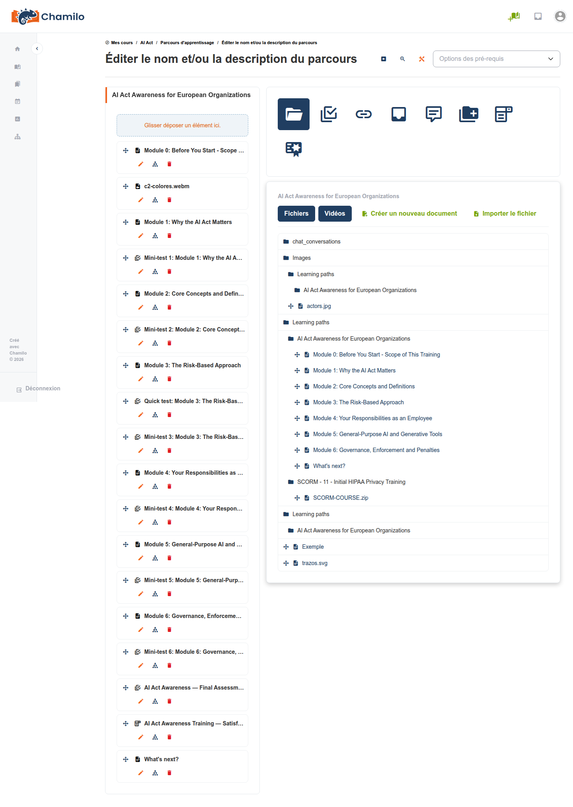
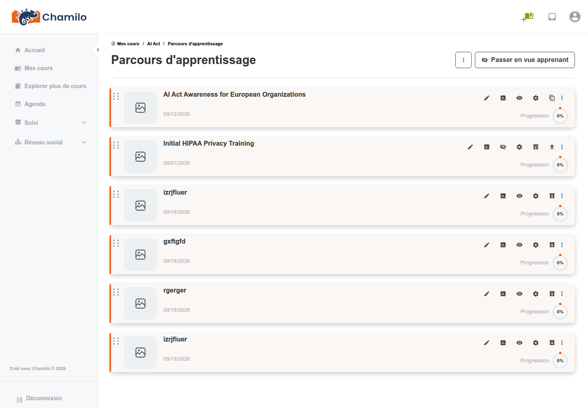
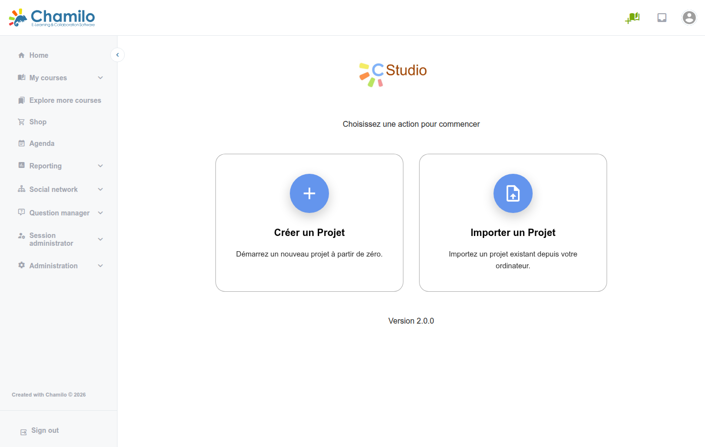
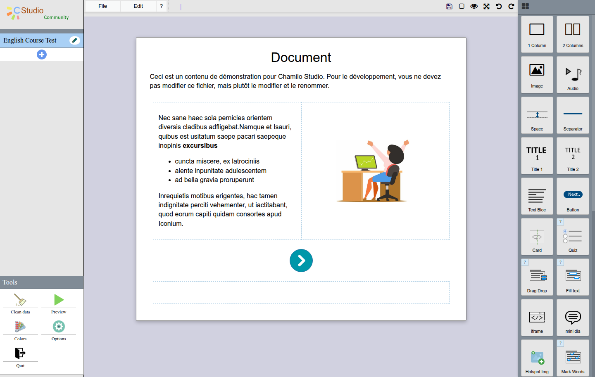
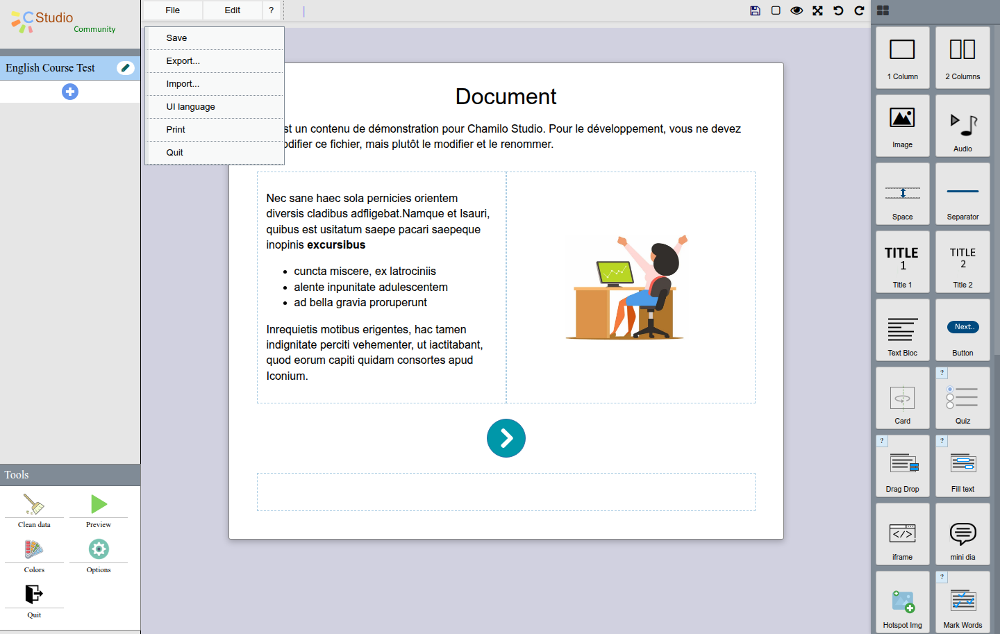

# Parcours d'apprentissage

Les parcours d'apprentissage vous permettent de créer des séquences structurées d'activités pédagogiques. Un parcours d'apprentissage guide vos apprenants selon un ordre précis de documents, d'exercices, de liens et d'autres ressources, avec des prérequis facultatifs et un suivi de la progression.

Cet outil est sans doute l'outil de cours le plus utilisé, car il agit comme un compositeur pour de nombreux autres outils et peut très bien être le ***seul*** outil présenté aux apprenants.

## Pourquoi utiliser les parcours d'apprentissage ?

Les parcours d'apprentissage sont utiles lorsque vous souhaitez :

* **Contrôler l'ordre** de consultation des contenus — garantir que les apprenants terminent les éléments fondamentaux avant de progresser
* **Suivre la progression** — voir exactement où se trouve chaque apprenant dans la séquence
* **Définir des prérequis** — exiger que les apprenants réussissent un exercice avant d'accéder à la section suivante
* **Valider l'achèvement** — lier l'achèvement du parcours d'apprentissage au carnet de notes et aux certificats
* **Conditionner les contenus** — créer des modules d'apprentissage autonomes que les apprenants peuvent parcourir à leur propre rythme

## Créer un parcours d'apprentissage

1. Ouvrez l'outil **Parcours d'apprentissage**  depuis la page d'accueil du cours
2. Cliquez sur **Créer un parcours d'apprentissage**
3. Saisissez un **titre** et une description facultative
4. Enregistrez — vous serez redirigé vers l'éditeur de parcours d'apprentissage

## L'éditeur de parcours d'apprentissage

L'éditeur comporte deux zones principales :

* **Panneau de gauche** — La liste des éléments (étapes) du parcours d'apprentissage, affichée sous forme d'arborescence
* **Panneau de droite** — Le contenu de l'élément sélectionné

### Ajouter des éléments

Cliquez sur **Ajouter un élément** et choisissez ce que vous souhaitez ajouter :

| Type d'élément | Description |
|-----------|-------------|
| **Section** | Un titre qui regroupe des éléments liés (comme le titre d'un chapitre). Les sections ne contiennent pas elles-mêmes de contenu. |
| **Document** | Un fichier ou une page web provenant de l'outil Documents de votre cours |
| **Exercice** | Un quiz ou un test provenant de l'outil Exercices |
| **Lien** | Une URL externe |
| **Travail** | Une publication d'étudiant provenant de l'outil Travaux |
| **Forum** | Un lien vers un forum du cours |
| **Enquête** | Un lien vers une enquête |
| **Certificat** | Une page spéciale permettant de déclencher la génération d'un certificat d'achèvement ou l'attribution de compétences |

### Organiser les éléments

* **Glisser-déposer** les éléments pour les réordonner
* **Imbriquer les éléments** sous des sections en les faisant glisser vers la droite
* **Supprimer** les éléments dont vous n'avez plus besoin

### Définir des prérequis

Les prérequis garantissent que les apprenants terminent certaines étapes avant d'en accéder à d'autres :

1. Sélectionnez un élément dans le parcours d'apprentissage
2. Ouvrez ses paramètres de **prérequis**
3. Choisissez le ou les éléments précédents qui doivent être terminés en premier
4. Pour les exercices, vous pouvez exiger un **score minimal** (par exemple, « Doit obtenir au moins 70 % au Quiz 1 avant d'accéder au Module 2 »)

### Modifier les éléments existants et les anciens liens

Utilisez l'**éditeur de parcours d'apprentissage** (le constructeur Vue) pour modifier une étape, ajuster ses prérequis, la déplacer dans l'arborescence ou la supprimer. Sélectionnez un élément et utilisez **Modifier** pour ouvrir son formulaire (pour les éléments de test liés, la modification peut ouvrir l'outil Exercices) ; utilisez **Prérequis** pour modifier ses conditions d'accès, faites glisser les éléments pour changer leur ordre, et utilisez l'action de suppression (avec confirmation) pour retirer un élément. Ces modifications nécessitent l'autorisation de modifier le parcours d'apprentissage dans son cours.

Les anciens signets ou intégrations peuvent encore pointer vers `public/main/lp/lp_controller.php` avec une action d'élément telle que `edit_item`, `edit_item_prereq`, `move_item`, `delete_item` ou `deleteitem`. Ces actions **redirigent désormais vers le constructeur Vue au lieu de modifier l'élément**. Un lien d'élément valide peut sélectionner l'élément et ouvrir le panneau de modification ou de prérequis ; un ancien lien de déplacement ou de suppression ouvre uniquement le constructeur, de sorte que l'enseignant doit y effectuer cette action. Si un lien n'ouvre pas l'élément prévu, accédez au parcours d'apprentissage depuis son cours actuel et sélectionnez-le manuellement.

## Expérience de l'apprenant

Lorsqu'un apprenant ouvre un parcours d'apprentissage :

* Il voit la liste des éléments dans le panneau de gauche
* Les éléments terminés sont marqués d'une coche
* Les éléments dont les prérequis ne sont pas satisfaits sont verrouillés
* La progression est suivie automatiquement — si un apprenant quitte puis revient, il reprend là où il s'était arrêté
* Une barre de progression affiche le pourcentage global d'achèvement

### Liens externes qui ne peuvent pas être intégrés

Une étape **Lien** externe s'ouvre normalement dans le parcours d'apprentissage lorsque le site de destination autorise l'intégration. Certains sites empêchent d'être affichés dans une iframe au moyen de `X-Frame-Options` ou d'une Content Security Policy (`frame-ancestors`) ; une page Chamilo en HTTPS ne peut pas non plus intégrer une page HTTP non sécurisée dans ce flux.

Lorsque Chamilo détecte qu'un lien externe ne peut pas être intégré, le lecteur affiche **Ce lien ne peut pas être affiché dans le parcours d'apprentissage** avec un lien **Ouvrir dans un nouvel onglet**. L'apprenant peut utiliser ce lien pour consulter la page séparément, puis revenir ensuite au parcours d'apprentissage. N'essayez pas de contourner les restrictions d'intégration d'un autre site.

La possibilité d'intégrer une page distante dépend de ses propres en-têtes de réponse et de la disponibilité du réseau. Ce repli a été ajouté dans la [PR #9164](https://github.com/chamilo/chamilo-lms/pull/9164).

### Étapes Forum et navigation dans les discussions

Lorsqu'un parcours d'apprentissage inclut une discussion de **Forum**, les apprenants lisent les réponses avec les messages les plus récents en premier, tout en restant dans le contexte du parcours d'apprentissage. Les boutons de retour propres au forum sont masqués dans cette vue ; utilisez donc les commandes du parcours d'apprentissage pour passer à l'étape suivante. En dehors du parcours d'apprentissage, le même fil conserve la navigation standard des Forums et l'affichage chronologique. Voir [Forums](../collaboration-and-communication/forums.md#forum-discussions-inside-a-learning-path) ([PR #9163](https://github.com/chamilo/chamilo-lms/pull/9163)).

## Contenu SCORM

L'outil de parcours d'apprentissage de Chamilo peut importer des packages **SCORM 1.2** — la norme d'apprentissage en ligne la plus largement utilisée — et, avec une prise en charge partielle, des packages **SCORM 2004**. Téléversez un fichier ZIP SCORM et Chamilo créera un parcours d'apprentissage à partir de celui-ci, en suivant la progression et les scores conformément à la spécification SCORM.


**La prise en charge de SCORM 2004 est partielle.** Le contenu, la progression et le suivi des scores fonctionnent, mais les *règles de séquençage et de navigation* de SCORM 2004 (qui contrôlent l'ordre dans lequel un apprenant peut consulter le contenu) ne sont pas appliquées. Les apprenants peuvent parcourir librement le parcours d'apprentissage, comme dans tout autre parcours d'apprentissage. Utilisez les [prérequis](#setting-prerequisites) propres à Chamilo si vous devez imposer un ordre.


Pour importer un package SCORM :

1. Dans l'outil **Parcours d'apprentissage**, cliquez sur le bouton **⋮** (plus d'actions) en haut à droite de la page, puis cliquez sur **Importer**

   

2. Cliquez sur **Choisir un fichier** et sélectionnez le fichier `.zip` SCORM. Ne le décompressez pas au préalable — Chamilo attend le package exactement tel qu'il a été exporté par votre outil auteur.
3. Ajustez éventuellement les paramètres (voir ci-dessous), puis cliquez sur **Importer**

   

4. Chamilo décompresse le package et crée automatiquement le parcours d'apprentissage. Celui-ci apparaît dans la liste des parcours d'apprentissage, où vous pouvez modifier son titre, sa visibilité et d'autres paramètres comme pour tout autre parcours d'apprentissage.

| Paramètre | Effet |
| --- | --- |
| **Utiliser le score maximal par défaut de 100** | Activé par défaut. Laissez-le activé, sauf si vous avez une raison précise de modifier la façon dont le score maximal du package est traité. |
| **Contenu** (avancé) | **Local** est la valeur par défaut et signifie que le package est stocké sur votre serveur Chamilo. Laissez ce réglage tel quel pour un téléversement normal. |
| **Authoring** (avancé) | Une étiquette indiquant quel outil a créé le package. La valeur par défaut (`Scorm`) convient à la plupart des packages. |

### Packages CMI5 / xAPI

Les packages CMI5 (le successeur moderne de SCORM fondé sur xAPI) sont pris en charge par le plugin **XApi**. Une fois le plugin activé par votre administrateur, vous pouvez importer un package CMI5 et les apprenants peuvent le lancer depuis le cours ; leurs statements sont transmis au Learning Record Store configuré.

## Création de contenu avec C-Studio

*Disponible si votre administrateur a activé le plugin C-Studio.*

C-Studio ajoute un éditeur visuel intégré, par glisser-déposer, pour créer du contenu interactif directement dans un parcours d'apprentissage — une alternative à l'importation d'un package SCORM lorsque vous ne disposez pas (ou ne souhaitez pas apprendre) d'un outil auteur distinct comme Articulate ou iSpring. Vous construisez le contenu page par page directement dans Chamilo, et il est stocké et suivi comme tout autre élément de parcours d'apprentissage.

### Démarrer un projet C-Studio

Lorsque le plugin est actif, la liste des parcours d'apprentissage affiche un bouton supplémentaire à côté du menu d'actions habituel, marqué d'un « + » et d'une infobulle « Studio Tools » :

Cliquez dessus pour commencer. Il vous sera demandé de créer un nouveau projet à partir de zéro ou d'en importer un existant :

Cet écran particulier n'est actuellement disponible qu'en français, quelle que soit la langue de votre plateforme ou de votre cours — une limitation connue de la version du plugin utilisée. Donnez un titre à votre projet et il s'ouvre directement dans l'éditeur.

### L'éditeur

L'éditeur est un constructeur visuel page par page :

* **Panneau de gauche** — les pages de votre projet, avec un « + » pour en ajouter, et une section **Tools** en bas (Clean data, Preview, Colors, Options, Quit)
* **Canevas central** — la page que vous construisez ; cliquez sur n'importe quel élément pour le modifier sur place
* **Panneau de droite** — la palette de composants, glissés sur le canevas

La palette couvre les blocs de construction de base (colonnes, images, audio, titres, texte, boutons, cartes) ainsi que plusieurs types d'exercices interactifs : **Drag Drop**, **Fill text**, **Hotspot Img**, **Mark Words**, **Find Words** et **Sort paragraphs**, plus un bloc **iframe** pour intégrer du contenu externe et un bloc **Quiz**.

### Langue

L'interface propre de C-Studio peut être en français par défaut la première fois que vous l'ouvrez, indépendamment de la langue de votre interface Chamilo ou de la langue du cours. Dans ce cas, allez dans **File > UI language** et choisissez votre langue — l'éditeur se recharge immédiatement et mémorise ensuite votre choix.

### Enregistrement et exportation

Utilisez **File > Save** au fur et à mesure de votre travail. **File > Export...** empaquette votre projet sous forme de fichier SCORM que vous pouvez télécharger, sauvegarder ou réutiliser ailleurs via **Import...**. **File > Quit** vous ramène à la liste des parcours d'apprentissage, où votre projet C-Studio apparaît désormais comme un élément ordinaire.

## Paramètres du parcours d'apprentissage

Configurez le comportement du parcours d'apprentissage :

| Paramètre | Description |
|---------|-------------|
| **Visibilité** | Masquer ou afficher le parcours d'apprentissage aux apprenants |
| **Prérequis** | Exiger l'achèvement d'autres parcours d'apprentissage avant celui-ci |
| **Lancement automatique** | Ouvrir automatiquement ce parcours d'apprentissage lorsque les apprenants entrent dans le cours |
| **Temps SCORM cumulé** | Indique s'il faut cumuler le temps sur plusieurs sessions |

## Liaison avec le carnet de notes

Vous pouvez inclure l'achèvement d'un parcours d'apprentissage comme activité notée dans le carnet de notes. Cela permet à la progression dans le parcours d'apprentissage de contribuer à la note globale du cours de l'apprenant et à l'éligibilité au certificat.

## Utilisation de l'IA

Si l'administrateur a activé la génération de parcours d'apprentissage assistée par IA, vous trouverez une option de générateur d'IA dans le menu déroulant des actions. Donnez à l'IA un contexte aussi précis que celui que vous souhaitez pour votre parcours d'apprentissage, demandez un nombre de pages et un nombre approximatif de mots par page, puis indiquez-lui si vous souhaitez le remplir de tests et lancez la génération. Quelques minutes plus tard, vous avez sous les yeux un parcours d'apprentissage complet, fondé sur du texte.

Modifiez les documents pour générer des illustrations avec davantage d'IA et il ne vous reste plus qu'une relecture à effectuer avant de pouvoir le partager avec vos apprenants.

### Assistant d'étude par IA pour les apprenants

Lorsque le paramètre global `ai_helpers.enable_ai_helpers` est activé, les apprenants peuvent utiliser un **assistant d'étude par IA** pendant la lecture d'un élément document dans le lecteur de parcours d'apprentissage normal. Ils sélectionnent un passage de texte, ouvrent la petite action de l'assistant d'IA qui apparaît à côté de la sélection, choisissent une **technique d'apprentissage** et cliquent sur **Generate**.

Les techniques disponibles comprennent la carte mentale, la technique de Feynman, l'interrogation élaborative, la répétition espacée, SQ3R, les analogies et métaphores, le double codage, la narration, les connexions thématiques, l'apprentissage entrelacé et les palais de mémoire. L'explication générée repose sur le passage sélectionné et utilise le contexte linguistique du cours et de l'utilisateur.

L'assistant n'est disponible que pour les éléments document dans l'exécution normale ; il n'est pas affiché dans les rapports ni en mode Impress.

## Conseils

* **Commencez par un plan** — Planifiez vos sections et vos éléments avant de construire le parcours
* **Utilisez les sections comme des chapitres** — Regroupez les éléments connexes sous des titres de section pour plus de clarté
* **Définissez des prérequis pour les évaluations** — Exigez que les apprenants étudient le contenu avant de passer un quiz
* **Variez les types de contenu** — Combinez documents de lecture, vidéos, exercices interactifs et ressources externes pour une expérience d'apprentissage engageante
* **Vérifiez la vue apprenant** — Utilisez la fonctionnalité Vue étudiant pour parcourir le parcours d'apprentissage comme le ferait un apprenant
* **Utilisez SCORM pour l'interactivité** — Si vous avez accès à des outils de création SCORM (comme Articulate, iSpring ou similaires), créez un contenu interactif riche et importez-le dans Chamilo. Si votre administrateur a activé le plugin C-Studio, vous pouvez créer un contenu interactif similaire directement dans Chamilo — voir [Création de contenu avec C-Studio](#content-authoring-with-c-studio) ci-dessus