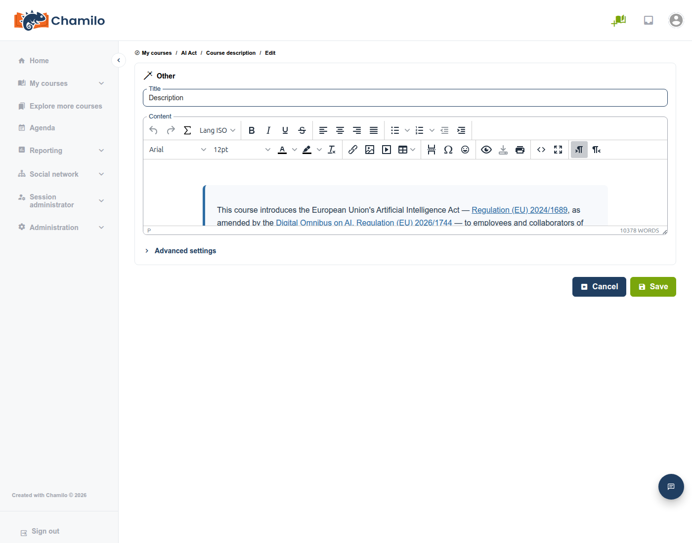
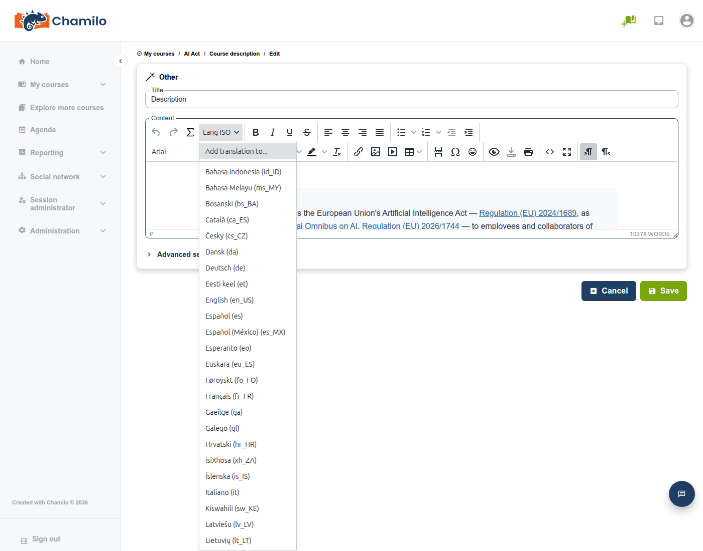
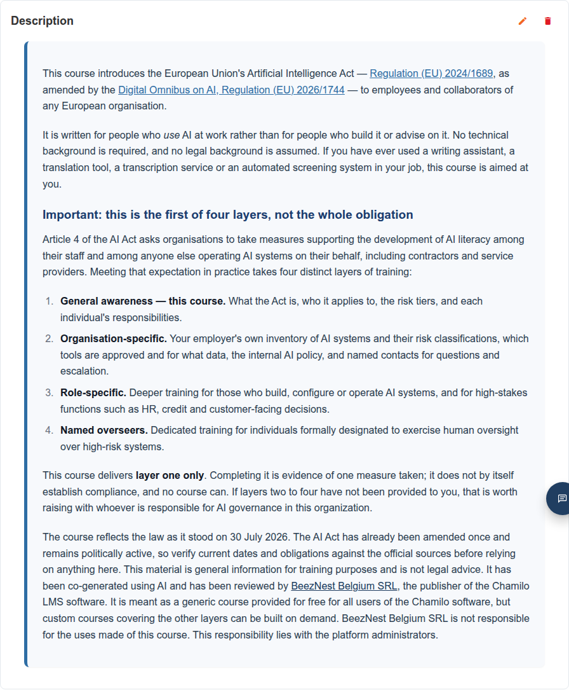
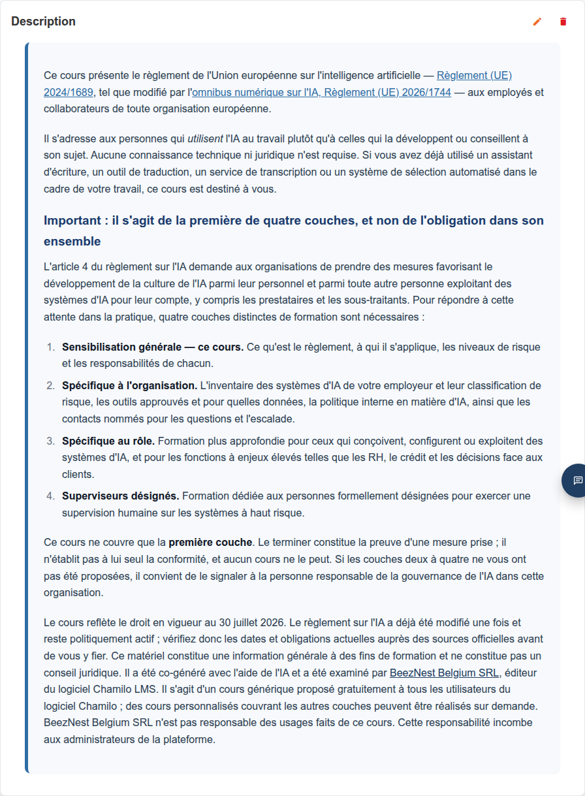
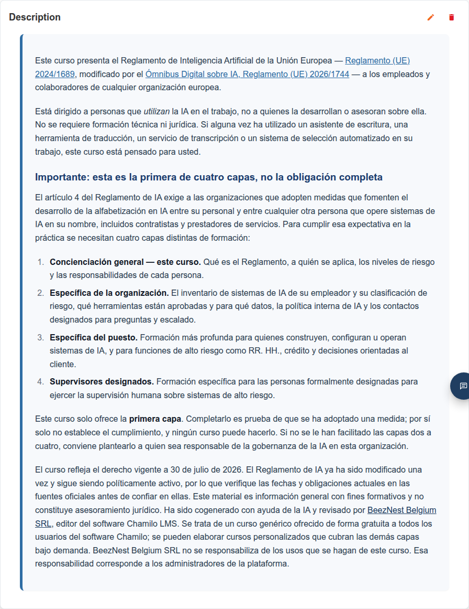
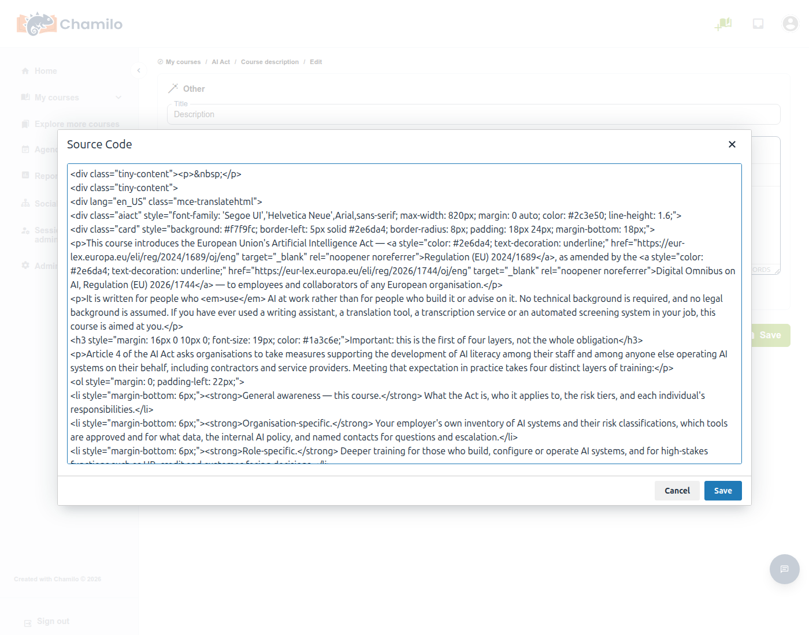

# Contenu multilingue

Chamilo vous permet de rédiger **plusieurs versions linguistiques d'un même contenu dans un seul champ** — une section de description de cours, un document, une question de test, une enquête — et de faire en sorte que chaque apprenant ne voie automatiquement que la version rédigée dans sa propre langue. Il s'agit de la fonctionnalité **translate_html**, nommée d'après le paramètre de la plateforme qui la régit.

Elle implique trois personnes différentes, chacune en voyant un aspect distinct :

* **Votre administrateur** doit activer la fonctionnalité à l'échelle de la plateforme avant que quiconque puisse l'utiliser.
* **Vous (l'enseignant)** rédigez les différentes versions linguistiques, à l'aide d'un bouton de l'éditeur de texte enrichi.
* **L'apprenant** en bénéficie sans jamais savoir qu'elle existe — il voit simplement le contenu dans sa propre langue, sans paramètre à rechercher ni à activer.

## Activation de la fonctionnalité

Il s'agit d'une tâche d'administrateur, et non d'enseignant. Sous **Administration > Paramètres de configuration > Éditeur**, le paramètre **Prise en charge du contenu HTML multilingue** (`translate_html`) doit être activé. Si vous ne voyez pas le bouton **Lang ISO** décrit ci-dessous dans la barre d'outils de votre éditeur, c'est presque certainement la raison — demandez à votre administrateur. Consultez [Paramètres de l'éditeur](../../admin-guide/platform-settings/editor-settings.md) pour la référence complète des paramètres. À partir de la v3.0.0, ce paramètre est activé par défaut (ce n'était pas le cas avant cette version), sauf si vous avez mis à niveau votre version à partir d'une version antérieure dans laquelle le paramètre était désactivé.

Désactiver à nouveau ce paramètre ne supprime ni ne casse aucun contenu déjà rédigé de cette manière — voir [Ce que voient les apprenants](#what-learners-see) ci-dessous.

## Rédaction de contenu multilingue

La fonctionnalité est disponible partout où vous disposez de l'éditeur de texte enrichi complet : sections de [description de cours](../creating-your-course/course-description.md), [documents](documents.md), questions de tests et d'enquêtes, et plus encore.

1. Rédigez (ou collez) le contenu dans votre langue par défaut, comme d'habitude.
2. Sélectionnez ce texte, puis cliquez sur le bouton **Lang ISO** dans la barre d'outils de l'éditeur.

3. Dans le menu, choisissez la langue dans laquelle vous venez d'écrire — la liste couvre toutes les langues actives sur votre plateforme. Si celle dont vous avez besoin n'y figure pas, utilisez **Code ISO Chamilo personnalisé...** en bas et saisissez-le (par ex. `en_US`, `fr_FR`, `es`).

4. Chamilo entoure votre sélection de cette balise de langue. Rédigez (ou collez) ensuite la version de la langue suivante juste après, sélectionnez-la, et recommencez avec une autre langue.

Continuez pour autant de langues que vous souhaitez couvrir. Toutes coexistent dans le même champ — pendant l'édition, vous verrez chaque version linguistique empilée l'une après l'autre ; ce n'est que lorsqu'une personne *consulte* réellement la page que Chamilo masque tout sauf la langue qui s'applique à elle (voir ci-dessous).

### Traduction assistée par IA

Si votre administrateur a configuré un fournisseur de texte IA, le même menu **Lang ISO** propose également **Ajouter une traduction vers...** en haut. Cela envoie votre contenu existant au modèle d'IA configuré et insère un nouveau bloc traduit automatiquement dans la langue que vous choisissez (ou dans toutes les langues restantes à la fois, si votre plateforme le permet) — vous n'avez pas à le rédiger vous-même. Les blocs linguistiques existants restent intacts, et les langues déjà présentes sont exclues de la liste, de sorte qu'une utilisation répétée ne crée pas de doublons.

Comme pour tout contenu généré par IA, relisez le résultat — c'est un moyen rapide d'obtenir une première ébauche solide dans une langue que vous ne parlez peut-être pas vous-même, et non un substitut à la relecture.

## Ce que voient les apprenants

Chaque apprenant ne voit qu'une seule version linguistique : Chamilo essaie d'abord la langue du profil de l'apprenant ; si aucun de vos blocs ne correspond, il se rabat sur la langue du cours, puis sur la langue par défaut de la plateforme ; si aucune de celles-ci ne correspond non plus, il affiche la langue que vous avez écrite en premier plutôt que de laisser le contenu vide. Tout cela se fait automatiquement — l'apprenant n'a rien à configurer, et vous n'avez rien à configurer par apprenant non plus.

Voici la même section de description de cours, telle que vue par trois apprenants ayant des langues d'interface différentes — rien d'autre dans le cours n'a changé entre ces trois captures d'écran, seule la langue du visiteur a changé :

### Sous le capot

Si vous ouvrez un jour la vue **Code source** d'un champ multilingue (le bouton `<>` de la barre d'outils de l'éditeur), vous verrez chaque version linguistique encapsulée comme suit :

Chaque version est encapsulée dans un `
` (ou un ``, pour une courte expression en ligne plutôt qu'un bloc entier) — c'est cet attribut `lang` que Chamilo compare à la langue du visiteur pour décider quoi afficher. Il est utile de reconnaître ce nom de classe spécifique si vous inspectez le code source d'une page ou si vous dépannez un contenu qui semble incorrect : **`mce-translatehtml`** est le marqueur à rechercher.

Cela explique également pourquoi la désactivation de `translate_html` dans les paramètres de la plateforme ne casse rien de ce qui a déjà été rédigé : ce paramètre contrôle uniquement l'affichage du bouton de *rédaction* **Lang ISO** dans l'éditeur. Le filtrage *côté affichage* décrit ci-dessus s'exécute de manière inconditionnelle ; le contenu multilingue déjà rédigé reste donc correctement filtré pour chaque visiteur, même sur une plateforme dont un administrateur a depuis désactivé le bouton de rédaction.

## Les titres ne fonctionnent pas de cette manière

Le titre d'un cours, le titre d'un document, le titre d'un test — ce sont des champs de texte brut, et non de texte enrichi ; ils ne peuvent donc pas contenir le balisage marqué par `lang` décrit ci-dessus. Ils restent une valeur unique et neutre, quel que soit le visiteur, et ce quel que soit le nombre de versions linguistiques que vous avez rédigées dans le contenu sous-jacent.

La seule exception : si votre administrateur a activé **Enregistrer les titres en HTML** (`save_titles_as_html`, également sous **Administration > Paramètres de configuration > Éditeur**) pour le champ de titre spécifique sur lequel vous travaillez, ce champ devient lui aussi un véritable champ HTML, et la même technique **Lang ISO** décrite ci-dessus peut lui être appliquée. Cela est peu courant et sert surtout aux questions de test — la plupart des titres de la plateforme restent du texte brut.

## Conseils

* **Placez la langue source en premier** — mettez en premier dans le champ la langue la plus courante de votre plateforme ; c'est le repli le plus naturel si vous oubliez plus tard de baliser une langue plus rare.
* **N'imbriquez pas les blocs de langue** — rédigez chaque version comme un bloc distinct et séquentiel ; l'imbrication de l'un dans l'autre n'est pas prise en charge, et l'éditeur défait activement les marqueurs imbriqués lorsque vous en insérez un nouveau.
* **Une section qui paraît vide dans une langue** signifie généralement qu'aucun bloc n'a jamais été balisé pour elle (ni pour son repli étendu au niveau du cours ou de la langue par défaut de la plateforme) — vérifiez dans la vue Code source les langues réellement présentes.