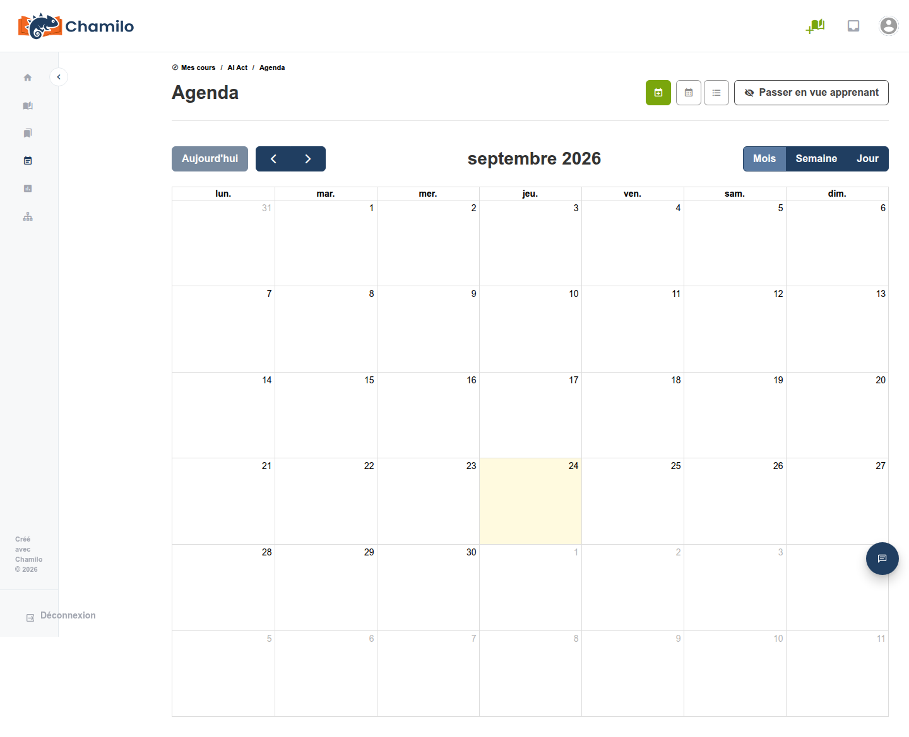
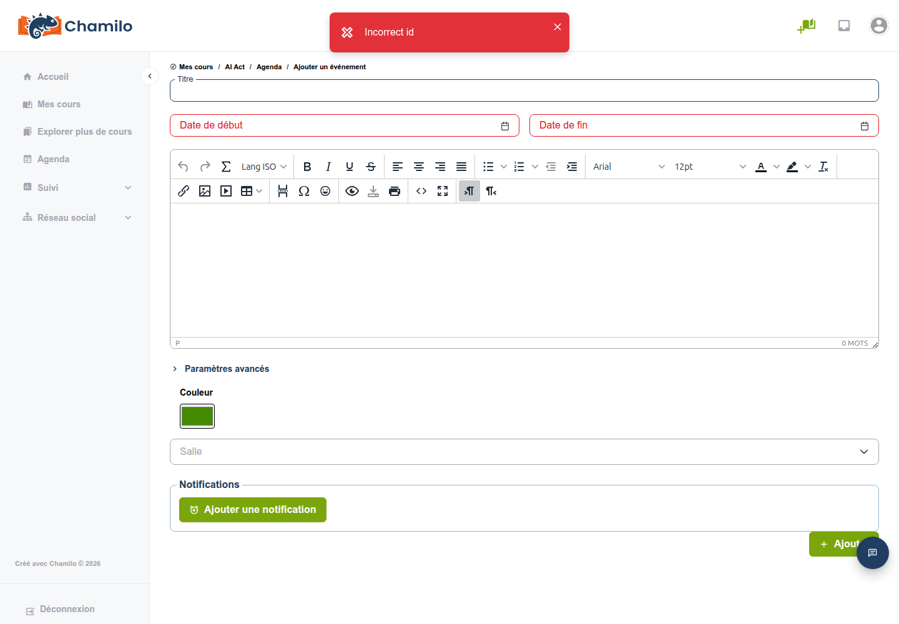
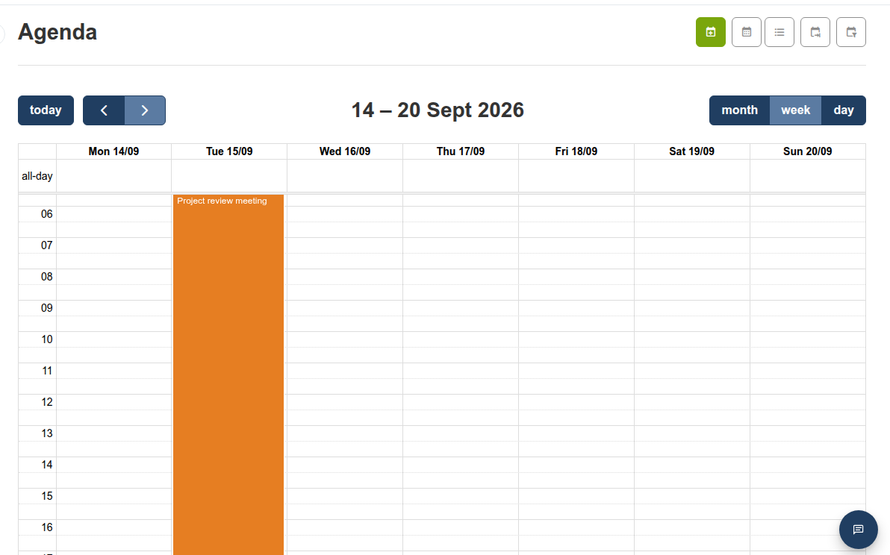

# Agenda

L'outil agenda vous permet de planifier des événements et des échéances dans votre cours. Les événements apparaissent dans un calendrier que vos apprenants peuvent consulter.

## Consulter l'agenda

Ouvrez l'outil **Agenda**  depuis la page d'accueil du cours. Vous pouvez consulter les événements selon trois modes :

* **Vue calendrier** — Un calendrier visuel mensuel, hebdomadaire ou quotidien
* **Vue liste** — Les événements affichés sous forme de liste chronologique
* **Événements personnels** — Filtrer pour n'afficher que les événements qui vous concernent

## Créer un événement

1. Cliquez sur **Ajouter un événement** 
2. Renseignez les détails de l'événement :
   * **Titre** — Un nom court pour l'événement
   * **Date et heure de début**
   * **Date et heure de fin**
   * **Description** — Détails supplémentaires (prend en charge le texte enrichi)
   * **Pièces jointes** — Cliquez sur **Ajouter une pièce jointe** pour joindre un ou plusieurs fichiers, et décrivez-les éventuellement dans **Commentaire du fichier**. Les apprenants voient les fichiers dans les détails de l'événement et peuvent les télécharger, si l'événement leur est envoyé. Pour supprimer un fichier, modifiez l'événement et cliquez sur l'icône de suppression à côté du fichier. Les pièces jointes ne sont disponibles que pour les événements de cours
   * **Commentaire** — Une courte note en texte brut, par exemple ce que les apprenants doivent apporter. Il n'est disponible que pour les événements de cours, et les apprenants le voient sous la description, dans les détails de l'événement et dans la vue liste
3. Choisissez le **public** dans le champ **Envoyer à** :
   * Laissez-le vide pour envoyer l'événement à **tout le monde** dans le cours (ou dans le cours de la session en cours)
   * Sélectionnez un ou plusieurs **utilisateurs** et/ou **groupes** du cours pour n'envoyer l'événement qu'à eux. Un apprenant ne voit alors l'événement que s'il lui a été envoyé ou à l'un de ses groupes ; les enseignants voient toujours tous les événements du cours.

   Vous pouvez modifier les destinataires ultérieurement en modifiant l'événement. Le champ **Envoyer à** n'est affiché qu'aux enseignants, dans l'agenda d'un cours ; dans l'agenda d'un groupe, les nouveaux événements appartiennent toujours à ce groupe.
4. Définissez éventuellement un **rappel**  pour envoyer des notifications par e-mail avant l'événement (configuration *cron* du portail requise par un administrateur)
5. Cochez éventuellement **Ajouter une annonce (Envoyer un e-mail)** pour publier également l'événement comme annonce de cours, envoyée par e-mail aux mêmes destinataires. L'annonce reprend le titre et la description de l'événement. Cette option n'est affichée qu'aux enseignants, lorsqu'ils créent un événement de cours
6. Choisissez une **couleur** pour l'événement en cliquant sur l'échantillon de couleur. Cette couleur sert à mettre en évidence l'événement dans tout le calendrier (vues mois, semaine et jour), ce qui permet de distinguer les événements d'un seul coup d'œil — par exemple pour différencier les échéances des séances ordinaires, ou les événements de différents cours dans votre agenda personnel.

   
7. Enregistrer

La couleur choisie est ensuite reflétée partout où l'événement apparaît dans le calendrier :

Par défaut, les nouveaux événements reçoivent une couleur selon leur contexte (cours, session, personnel ou global), mais vous pouvez la remplacer par la couleur de votre choix.

## Gérer les événements

* **Modifier**  — Cliquez sur un événement pour modifier ses détails
* **Supprimer**  — Retirer un événement du calendrier
* **Glisser-déposer** — Dans la vue calendrier, faites glisser les événements pour les replanifier

## Répéter un événement

Lorsque vous créez un événement de cours, cochez **Répéter l'événement**, puis choisissez :

* **Type de répétition** — **Quotidien**, **Hebdomadaire**, **Mensuel, par date** ou **Annuel**
* **Date de fin de répétition** — Le dernier jour auquel une répétition peut commencer

L'agenda crée alors une copie de l'événement à chaque répétition, avec les mêmes détails et les mêmes destinataires. Chaque copie est un événement distinct : vous pouvez la modifier ou la supprimer individuellement. Pour supprimer toute la série d'un coup, cliquez sur n'importe quel événement de la série, puis sur **Supprimer tous les éléments**.

Les options de répétition ne sont disponibles que lors de la création d'un événement de cours ; vous ne pouvez pas ajouter une répétition à un événement existant.

## Filtrer par destinataire

En tant qu'enseignant, utilisez le sélecteur **Filtre** au-dessus de l'agenda du cours pour n'afficher que les événements envoyés à un utilisateur ou à un groupe. Choisissez **Tous** (ou videz le sélecteur) pour revoir tous les événements. Le filtre s'applique à la fois à la vue calendrier et à la vue liste, et il est conservé lorsque vous passez de l'une à l'autre.

## Agenda personnel

Vous disposez également d'un **agenda personnel** accessible depuis la barre latérale. L'agenda personnel regroupe les événements de tous vos cours dans une vue unique. C'est ici que les apprenants consultent leur emploi du temps combiné pour l'ensemble des cours auxquels ils sont inscrits.

## Conseils

* **Fixer des échéances** — Créez des événements pour les dates de remise des travaux et les échéances des exercices afin que les apprenants puissent les voir dans leur calendrier
* **Utiliser des rappels** — Activez les rappels par e-mail pour les événements importants afin d'aider les apprenants à rester dans les temps
* **Coordonner avec les sessions** — Si vous enseignez dans plusieurs sessions, chaque session possède ses propres événements, visibles uniquement par les apprenants de cette session. Les enseignants disposent d'une fonctionnalité leur permettant de consulter les événements (devoirs, sorties, etc.) des autres cours de leurs sessions afin d'éviter de surcharger les étudiants.