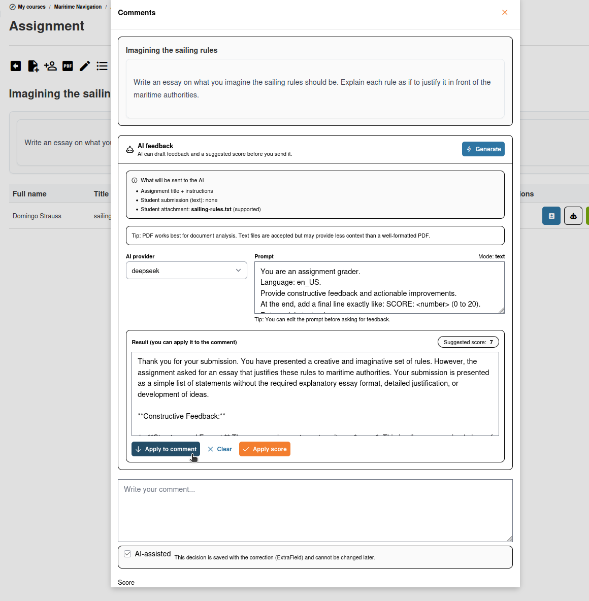

# Notation par IA

La notation par IA vous aide à évaluer les productions ouvertes des apprenants — dissertations, réponses rédigées et travaux déposés — en proposant des suggestions de notes et des retours générés par l'IA.

## Où apparaît la notation par IA

La notation par IA est disponible dans deux contextes :

* **Questions ouvertes d'exercice** — Lorsque vous notez manuellement les questions à réponse libre d'un exercice
* **Remises de travaux** — Lorsque vous examinez et notez les publications des apprenants dans l'outil Travaux

Recherchez le bouton **Notation par IA** (indiqué par une icône de robot ) dans l'interface de notation.

## Fonctionnement

1. Ouvrez une remise ou une réponse à noter
2. Cliquez sur le bouton **Notation par IA**
3. L'IA analyse la réponse de l'apprenant et produit :
   * Une **note suggérée** fondée sur la qualité et la pertinence de la réponse
   * Des **commentaires de retour** expliquant les points forts et les points faibles de la réponse
4. Examinez les suggestions de l'IA
5. **Acceptez, modifiez ou rejetez** la note et le retour
6. Enregistrez votre note finale

## Remarques importantes

* **La notation par IA est une suggestion** — Vous avez toujours le dernier mot. L'IA fournit un point de départ que vous pouvez ajuster selon votre jugement professionnel.
* **L'examen est indispensable** — L'IA peut mal interpréter le contexte, manquer des nuances ou attribuer une note incorrecte. Examinez toujours la note suggérée avant de la confirmer.
* **Fonctionne mieux avec des critères clairs** — Plus les consignes du travail et la grille d'évaluation sont précises, meilleures seront les suggestions de l'IA.

## Mention du contenu généré par IA

Les commentaires générés par l'IA sont accompagnés d'une mention indiquant qu'ils ont été créés à l'aide de l'intelligence artificielle. Cette transparence aide les apprenants à comprendre l'origine de la notation.

## Conseils

* **Utilisez-la pour les classes nombreuses** — La notation par IA est particulièrement utile lorsque vous avez de nombreuses remises à examiner, car elle accélère l'évaluation initiale
* **Fournissez des descriptions de travaux détaillées** — Des consignes claires aident l'IA à comprendre à quoi ressemble une bonne réponse
* **Calibrez vos attentes** — Notez d'abord quelques remises manuellement afin d'établir vos critères, puis utilisez la notation par IA pour le reste
* **Exploitez le retour** — Le retour généré par l'IA peut constituer un point de départ utile pour vos commentaires, même si vous ajustez la note