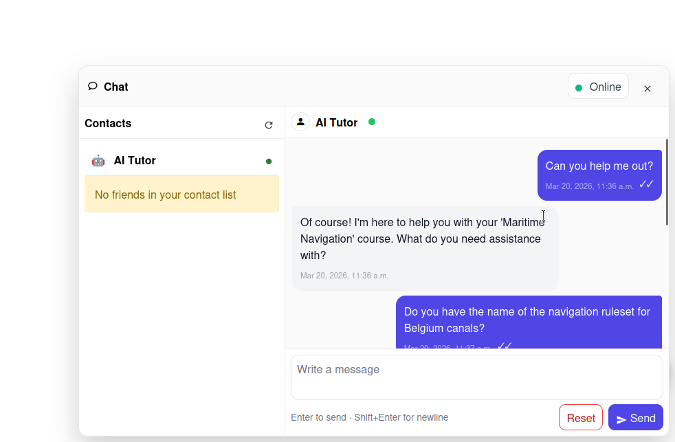

# Tuteur IA

Le Tuteur IA est un chatbot intégré à Chamilo avec lequel les apprenants peuvent interagir pour obtenir des réponses instantanées générées par l'IA. Il fonctionne dans deux contextes, avec une orientation différente dans chacun :

* **Dans un cours** — le Tuteur IA est centré sur ce cours : il répond aux questions sur son contenu, explique les concepts qu'il aborde et guide les apprenants à travers le matériel.
* **En dehors d'un cours** (sur la plateforme générale) — le Tuteur IA traite plutôt des questions génériques sur l'utilisation de la plateforme, par exemple comment trouver quelque chose ou utiliser une fonctionnalité, plutôt que le contenu du cours.

## Fonctionnement

Lorsque le Tuteur IA est activé pour un cours, les apprenants voient une interface de discussion dans laquelle ils peuvent :

* **Poser des questions** sur le contenu du cours
* **Obtenir des explications** sur les concepts abordés dans le cours
* **Recevoir des conseils** sans attendre la réponse de l'enseignant

Dans un cours, le Tuteur IA utilise le contexte de ce cours pour fournir des réponses pertinentes. Il est conçu pour compléter votre enseignement, et non pour le remplacer.

## Activation du Tuteur IA

Le Tuteur IA nécessite deux niveaux de configuration :

1. **Niveau plateforme** — L'administrateur doit activer les assistants IA et configurer au moins un fournisseur d'IA (voir [Configuration de l'IA](../../admin-guide/integrations/ai-configuration.md))
2. **Niveau cours** — Le Tuteur IA doit être activé dans les paramètres du cours (un simple interrupteur activé/désactivé). Le fournisseur utilisé pour la discussion est celui configuré par l'administrateur.

## L'interface de discussion

Le Tuteur IA apparaît sous la forme d'un **panneau de discussion ancré** dans le cours. Les apprenants peuvent :

* Saisir des messages et recevoir des réponses générées par l'IA
* Consulter l'historique de leur conversation
* Réinitialiser la conversation pour repartir de zéro

L'interface de discussion affiche l'échange entre l'apprenant et l'IA dans un format de messagerie familier.

## Comportement important

* **Limité à l'endroit où il est ouvert** — Dans un cours, le Tuteur IA ne répond qu'à propos de ce cours ; ouvert en dehors de tout cours, il bascule vers des questions générales sur l'utilisation de la plateforme. Le mode à l'échelle de la plateforme (hors cours) est un interrupteur distinct que votre administrateur contrôle indépendamment de celui propre à chaque cours.
* **Désactivé pendant les examens** — Le Tuteur IA est automatiquement désactivé lorsqu'un apprenant passe un exercice, afin d'empêcher la triche
* **Conversation par apprenant** — Chaque apprenant dispose de sa propre conversation privée avec le Tuteur IA, et le contexte du prompt ne comprend que les messages les plus récents
* **Basculement de fournisseur** — Si le fournisseur configuré échoue, Chamilo bascule vers un autre fournisseur disponible afin que la discussion continue de fonctionner

## En tant qu'enseignant

Vous devez savoir que :

* Le Tuteur IA ne donne pas toujours des réponses parfaites — encouragez les apprenants à vérifier les informations importantes
* Vous pouvez consulter l'utilisation du Tuteur IA grâce au suivi de la plateforme
* Le Tuteur IA est un complément à votre enseignement, et non un substitut. Utilisez-le en parallèle des forums, des annonces et de la messagerie directe pour un accompagnement complet des apprenants.

## Conseils

* **Définir les attentes** — Indiquez aux apprenants, au début du cours, qu'un Tuteur IA est disponible et expliquez comment l'utiliser de manière appropriée
* **Encourager l'esprit critique** — Rappelez aux apprenants d'exercer leur esprit critique face aux réponses générées par l'IA
* **L'utiliser pour les questions fréquentes** — Le Tuteur IA est particulièrement utile pour traiter les questions courantes auxquelles vous répondriez autrement de façon répétée