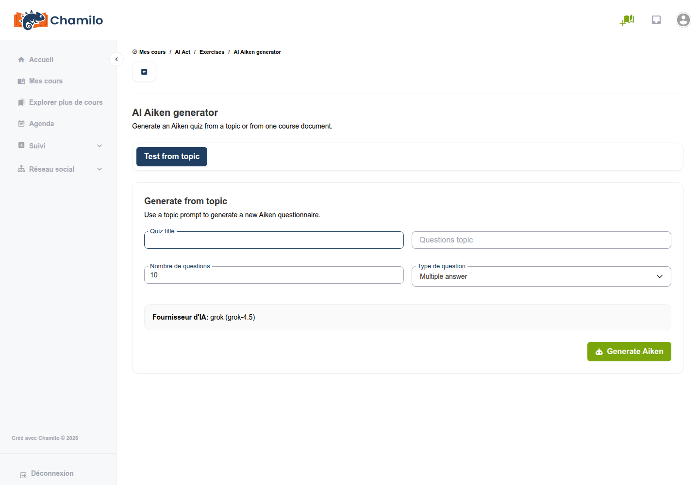
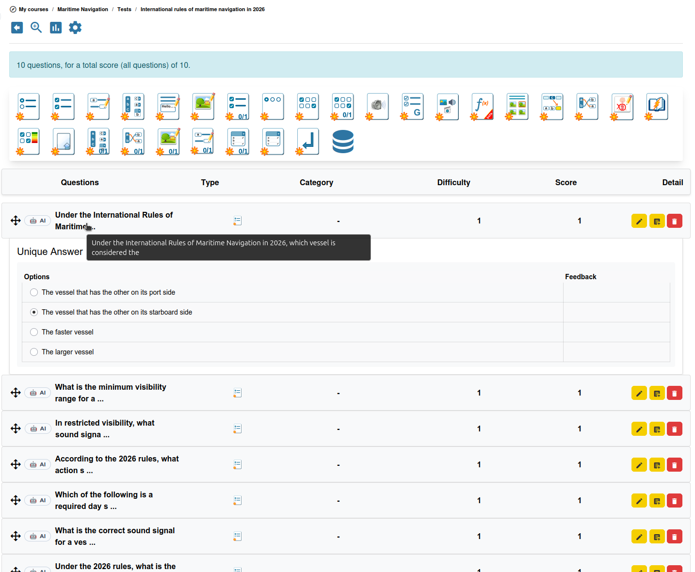

# Générateur d'exercices

Le générateur d'exercices par IA vous aide à créer automatiquement des questions de quiz à l'aide de l'intelligence artificielle. Vous fournissez un sujet ou un contenu, et l'IA génère des questions que vous pouvez examiner, modifier et ajouter à vos exercices.

## Accéder au générateur d'exercices

Le générateur d'exercices est disponible lors de la création ou de la modification d'un exercice, à condition que :

1. Les assistants IA soient activés au niveau de la plateforme
2. Au moins un fournisseur de texte IA soit configuré

Recherchez le bouton ou la section **Générateur IA** dans l'interface de création d'exercice.

## Comment générer des questions

Le générateur propose deux modes, disponibles sous forme d'onglets :

* **Test à partir d'un sujet** — Générer des questions à partir d'une description textuelle du sujet
* **Test à partir d'un document** — Générer des questions à partir d'un document du cours (disponible uniquement lorsqu'un fournisseur capable de traiter des documents est configuré). Lorsque ce mode est utilisé, le champ du sujet devient facultatif et est traité comme une indication supplémentaire.

1. Ouvrez le formulaire du générateur IA dans un exercice et choisissez le mode
2. Configurez les paramètres de génération :
   * **Titre du quiz** — Le titre de l'exercice résultant
   * **Sujet des questions** — Décrivez le thème des questions (ou, en mode document, une indication facultative)
   * **Nombre de questions** — Combien de questions générer (plafonné à 100)
   * **Type de question** — Actuellement, seul le type **Réponse multiple** est proposé
   * **Fournisseur d'IA** — Sélectionnez le fournisseur d'IA à utiliser (affiché uniquement lorsque plusieurs sont configurés)
3. Cliquez sur **Générer**
4. L'IA produit un ensemble de questions avec des options de réponse et les bonnes réponses indiquées. Lorsque la mention de transparence relative à l'IA est activée, les questions générées sont préfixées par **\[AI-assisted\]**.

## Examiner et modifier

Les questions générées sont présentées comme des **suggestions**. Vous devez :

* **Examiner chaque question** pour en vérifier l'exactitude et la pertinence
* **Modifier la formulation** si nécessaire — ajustez les questions, les options de réponse et les commentaires
* **Vérifier les bonnes réponses** — assurez-vous que l'IA a identifié les bonnes réponses
* **Supprimer les questions inappropriées** — supprimez celles qui ne répondent pas à vos exigences
* **Ajuster la notation** — définissez des valeurs de points appropriées pour chaque question

Une fois satisfait, ajoutez les questions à votre exercice.

Notez que, malgré nos demandes de format spécifiques, certains modèles renvoient des titres de questions préfixés par un numéro. Nous ne recommandons pas de laisser ce numéro, car cela entravera le mélange des questions dans les tests comportant des questions sélectionnées aléatoirement. De plus, il arrive parfois que vous n'obteniez pas autant de questions que demandé : vérifiez donc ce point et, le cas échéant, générez davantage de questions, ou changez de modèle si vous en avez la possibilité.

## Mention de transparence sur le contenu généré par l'IA

Le contenu généré par l'IA est accompagné d'une mention de transparence indiquant qu'il a été créé à l'aide de l'intelligence artificielle. Cette transparence aide les apprenants à comprendre l'origine du matériel.

## Conseils

* **Fournissez des sujets précis** — Plus la description de votre sujet est précise, plus les questions générées seront pertinentes.
* **Examinez toujours** — Le contenu généré par l'IA peut contenir des erreurs. Ne publiez jamais de questions sans les avoir examinées au préalable.
* **Utilisez-le comme point de départ** — Les questions générées font gagner du temps, mais ne constituent pas un produit fini. Modifiez-les pour les adapter à votre style d'enseignement et au contenu de votre cours.
* **Mélangez avec des questions manuelles** — Combinez les questions générées par l'IA avec des questions créées manuellement pour obtenir les meilleurs résultats.
* **Essayez différents fournisseurs** — Si plusieurs fournisseurs d'IA sont disponibles, essayez-en différents pour voir lequel produit les meilleures questions pour votre domaine.