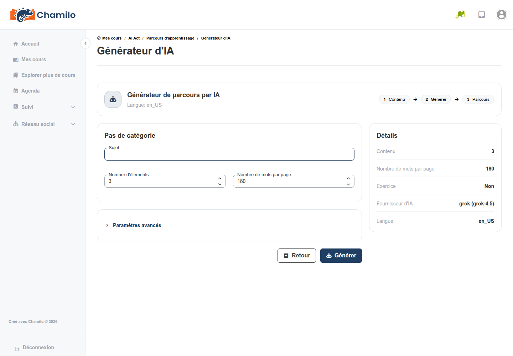

# Générateur de parcours d'apprentissage

Le générateur de parcours d'apprentissage par IA vous aide à créer automatiquement des séquences d'apprentissage structurées. Vous indiquez un sujet et des objectifs, et l'IA génère un plan de parcours d'apprentissage comprenant des sections et des éléments de contenu que vous pouvez examiner et personnaliser.

## Accéder au générateur de parcours d'apprentissage

Le générateur de parcours d'apprentissage est disponible lors de la création d'un nouveau parcours d'apprentissage, à condition que :

1. Les assistants IA sont activés au niveau de la plateforme
2. Le générateur de parcours d'apprentissage est activé dans les paramètres du cours
3. Au moins un fournisseur de texte IA est configuré

Recherchez la section **Générateur IA** dans l'interface de création de parcours d'apprentissage.

## Comment générer un parcours d'apprentissage

1. Ouvrez le formulaire du générateur IA
2. Configurez les paramètres :
   * **Sujet** — Le thème du parcours d'apprentissage
   * **Nombre d'éléments** — Nombre de pages de contenu que le parcours doit contenir
   * **Nombre de mots par page** — Longueur approximative de chaque page
   * **Ajouter un test après chaque page** — Lorsque cette option est cochée, l'IA crée également un court quiz à choix multiples après chaque page (2 questions par défaut, plafonné à 5)
3. Cliquez sur **Générer**
4. L'IA produit un parcours d'apprentissage comportant un élément de document par page et, éventuellement, un élément de quiz après chacun d'eux

## Examiner et personnaliser

Le parcours d'apprentissage généré constitue un **point de départ**. Vous devez :

* **Examiner la structure** — Vérifiez que les sections sont dans un ordre logique
* **Modifier le contenu** — Modifiez le texte généré, ajoutez vos propres supports et supprimez les sections non pertinentes
* **Ajouter des ressources** — Insérez vos propres documents, exercices, liens et autres contenus
* **Définir les prérequis** — Configurez les sections qui doivent être terminées avant les autres
* **Ajouter des évaluations** — Incluez des exercices aux moments appropriés pour vérifier la compréhension

## Mention relative au contenu généré par IA

Le contenu généré par l'IA est accompagné d'une mention indiquant qu'il a été créé à l'aide de l'intelligence artificielle. Cette transparence aide les apprenants à comprendre l'origine du matériel.

## Conseils

* **Commencez de manière générale, puis affinez** — Générez d'abord une structure de haut niveau, puis ajoutez manuellement les détails et les ressources spécifiques
* **Utilisez-le pour la planification du cours** — Même si vous n'utilisez pas directement le contenu généré, la structure suggérée par l'IA peut constituer un outil de planification utile
* **Combinez avec la génération d'exercices** — Après avoir généré un parcours d'apprentissage, utilisez le générateur d'exercices pour créer des évaluations pour chaque section