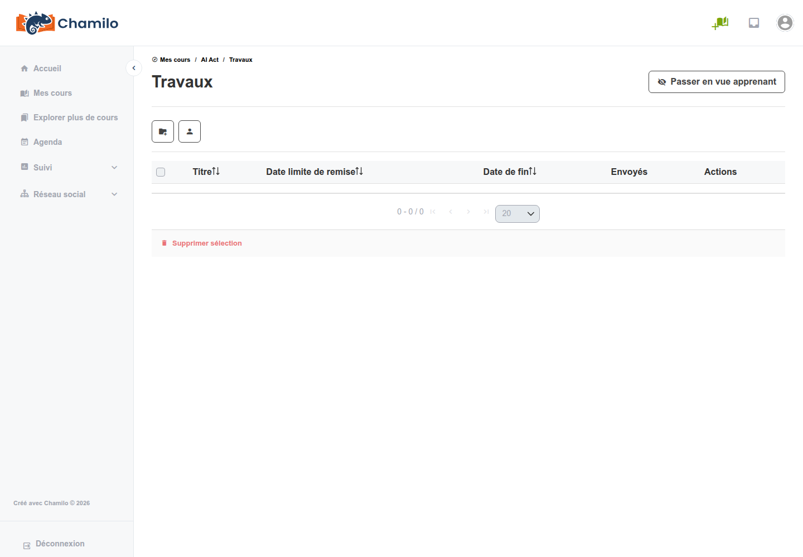
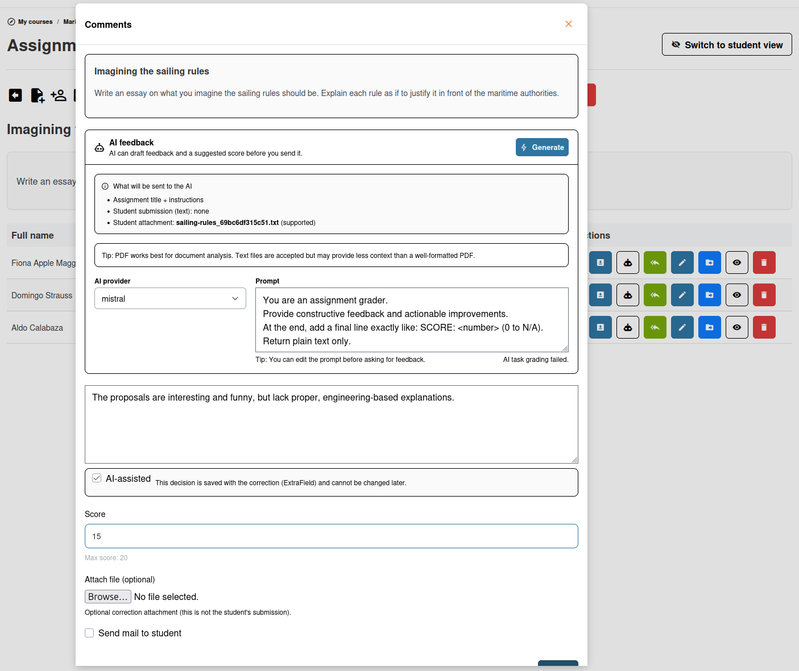

# Travaux

L'outil Travaux (également appelé « publications des apprenants ») vous permet de collecter les productions des apprenants — dissertations, projets, rapports ou toute remise sous forme de fichier — et de les noter.

## Créer un travail

1. Ouvrez l'outil **Travaux**  depuis la page d'accueil du cours
2. Cliquez sur **Créer un travail**
3. Renseignez les informations :
   * **Nom du travail** — Le nom du travail (par exemple, « Rapport de projet final »)
   * **Description** — Consignes destinées aux apprenants, indiquant ce qu'il faut remettre et comment le travail sera évalué (prend en charge le texte enrichi)
   * **Note maximale** — Sur quel total le travail sera noté
   * **Ajouter au carnet de notes** — Ajouter comme élément évalué dans l'outil d'évaluation (carnet de notes), afin qu'il puisse contribuer à l'atteinte des objectifs du cours
   * **Date limite** — La date et l'heure officielles (publiées) après lesquelles les remises sont signalées comme en retard (les envois restent acceptés)
   * **Se termine le (complètement fermé)** — La date et l'heure de clôture définitive après lesquelles aucun envoi n'est possible
   * **Ajouter au calendrier** — Créer un événement pour faire référence à cette date de remise du travail
   * **Type de remise** — Choisissez entre **Autoriser uniquement le texte**, **Autoriser uniquement les fichiers** ou **Autoriser les fichiers ou le texte en ligne**
4. Enregistrer

Une fois le travail créé, vous pouvez également :
* Téléverser des documents modèles depuis la page de détail du travail
* Affecter le travail à des utilisateurs spécifiques (plutôt qu'à tous les utilisateurs du cours)

Et une fois que les apprenants ont remis leurs travaux, vous pouvez :
* Exporter une liste PDF des remises
* Afficher une liste uniquement des apprenants qui n'ont pas remis leur travail
* Télécharger tous les travaux dans une grande archive ZIP
* Téléverser toutes les corrections dans une grande archive ZIP
* Supprimer toutes les corrections que vous avez remises (cela ne supprime pas les remises des apprenants)

## Travaux pour les groupes

Lorsque le cours comporte des groupes, le formulaire de travail peut afficher **Il s'agit d'un travail par groupes**. Activez cette option pour créer un seul travail partagé entre les groupes de la **Catégorie de groupes** sélectionnée. Si les catégories de groupes sont désactivées, Chamilo peut appliquer le travail à tous les groupes.

Configurez le travail partagé depuis l'outil Travaux habituel, et non depuis l'intérieur d'un groupe particulier. Les apprenants accèdent au même travail depuis le contexte de leur propre groupe ; le travail n'a donc pas besoin d'être dupliqué une fois par groupe.

Si plusieurs catégories de groupes existent, sélectionnez la catégorie dont les groupes doivent recevoir le travail. L'option n'est pas proposée lorsque vous vous trouvez déjà dans le contexte d'un groupe spécifique.

## Comment les apprenants remettent leur travail

Les apprenants ouvrent le travail et :

1. Cliquent sur **Téléverser un fichier** ou sur le bouton de remise
2. Sélectionnent un fichier depuis leur ordinateur (ou rédigent le texte directement, selon la configuration)
3. Ajoutent un commentaire facultatif
4. Remettent

Les apprenants peuvent voir s'ils ont déjà remis leur travail et, si cela est autorisé, mettre à jour leur remise.

### Remises en texte enrichi (HTML)

Lorsque vous configurez **Autoriser uniquement le texte** ou **Autoriser les fichiers ou le texte en ligne**, les apprenants peuvent rédiger une réponse mise en forme dans l'éditeur en ligne plutôt que de téléverser un document distinct. Chamilo assainit le HTML remis et le stocke sous forme de fichier de remise `.html`. Il reste soumis aux règles d'accès et de date limite déjà définies pour le travail.

Dans la liste des remises du formateur, utilisez **Aperçu** pour ouvrir une remise HTML disponible, ou **Corriger et noter** pour en voir le contenu dans la boîte de dialogue de révision avant d'ajouter un retour et une note. Le HTML est présenté de manière sécurisée plutôt qu'exécuté comme un script fourni par l'apprenant. Voir [PR #9410](https://github.com/chamilo/chamilo-lms/pull/9410).

## Examiner les remises

En tant que formateur, ouvrez un travail pour voir la liste de toutes les remises :

* **Nom de l'apprenant** — Qui a remis
* **Date de remise** — Quand le travail a été remis
* **Fichier** — Télécharger le fichier remis
* **État** — Si la remise a été notée
* **Commentaires** — Tout commentaire laissé par l'apprenant ou par vous

### Suivre un devoir

Les enseignants et les tuteurs de session habilités peuvent choisir de suivre un devoir individuel et recevoir des notifications lorsqu'un apprenant commente l'une de ses remises.

1. Ouvrez la page de détail du devoir depuis l'outil **Devoirs**.
2. Sélectionnez **Suivre** (icône de cloche). Le bouton devient **Suivi**.
3. Sélectionnez à nouveau **Suivi** pour cesser de suivre ce devoir.

L'enseignant qui crée un nouveau devoir le suit automatiquement et peut cesser de le suivre ultérieurement. Le suivi est personnel à chaque enseignant ou tuteur ; il n'abonne pas l'ensemble du cours. Les apprenants ne disposent pas de cette commande. Les notifications sont envoyées uniquement aux abonnés actifs qui conservent le rôle de cours ou de session approprié ; l'auteur du commentaire ne reçoit pas de notification pour son propre commentaire.

**Important :** Les notifications ne sont envoyées que lorsque le paramètre de cours `email_to_teachers_on_new_work_feedback` est activé (valeur `1`, **Oui**). Suivre un devoir ne remplace pas, à lui seul, un paramètre de cours désactivé. Cela concerne les commentaires des apprenants sur les remises, et non chaque modification de devoir ou téléversement de fichier. L'envoi dépend également de la configuration de messagerie/courriel du portail.

### Noter une remise

1. Cliquez sur une remise pour l'ouvrir
2. Examinez le fichier remis
3. Saisissez une **note**
4. Rédigez des **commentaires de rétroaction** pour l'apprenant
5. Téléversez éventuellement un **fichier corrigé** en pièce jointe
6. Enregistrez

### Notation assistée par IA

Si des outils d'IA sont configurés sur votre plateforme, une option **Notation par IA** peut apparaître lors de l'examen des remises. Elle utilise un modèle d'IA pour suggérer une note et une rétroaction pour les travaux à réponse ouverte. Consultez [Notation par IA](../ai-tools/ai-grading.md) pour plus de détails.

## Gérer les remises

Actions de groupe :
* **Télécharger le paquet de devoirs** — Téléchargez toutes les remises dans un seul fichier ZIP pour un examen hors ligne
* **Téléverser le paquet de corrections** — Si vous avez téléchargé toutes les remises dans un seul fichier ZIP, modifié les fichiers sur place sur votre ordinateur puis les avez recompressés, vous pouvez envoyer le ZIP comme paquet de corrections. Ne modifiez pas les noms de fichiers, sinon cela ne fonctionnera pas.
* **Remises tardives** — Les remises après la date limite sont signalées, mais peuvent encore être acceptées selon vos paramètres

Actions sur une remise individuelle :
* **Téléverser une correction** — Téléversez une correction pour un apprenant 
* **Télécharger** — Téléchargez la remise d'un apprenant
* **Corriger et noter** — Ajoutez une correction et une note à la remise de l'apprenant 
* **Modifier** — Modifiez le titre du document ou la rétroaction précédente sur la remise
* **Déplacer** — Transférez une remise entre des dossiers de devoirs (par exemple si l'étudiant a remis dans le mauvais devoir)
* **Visibilité** — Contrôlez si les apprenants peuvent voir les remises des autres

## Lier au carnet de notes

Les notes des devoirs peuvent être incluses dans le carnet de notes du cours (outil « Évaluations »). Cela permet aux notes des devoirs de contribuer à la note globale du cours de l'apprenant et à l'éligibilité au certificat. Consultez [Carnet de notes](gradebook.md) pour plus de détails.

## Examiner les remises regroupées par apprenant

Pour les enseignants, le détail du devoir regroupe désormais les remises par étudiant. Le tableau initial affiche chaque apprenant et le **Nombre remis** ; ouvrez la ligne d'un apprenant pour examiner ses remises et accéder aux actions habituelles de rétroaction et de notation. Cela évite de répéter l'identité d'un apprenant dans la liste de premier niveau lorsque plusieurs remises sont autorisées.

Le regroupement est un changement de présentation, et non une modification des autorisations de remise, des dates limites ou de la notation. Consultez [PR de regroupement des remises n° 9424](https://github.com/chamilo/chamilo-lms/pull/9424).

## Envoyer des rappels uniquement aux apprenants sélectionnés

Ouvrez **Utilisateurs sans remise** depuis le détail du devoir pour examiner les apprenants qui n'ont pas encore remis. Sélectionnez les utilisateurs précis que vous souhaitez contacter et choisissez **Rappeler tous les utilisateurs sélectionnés** ; confirmez avant l'envoi. **Envoyer un courriel à tous** reste disponible lorsque chaque apprenant sans remise doit recevoir un rappel.

Une sélection est requise pour l'action sélective. Vérifiez la liste des destinataires avant de confirmer ; l'envoi d'un rappel est une opération réelle de courriel, et non un simple aperçu. Consultez [PR des rappels sélectifs n° 9386](https://github.com/chamilo/chamilo-lms/pull/9386).

## Conseils

* **Soyez précis dans les consignes** — Décrivez clairement ce que les apprenants doivent remettre, le format attendu et les critères d'évaluation
* **Fixez des dates limites réalistes** — Utilisez l'outil Agenda pour rendre les dates limites visibles dans le calendrier du cours
* **Utilisez la fonction de fichier corrigé** — Téléversez des versions annotées des travaux des étudiants afin qu'ils puissent voir vos corrections précises
* **Activez la visibilité entre pairs avec prudence** — Permettre aux apprenants de voir le travail des autres peut favoriser l'apprentissage, mais n'est pas approprié pour tous les devoirs