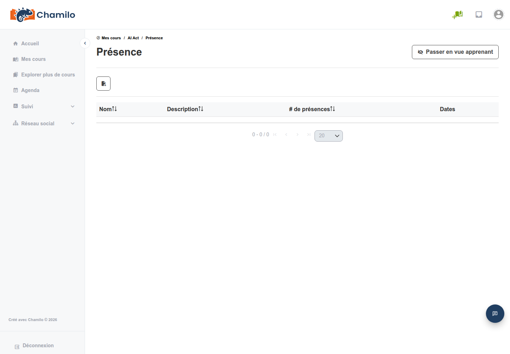

# Présences

L'outil de présences vous permet de suivre la présence des apprenants aux séances de cours planifiées, qu'elles soient en présentiel ou en ligne.

## Créer une feuille de présences

1. Ouvrez l'outil **Présences** depuis la page d'accueil du cours
2. Cliquez sur **Ajouter une feuille de présences** pour créer une feuille de présences
3. Saisissez un **Titre** pour la feuille de présences (par exemple, « Semaine 1 - Introduction »)
4. Saisissez une **Description** (celle-ci est principalement destinée à votre usage — les apprenants ne verront pas la description)
5. Enregistrez

### Paramètres avancés

1. **Exiger une présence unique** vous permet de considérer un apprenant comme pleinement présent s'il a participé ne serait-ce qu'à une seule date de la feuille de présences
2. **Options du carnet de notes** vous permettent de décider de qualifier la feuille de présences dans l'outil d'évaluation (carnet de notes).

## Ajouter des dates

Chaque feuille de présences contient une ou plusieurs dates (séances) pour lesquelles vous enregistrez la présence :

1. Ouvrez une feuille de présences ou poursuivez le processus de création
2. Cliquez sur **Ajouter une date** 
3. Sélectionnez la date et l'heure
4. Facultativement, cochez **Répéter la date** pour choisir une logique de répétition
5. Indiquez une **Durée** en minutes pour l'événement (60 minutes par défaut)
6. Facultativement, sélectionnez un **Groupe** si cette date de présence ne s'applique qu'à un seul groupe d'apprenants
7. Enregistrez

Vous pouvez ajouter plusieurs dates à la même feuille de présences (par exemple, toutes les séances d'un mois).

## Enregistrer les présences

Pour chaque date, marquez chaque apprenant comme :

* **Présent** — L'apprenant a assisté à la séance (valeur par défaut pour tous les apprenants)
* **Absent** — L'apprenant n'a pas assisté à la séance

Cliquez sur la cellule de statut à côté du nom de chaque apprenant pour basculer entre présent et absent.

Par défaut, tous les apprenants sont marqués présents, car nous considérons qu'il y a généralement plus de personnes présentes qu'absentes.

Remarque : les administrateurs peuvent modifier la configuration du portail pour vous permettre de choisir des types de présence plus étendus (retard, absence justifiée, etc.), qui peuvent mieux refléter vos procédures. Dans ce cas, un simple clic sur le champ de présence bascule entre tous les types de présence.

## Consulter les rapports de présences

L'outil de présences affiche :

* Un tableau récapitulatif avec tous les apprenants et toutes les dates
* Le pourcentage de présence de chaque apprenant (séances présentes / séances totales)
* Des indicateurs à code couleur pour une lecture rapide

## Compléments

Les présences disposent de quelques fonctionnalités étendues qui ne sont pas visibles immédiatement :
* Les **Signatures** peuvent être activées afin que les apprenants puissent signer leur présence en classe sur une tablette tenue par l'enseignant
* Des **Commentaires** peuvent être ajoutés par l'enseignant sur la présence de chaque étudiant
* Des **rapports PDF** peuvent être extraits pour se conformer à la réglementation

## Conseils

* **Lier à la progression du cours** — Utilisez les données de présence conjointement avec l'outil Progression du cours pour mettre en relation la présence et la couverture des sujets
* **Exporter les données** — Exportez la feuille de présences pour les dossiers administratifs
* **Définir les attentes** — Si la présence est obligatoire, communiquez clairement la politique dans l'introduction de votre cours ou dans les annonces