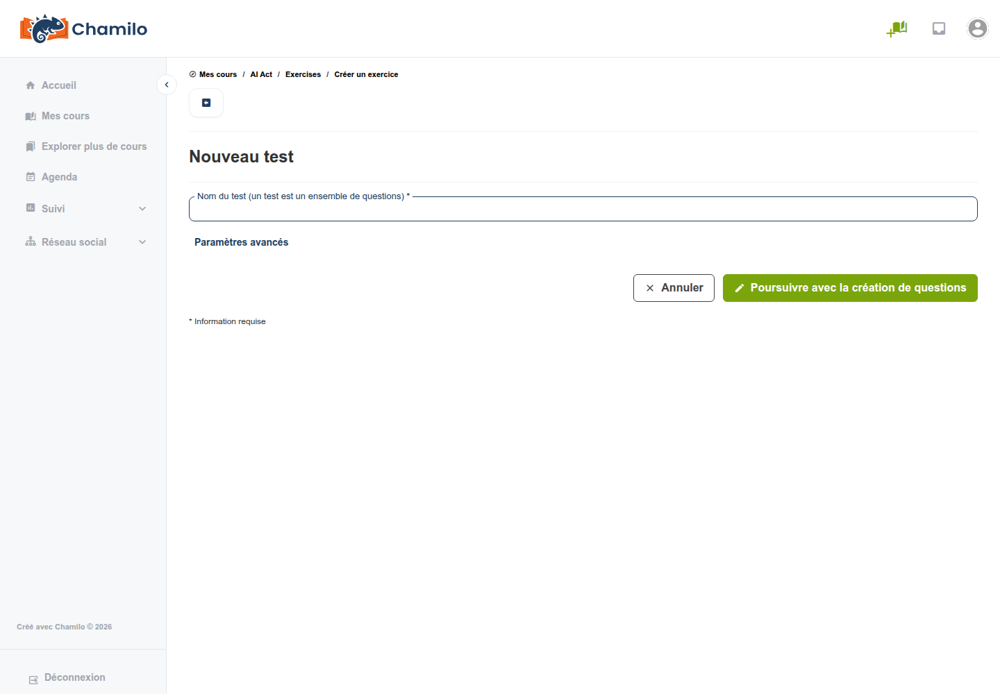
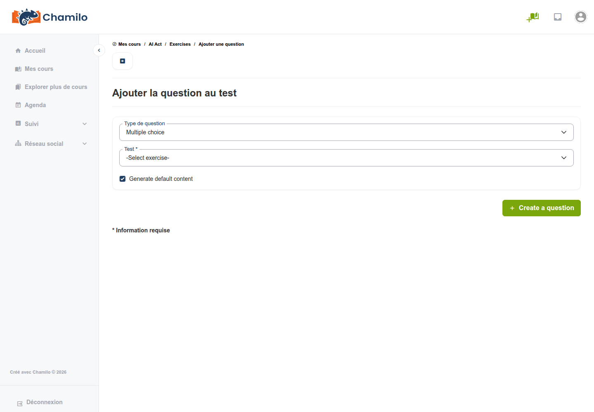

# Exercices

L'outil Exercices (également appelé « tests ») vous permet de créer des quiz et des examens avec une correction automatique. Chamilo prend en charge une grande variété de types de questions, du simple choix multiple aux questions interactives de type zone sensible.

## Créer un exercice

1. Ouvrez l'outil **Exercices**  depuis la page d'accueil du cours
2. Cliquez sur **Nouvel exercice**
3. Saisissez un **titre** et une **description** facultative
4. Configurez les paramètres de l'exercice (voir ci-dessous)
5. Enregistrez, puis ajoutez des questions

## Paramètres de l'exercice

### Affichage et navigation

| Paramètre | Options | Description |
|---------|---------|-------------|
| **Disposition des questions** | Toutes sur une page / Une par page | Afficher toutes les questions en même temps ou une à la fois |
| **Masquer les titres des questions** | Oui / Non | Indique s'il faut afficher les titres des questions aux apprenants |
| **Afficher le bouton précédent** | Oui / Non | Permettre aux apprenants de revenir aux questions précédentes |
| **Empêcher la navigation vers l'arrière** | Oui / Non | Obliger les apprenants à répondre dans l'ordre, sans revenir en arrière |

### Durée et disponibilité

| Paramètre | Description |
|---------|-------------|
| **Limite de temps** | Durée maximale (en minutes) pour terminer l'exercice. Un compte à rebours est affiché à l'apprenant |
| **Date de début** | Moment à partir duquel l'exercice devient disponible pour les apprenants |
| **Date de fin** | Moment à partir duquel l'exercice n'est plus disponible |

### Conditions d'accès

Lorsque l'administrateur active **Conditions d'accès avant un test** (`allow_final_exam_access_rule`), la partie **Tentatives et calendrier** des paramètres avancés affiche un bloc **Conditions d'accès**. Utilisez-le pour maintenir un test, généralement un examen final, fermé jusqu'à ce que l'apprenant soit prêt :

| Paramètre | Description |
|---------|-------------|
| **Temps minimum dans le cours avant de commencer le test (en minutes)** | L'apprenant ne peut commencer le test qu'après avoir passé ce temps dans le cours, tel que le comptabilisent les rapports du cours (le même temps que l'horloge du temps passé dans le cours). 0 ne définit aucun minimum |
| **Champ de profil requis avant de commencer le test** | Un champ du profil de l'apprenant, tel qu'un identifiant étudiant, qui doit d'abord être renseigné. Seuls les champs de texte que les apprenants peuvent modifier sur leur propre profil sont proposés |
| **L'apprenant peut choisir de ne pas renseigner ce champ** | Pose d'abord une question à l'apprenant (**Question posée avant de renseigner le champ**). S'il répond Non, le champ est marqué comme refusé et le test peut commencer |

Tant que les conditions ne sont pas remplies, la page de démarrage du test masque le bouton **Commencer le test** et indique à l'apprenant combien de temps il lui reste à passer dans le cours et quel champ de profil renseigner. L'apprenant renseigne le champ directement sur cette page : il n'accepte que des chiffres (au moins 3). Les enseignants ne sont pas concernés par ces conditions.

Sous les champs, **Conditions d'accès en JSON** affiche, en lecture seule, la règle telle qu'elle sera enregistrée. Cochez **Modifier le JSON** pour l'écrire vous-même : les champs ci-dessus sont alors figés et le JSON est enregistré tel qu'il est écrit, y compris les clés que les champs ne modifient pas (telles que le `source` des règles importées depuis une plateforme plus ancienne). Le JSON doit être un objet comportant au moins `minimum_minutes_before_exam` (un nombre entier de minutes) et `user_identifier_field_variable` (le champ de profil, ou une chaîne vide) ; `allow_user_identifier_opt_out` (true ou false) et `user_identifier_opt_out_prompt` sont facultatifs. Un JSON vide supprime les conditions. Décocher **Modifier le JSON** remplit les champs à partir d'un JSON valide.

### Tentatives et notation

| Paramètre | Description |
|---------|-------------|
| **Nombre maximal de tentatives** | Nombre de fois qu'un apprenant peut passer l'exercice (0 = illimité) |
| **Pourcentage de réussite** | Score minimal pour réussir (par exemple, 70 %). Les apprenants qui n'atteignent pas ce seuil voient un message d'échec |
| **Propager la notation négative** | Indique si les points négatifs des questions individuelles réduisent le score total en dessous de zéro |

### Rétroaction

| Paramètre | Options |
|---------|---------|
| **À la fin** | Afficher les résultats et les bonnes réponses après que l'apprenant a soumis |
| **Immédiate** | Afficher la rétroaction après chaque question (utile pour les exercices d'apprentissage) |
| **Mode examen** | Ne pas afficher de rétroaction ni de résultats |

### Signalements de problèmes sur les questions par les apprenants

Activez **Autoriser les apprenants à signaler des problèmes dans les questions** lorsque vous souhaitez que les apprenants signalent des questions peu claires, incorrectes ou défectueuses pendant une tentative en cours. L'option de signalement n'est affichée qu'aux apprenants et uniquement pour les éléments de question ordinaires.

Un apprenant saisit un commentaire dans **Signaler un problème avec cette question**. Le signalement est associé à cette question et à cette tentative ; il ne modifie ni la réponse ni le score de l'apprenant.

### Affichage des résultats

Contrôlez ce que les apprenants voient après avoir terminé l'exercice :

* Afficher le score et les réponses attendues
* Afficher uniquement le score
* Afficher le score avec une répartition par catégorie
* Afficher le classement parmi les autres apprenants
* Afficher uniquement lors de la dernière tentative
* Afficher une visualisation en graphique radar

### Messages de fin

* **Message de réussite** — Texte personnalisé affiché lorsque l'apprenant réussit
* **Message d'échec** — Texte personnalisé affiché lorsque l'apprenant n'atteint pas le pourcentage de réussite

### Randomisation des questions

| Paramètre | Description |
|---------|-------------|
| **Ordre aléatoire des questions** | Mélanger l'ordre des questions à chaque tentative |
| **Réponses aléatoires** | Mélanger les options de réponse au sein de chaque question |
| **Aléatoire par catégorie** | Sélectionner des questions au hasard dans chaque catégorie de questions |

Vous pouvez également configurer des stratégies de sélection avancées qui combinent catégories et randomisation.

## Types de questions

Chamilo propose un ensemble riche de types de questions, organisés en plusieurs catégories :

### Choix unique

* **Choix multiple (réponse unique)** — L'apprenant sélectionne une seule réponse correcte parmi une liste d'options
* **Réponse unique avec images** — Identique au type précédent, mais les options de réponse sont affichées sous forme d'images

### Choix multiple

* **Réponses multiples** — L'apprenant sélectionne une ou plusieurs réponses correctes
* **Réponses multiples (liste déroulante)** — Les options de réponse sont présentées sous forme de menus déroulants
* **Vrai/Faux** — Une série d'affirmations que l'apprenant marque comme vraies ou fausses
* **Vrai/Faux avec degré de certitude** — Vrai/faux avec un niveau de confiance supplémentaire, permettant une notation plus nuancée

### Texte à trous

* **Texte à trous** — L'apprenant complète les mots manquants dans un texte. Vous définissez les blancs et les réponses acceptées lors de la création de la question.

### Appariement

* **Appariement** — L'apprenant relie des éléments de deux colonnes
* **Appariement (glisser-déposer)** — Même principe, mais avec une interface de glisser-déposer
* **Glisser-déposer** — Faire glisser des éléments vers les positions correctes

### Questions ouvertes

* **Réponse libre (dissertation)** — L'apprenant rédige une réponse textuelle. Nécessite une correction manuelle (ou une correction assistée par IA si elle est configurée)
* **Expression orale** — L'apprenant enregistre une réponse audio à l'aide de son microphone
* **Réponse par téléversement** — L'apprenant téléverse un fichier comme réponse

### Zone sensible

* **Zone sensible** — L'apprenant clique sur des zones précises d'une image pour répondre
* **Délimitation de zone sensible** — L'apprenant trace des contours autour de zones sur une image

### Calculée

* **Réponse calculée** — Questions numériques avec une formule et une marge de tolérance. Utile pour les cours de mathématiques et de sciences.

### Spécial

* **Compréhension écrite** — Évaluations fondées sur la lecture d'un passage
* **Annotation** — L'enseignant téléverse une image et l'apprenant l'annote
* **Réponse dans un document Office** — Lorsque le plugin OnlyOffice est activé, l'apprenant répond à la question en modifiant un document Office intégré (Word, Excel, PowerPoint). Sa réponse est enregistrée dans un fichier distinct, rattaché à l'exercice, afin de pouvoir être examinée avec le reste de sa tentative.

## Ajouter des questions à un exercice

1. Ouvrez l'exercice et cliquez sur **Ajouter une question**
2. Sélectionnez le type de question
3. Saisissez le **texte de la question** (prend en charge le texte enrichi avec images et mise en forme)
4. Définissez les **réponses** et leur notation :
   * Pour chaque option de réponse, indiquez si elle est correcte et combien de points elle vaut
   * Vous pouvez attribuer des points négatifs aux mauvaises réponses afin de décourager les réponses au hasard
5. Ajoutez éventuellement un **retour** — des explications affichées à l'apprenant après sa réponse
6. Définissez le **niveau de difficulté** et la **catégorie** (utiles pour la sélection aléatoire et les rapports)
7. Enregistrez

## Corriger les questions ouvertes

Les questions ouvertes (question ouverte, expression orale, téléversement de fichier, annotation et réponses dans un document Office) sont corrigées manuellement. Ouvrez la tentative de l'apprenant depuis les résultats de l'exercice en mode correction : sous chacune de ces réponses, la zone **Correction de l'enseignant** définit le score et un **Commentaire de l'enseignant**.

Lorsque **Retour audio sur les réponses soumises** (`exercise.allow_teacher_comment_audio`) est activé dans les paramètres de la plateforme, la zone propose également un **Commentaire audio** : cliquez sur **Démarrer l'enregistrement**, parlez, puis sur **Arrêter l'enregistrement**, et écoutez le résultat avant d'enregistrer. L'enregistrement est sauvegardé avec la correction, via **Enregistrer comme brouillon** ou **Enregistrer la correction**. Un nouvel enregistrement remplace le précédent. L'apprenant l'entend à côté du commentaire écrit lorsque l'exercice affiche le retour.

## Consulter les signalements des apprenants

Ouvrez une question dans l'éditeur de questions et développez **Signalements des apprenants**. Chaque signalement indique l'apprenant, l'heure, l'exercice lorsqu'il est disponible, et le commentaire soumis. Lorsque Chamilo peut associer le signalement à la tentative, utilisez **Voir la tentative** pour examiner les réponses environnantes avant de corriger la question.

## Historique des modifications de réponses (technique)

Chamilo 3.1 peut enregistrer les modifications apportées aux réponses pendant une tentative d'exercice, y compris dans le lecteur Vue moderne et dans les flux hérités applicables d'enregistrement des réponses. Le journal est stocké séparément dans `track_e_attempt_log`, ce qui préserve les états antérieurs des réponses sans modifier les réponses finales ni les scores.

Il s'agit d'un enregistrement d'audit interne, **pas** d'un score de question supplémentaire et **pas** d'un visualiseur général de l'historique des réponses dans l'interface enseignant. Le déploiement de cette fonctionnalité nécessite la migration de base de données Chamilo associée. Voir [Historique des réponses aux exercices #9277](https://github.com/chamilo/chamilo-lms/pull/9277).

## Catégories de questions

Vous pouvez organiser les questions en catégories (par exemple, « Module 1 », « Vocabulaire », « Avancé »). Les catégories sont utiles pour :

* Organiser de grandes banques de questions
* Permettre une sélection aléatoire par catégorie (par exemple, « 5 questions du module 1, 3 du module 2 »)
* Consulter les scores ventilés par catégorie dans les rapports

## Réutilisation des questions

Les questions peuvent être réutilisées dans plusieurs exercices au sein du même cours. Lors de l'ajout d'une question, vous pouvez choisir d'en créer une nouvelle ou de sélectionner une question existante dans la banque de questions.

## Importation d'exercices

Chamilo prend en charge l'importation d'exercices à partir de formats externes :

* **IMS QTI / Common Cartridge** — Le format standard de quiz pour l'apprentissage en ligne
* **Format Moodle** — Importer des quiz à partir d'exportations Moodle

Pour importer, recherchez l'option **Importer** dans l'outil Exercices et téléversez votre fichier.

### Interopérabilité IMS QTI 2

Chamilo 3.1 prend en charge un sous-ensemble défini de types de questions IMS QTI 2. Les améliorations récentes couvrent l'**appariement** (`matchInteraction`), y compris les associations correctes, et le **texte à trous**, y compris les blancs saisis (`textEntryInteraction`), les blancs à liste déroulante (`inlineChoiceInteraction`) et leur notation par blanc lorsqu'elle est représentée par le paquet importé.

L'exportateur QTI 2 prend en charge les questions à choix unique, à choix multiple, à combinaison exacte, à réponse libre, d'appariement (y compris l'appariement par glisser-déposer), d'ordonnancement et de texte à trous. Les questions à réponses multiples utilisent le QTI `choiceInteraction` avec `maxChoices="0"`, ce qui permet aux apprenants de sélectionner plus d'une option. Les questions à combinaison exacte n'attribuent le score complet que lorsque exactement les choix corrects sont sélectionnés, et sont réimportées comme questions à combinaison exacte.

**Réponse unique avec « je ne sais pas » (type 10)** utilise un `choiceInteraction` QTI 2.1 avec une seule réponse. Chamilo inclut le choix fixe **Je ne sais pas** avec zéro point et une étiquette `assessmentItem` facultative `chamilo:unique-answer-unknown`. Lorsqu'un paquet produit par Chamilo est réimporté dans Chamilo, cette étiquette rétablit le type 10 et sa réponse fixe. Les questions à choix unique non marquées sont importées comme réponse unique ordinaire (type 1), même lorsqu'un choix indique « Je ne sais pas ». D'autres outils QTI peuvent ignorer ou supprimer l'étiquette ; vérifiez donc le type de question et la notation après les transferts.

L'appariement et l'appariement par glisser-déposer utilisent tous deux le QTI `matchInteraction`. Pour l'appariement par glisser-déposer, Chamilo ajoute l'étiquette `assessmentItem` facultative `chamilo:matching-draggable`. **Les allers-retours QTI 2.1 de Chamilo vers Chamilo préservent l'appariement par glisser-déposer (type 19)** lorsque cette étiquette est présente ; les éléments d'appariement ordinaires ou non marqués sont importés comme appariement standard (type 4). D'autres outils QTI peuvent ignorer ou supprimer l'étiquette facultative ; la présentation par glisser-déposer n'est donc pas garantie lors d'un transfert via un autre outil.

**L'ordonnancement (type 18)** est exporté et importé à l'aide de `orderInteraction` QTI 2.1 avec une réponse ordonnée. Un aller-retour de Chamilo vers Chamilo préserve l'ordre correct, l'orientation horizontale ou verticale et les points de crédit partiel par position. Les outils QTI peuvent utiliser des règles de notation différentes ou omettre cette notation positionnelle ; vérifiez donc les pondérations importées et le score total avant d'utiliser une évaluation.

Les types de questions non pris en charge peuvent être ignorés lors de l'exportation ou de l'importation ; comparez donc le nombre de questions et la notation après chaque transfert.

Pour les évaluations critiques, testez l'archive exportée en l'important dans un cours hors production et en vérifiant les questions et les réponses avant de l'utiliser avec les apprenants. Cela **ne** constitue **pas** une garantie de couverture complète de QTI 2 pour tous les types de questions ou tous les paquets.

## Afficher ou masquer le score maximal de chaque question

Ouvrez la configuration d'un exercice et localisez **Afficher le score maximal par question pendant le test**. Activez cette option lorsque les apprenants doivent voir le nombre maximal de points disponibles pour chaque question pendant un exercice ; désactivez-la lorsque cette information doit rester masquée pendant la tentative.

Cela contrôle la présentation dans le lecteur d'exercices, et non la manière dont les questions sont notées. La valeur configurée est conservée lorsque l'exercice est dupliqué et s'applique à la fois au lecteur moderne et au flux d'exercices hérité pris en charge. Voir [PR sur le score maximal des questions #9362](https://github.com/chamilo/chamilo-lms/pull/9362).

---
## Création d'une copie liée d'un exercice

Dans la liste des exercices, utilisez **Créer un exercice lié** sur un exercice pour lequel cette action est disponible, puis confirmez. Cela crée un autre exercice lié à l'ensemble de questions d'origine plutôt qu'une copie entièrement indépendante. Utilisez une copie indépendante classique lorsque les questions doivent être modifiées sans affecter les exercices associés.

Avant de modifier les questions liées, vérifiez quels autres exercices les réutilisent, afin qu'une modification partagée n'altère pas involontairement une autre évaluation. L'action de copie liée n'est affichée que pour les exercices éligibles. Voir [PR n° 9350 sur la copie d'exercice lié](https://github.com/chamilo/chamilo-lms/pull/9350).

## Conseils

* **Varier les types de questions** — Combinez des questions à choix multiples, des textes à trous et des questions ouvertes pour une évaluation complète
* **Utiliser les catégories** — Organisez les questions par thème afin de permettre une sélection aléatoire ciblée
* **Définir un pourcentage de réussite** — Donnez aux apprenants un objectif clair et reliez-le à la génération de certificats via le Cahier de notes
* **Utiliser un retour immédiat pour l'entraînement** — Créez des exercices d'entraînement non notés avec un retour immédiat afin d'aider les apprenants à apprendre de leurs erreurs
* **Randomiser pour préserver l'intégrité** — Activez l'ordre aléatoire des questions et des réponses afin de réduire les risques de copie