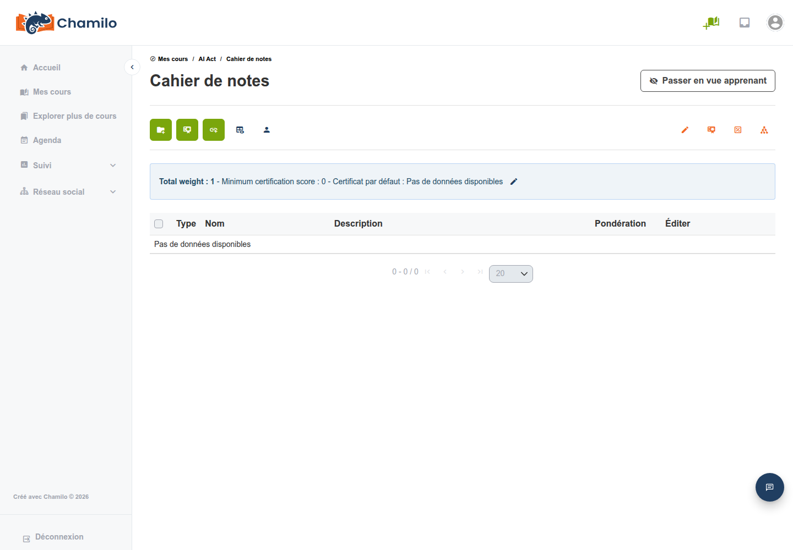
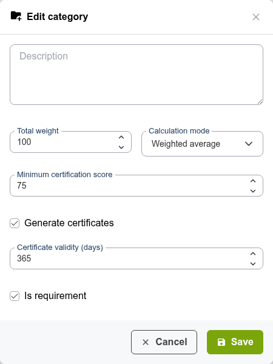

# Évaluations

Les évaluations (anciennement *gradebook*) regroupent les scores des exercices, des travaux et des autres activités notées dans une vue unifiée des résultats de chaque apprenant. Elles contrôlent également la génération des certificats.

## Fonctionnement des évaluations

Les évaluations sont des systèmes de notation pondérée. Vous définissez :

1. **Quelles activités** contribuent à la note (exercices, travaux, présences, etc.)
2. **Le poids** de chaque activité (dans quelle mesure elle compte pour la note finale)
3. **Le score minimum de certification** (le seuil requis pour obtenir un certificat)
4. **Un score minimum par activité** — Chaque activité du carnet de notes peut avoir son propre **Score minimum**. Les apprenants qui obtiennent un score inférieur à ce minimum pour une activité clé peuvent être empêchés d'atteindre les objectifs et d'obtenir le certificat, même si leur total pondéré global est par ailleurs suffisant.

Les activités peuvent être de 2 types :
* **Activité en classe** (ou activité en présentiel), dont les notes doivent être importées depuis une autre source
* **Activité en ligne** sélectionnée dans le cours, dont les notes sont obtenues par la réalisation de l'activité dans le cours

Chamilo calcule la note globale de chaque apprenant à partir de ces poids.

## Configuration de l'évaluation

1. Ouvrez l'outil **Évaluations**  depuis la page d'accueil du cours
2. Vous verrez l'aperçu des évaluations, initialement vide

### Ajout d'activités

1. Cliquez sur **Ajouter une activité en ligne**
2. Choisissez le type :
   * **Test** — Lier un exercice spécifique du cours
   * **Travail** — Lier un dossier de publications d'étudiants
   * **Parcours d'apprentissage** — Lier l'achèvement d'un parcours d'apprentissage
   * **Présences** — Lier une feuille de présences
   * **Fil de discussion du forum** — Lier un fil de discussion du forum (qui doit être noté manuellement)
   * **Enquête** — Lier une enquête
3. Sélectionnez l'activité spécifique dans le type choisi
4. Définissez le **Poids** de cette activité (par exemple, 30 % pour l'examen de mi-parcours, 40 % pour le projet final)
5. Définissez le **Score minimum** le cas échéant
6. Enregistrez

Le poids total de toutes les activités doit s'élever à 100 %.

### Sous-catégories

Pour les barèmes de notation complexes, vous pouvez créer des **sous-catégories** afin de regrouper des activités liées :

* **Exemple** : une sous-catégorie « Devoirs » (poids : 30 %) contenant cinq travaux individuels valant chacun 20 % de la sous-catégorie
* Les sous-catégories vous permettent d'organiser l'évaluation de manière hiérarchique tout en conservant un calcul global simple

## Consultation des notes

L'évaluation affiche un tableau comportant :

* Le nom de chaque apprenant
* Les scores de chaque activité
* Le total pondéré
* Si l'apprenant remplit les conditions pour obtenir un certificat

Vous pouvez trier selon n'importe quelle colonne afin d'identifier rapidement les meilleurs résultats ou les apprenants en difficulté.

### Graphiques de répartition des scores

Sous le tableau, et sur la page **Vue graphique**, l'évaluation trace un diagramme
en barres par activité, plus un pour le total. Chaque graphique est un diagramme en colonnes : l'axe
horizontal liste vos plages de scores de la plus basse à la plus élevée, et la
hauteur de chaque barre correspond au nombre d'apprenants dans cette plage.

Le graphique **Total** indique également la moyenne de la classe. Un point rouge se place sur la plage
qui contient la moyenne, et la légende donne le pourcentage exact.

Ces graphiques n'apparaissent que lorsque les règles d'affichage des scores sont définies. Si vous voyez le
message *To view graph score rule must be enabled*, définissez d'abord vos plages
dans les paramètres de notation de l'évaluation.

## Certificats

Pour activer la génération des certificats :

1. Dans les paramètres de l'évaluation, définissez un **score minimum de certification** (par exemple, 70 %)
2. Lorsque le total pondéré d'un apprenant atteint ou dépasse ce seuil (et qu'il n'a échoué à aucun score minimum par activité), il peut télécharger son certificat
3. Le certificat est généré à partir d'un modèle configuré par l'administrateur de la plateforme

Une fois **Générer les certificats** activé sur la catégorie racine, un champ **Validité du certificat (jours)** apparaît. Laissez-le à `0` pour des certificats qui n'expirent jamais, ou indiquez un nombre de jours après lequel le certificat expire — Chamilo peut alors rappeler aux apprenants l'approche de cette date d'expiration, soit automatiquement (cron, configuré par l'administrateur), soit manuellement depuis la liste des certificats.

Voir [Certificats et compétences](../tracking-and-reporting/certificates-and-skills.md#certificate-validity-and-expiry) pour plus de détails.

## Lien avec les compétences

Vous pouvez associer des **compétences** à l'évaluation. Lorsqu'un apprenant atteint les objectifs définis pour terminer l'évaluation, il peut obtenir un certificat, une compétence, ou les deux. Les compétences sont visibles sur son profil dans l'espace du réseau social. Cela constitue au fil du temps un dossier de compétences.

## Exportation des notes

Cliquez sur le bouton **Exporter**  pour télécharger les notes sous forme de feuille de calcul. Cela est utile pour :

* Partager les notes avec les systèmes administratifs
* Effectuer des analyses complémentaires en dehors de Chamilo
* Conserver des archives hors ligne

### Exportation de la liste Excel : résultats numériques

Dans la **vue liste**, l'exportation Excel (`.xls`) inscrit chaque activité évaluée et le total dans trois colonnes distinctes : **Pourcentage**, **Note** et **Note maximale**. Les valeurs sont des nombres, et non un texte combiné tel que `18 / 20 (90%)`, ce qui vous permet de calculer des totaux, des moyennes et des graphiques dans une feuille de calcul.

Par exemple, un résultat d'activité de 18 sur 20 est exporté sous forme de cellule numérique au format pourcentage (affichée comme **90.00%**), **18** dans la colonne de note et **20** dans la colonne de note maximale. Un apprenant sans résultat enregistré a des cellules de note vides, et non des zéros. Cela s'applique spécifiquement à l'exportation Excel de la liste des évaluations ; cela n'implique pas la même structure de colonnes pour les formats CSV, PDF ou les autres formats d'exportation.

## Jeton de sécurité sur les liens d'action

Certains liens qui modifiaient auparavant des données par une simple requête GET portent désormais un jeton de sécurité propre à la session. Ainsi, un lien copié depuis une ancienne page, un favori ou un lien ouvert depuis un autre site n'exécute plus l'action : l'utilisateur voit la page « non autorisé » (ou, pour les certificats, le message « Jeton de sécurité expiré, rechargez la page »). Rechargez la page et utilisez à nouveau le bouton. Les utilisateurs qui cliquent normalement sur les boutons ne remarquent aucun changement.

* Carnet de notes (pages du cours et « mon carnet de notes ») : supprimer ou afficher/masquer une catégorie, une évaluation ou un lien ; déplacer une catégorie ou une évaluation ; créer les catégories manquantes ; supprimer le résultat d'un apprenant ou l'une de ses tentatives.
* Liste des certificats du carnet de notes : **Générer les certificats**.
* Session > Annonces planifiées : **Envoyer manuellement les annonces en attente**. L'envoi planifié effectué par cron (`app:send-scheduled-announcements` / `main/cron/scheduled_announcement.php`) n'est pas affecté.

## Conserver les noms des apprenants visibles dans la vue à plat

Dans la **vue à plat** des évaluations, les colonnes du prénom et du nom de l'apprenant restent figées tandis que les colonnes d'évaluation défilent horizontalement. Cela facilite l'examen des tableaux de notes larges sans perdre de vue l'apprenant associé à chaque ligne. La modification est uniquement visuelle ; elle ne modifie pas les notes, les pondérations, les calculs ni les exportations. Voir [PR n° 9429 sur les colonnes d'apprenants figées](https://github.com/chamilo/chamilo-lms/pull/9429).

## Conseils

* **Planifiez vos pondérations dès le début** — Définissez le barème de notation au début du cours afin que les apprenants sachent à quoi s'attendre
* **Utilisez des sous-catégories pour les cours complexes** — Regroupez les travaux, les tests et la participation dans des catégories claires
* **Définissez des seuils de réussite significatifs** — La note de certification doit refléter une compétence réelle, et non seulement la participation
* **Vérifiez régulièrement** — Consultez périodiquement le carnet de notes pour vous assurer que toutes les activités sont correctement liées et que les notes sont enregistrées