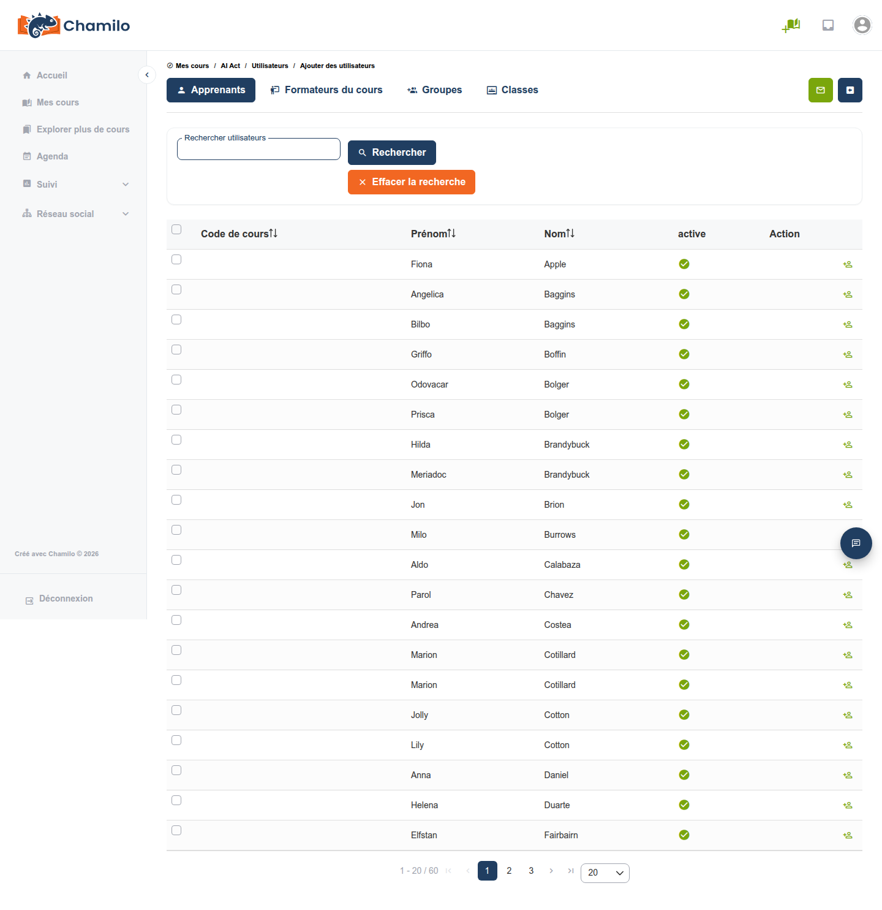
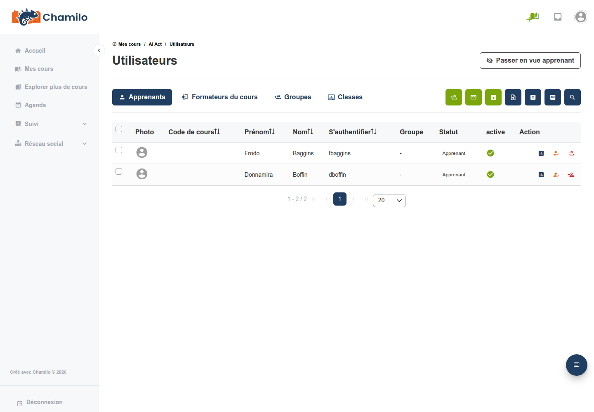
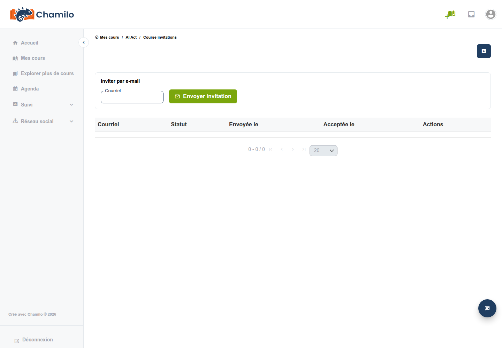

# Inscription des utilisateurs

Avant de pouvoir évaluer un apprenant, celui-ci doit être inscrit à votre cours. Chamilo propose quatre méthodes pour intégrer une personne, selon qui effectue l'inscription et selon que la personne possède déjà un compte sur la plateforme.

| Méthode | Qui l'effectue | Compte existant requis ? |
|--------|-------------|------------------------------|
| [Inscription par l'administrateur](#administrator-enrollment) | Administrateur de la plateforme | Oui |
| [Auto-inscription via le catalogue de cours](#self-enrollment-via-the-course-catalog) | L'apprenant lui-même | Oui |
| [Inscription manuelle via l'outil Utilisateurs](#manual-enrollment-via-the-users-tool) | Enseignant (ou administrateur du cours) | Oui |
| [Invitation d'utilisateurs par e-mail](#inviting-users-by-email) | Enseignant (ou administrateur du cours) | **Non** |

## Inscription par l'administrateur

Un administrateur de la plateforme peut inscrire n'importe quel utilisateur existant à n'importe quel cours directement depuis le panneau d'administration — utile pour un accueil groupé (par exemple l'importation d'une liste de classe) ou lorsqu'un enseignant ne dispose pas des droits nécessaires pour gérer lui-même les inscriptions. Voir la section [Cours](../../admin-guide/courses/README.md) du Guide d'administration.

## Auto-inscription via le catalogue de cours

Si la [visibilité](../creating-your-course/course-settings.md#course-visibility) de votre cours le permet, les apprenants disposant d'un compte sur la plateforme peuvent s'inscrire eux-mêmes en trouvant votre cours dans **Explorer davantage de cours** et en cliquant pour le rejoindre — aucune action de votre part n'est nécessaire. La disponibilité de cette option, et le fait qu'elle exige ou non un mot de passe, sont contrôlés par les **Paramètres d'inscription** dans les [Paramètres du cours](../creating-your-course/course-settings.md#enrollment-settings).

## Inscription manuelle via l'outil Utilisateurs

Pour inscrire une personne qui possède déjà un compte sur la plateforme mais qui ne s'est pas inscrite d'elle-même, ouvrez l'outil **Utilisateurs** de votre cours et cliquez sur l'icône **Ajouter des utilisateurs** .

1. Recherchez la personne par nom, nom d'utilisateur, adresse e-mail ou code officiel
2. Cliquez sur **Inscrire** dans sa ligne, ou sélectionnez-en plusieurs à l'aide des cases à cocher et utilisez le menu **Action** pour les inscrire tous en une seule fois

Seuls les utilisateurs qui ne sont pas déjà inscrits au cours apparaissent dans les résultats.

> Cette icône est disponible par défaut pour les enseignants. Un administrateur de la plateforme peut la restreindre aux seuls administrateurs via le paramètre **Allow User Course Subscription By Course Administrator** (`allow_user_course_subscription_by_course_admin`) — si vous ne voyez pas l'icône **Ajouter des utilisateurs**, contactez votre administrateur.

## Invitation d'utilisateurs par e-mail

Les trois méthodes ci-dessus supposent toutes que la personne possède déjà un compte sur la plateforme. Les **invitations au cours** couvrent le cas où ce n'est pas le cas : vous envoyez une invitation à une adresse e-mail, et Chamilo envoie à cette personne un lien à usage unique. L'ouverture du lien lui permet de créer un compte, et dès qu'elle termine son inscription, elle est automatiquement inscrite à votre cours — aucune étape d'inscription distincte n'est nécessaire.

### Accès à l'outil

Ouvrez l'outil **Utilisateurs** de votre cours, puis cliquez sur l'icône **Inviter par e-mail**  dans la barre d'outils, à côté de **Ajouter des utilisateurs** :

Cela ouvre la page **Invitations au cours**.

### Qui peut envoyer des invitations

* Les administrateurs de la plateforme, toujours.
* Dans un cours simple (non ouvert dans une session) : les enseignants et les autres utilisateurs disposant de droits de modification sur le cours.
* Dans une session : le coach général de la session, ou un administrateur de session — et non l'ensemble plus large des coachs de cours, car l'envoi d'une invitation ici inscrit à la *session entière*, et non uniquement à ce cours.

### Envoi d'une invitation

1. Saisissez l'adresse e-mail du destinataire dans le formulaire **Inviter par e-mail**
2. Cliquez sur **Envoyer l'invitation**

Chaque invitation que vous avez envoyée pour ce cours apparaît sous le formulaire, avec son statut :

| Statut | Signification |
|--------|---------|
| **En attente** | Envoyée, pas encore utilisée. Toujours dans sa période de validité. |
| **Acceptée** | Le destinataire s'est inscrit et a été abonné. |
| **Révoquée** | Vous l'avez annulée avant qu'elle ne soit utilisée. |

Pour une invitation encore en attente, la colonne **Actions** propose :

* **Copier**  — copie le lien d'invitation, au cas où vous préféreriez le partager vous-même (messagerie, en personne) plutôt que de vous fier à l'e-mail.
* **Révoquer**  — annule immédiatement l'invitation ; le lien cesse de fonctionner. Une invitation déjà acceptée ne peut pas être révoquée.

> **L'adresse e-mail invitée ne doit pas déjà disposer d'un compte sur cette plateforme.** Si c'est le cas, l'envoi de l'invitation échoue avec un message vous demandant d'inscrire directement cet utilisateur existant — via [Inscription manuelle via l'outil Utilisateurs](#manual-enrollment-via-the-users-tool) ci-dessus.

### Invitations dans une session

Si vous ouvrez l'outil Utilisateurs depuis un cours qui se déroule au sein d'une session, la page affiche un rappel indiquant que l'invitation s'applique à l'ensemble de la session, et non uniquement à ce cours :

> *Ce cours est ouvert dans une session. L'envoi d'une invitation ici abonnera le destinataire à l'ensemble de la session, et non uniquement à ce cours.*

Cela reflète le fonctionnement de l'inscription ailleurs dans Chamilo : vous abonnez une personne à une session dans son ensemble, ou à un cours autonome, mais jamais à « ce seul cours au sein de cette session » comme action distincte.

### Ce que voit la personne invitée

L'e-mail contient un lien vers la page d'inscription. En l'ouvrant :

* Le champ e-mail est prérempli et verrouillé sur l'adresse que vous avez invitée — la personne ne peut pas s'inscrire sous une autre adresse avec ce lien.
* Elle peut terminer son inscription **même si l'auto-inscription est actuellement désactivée à l'échelle de la plateforme** — à condition que votre administrateur ait activé le paramètre **Autoriser l'inscription via les liens d'invitation aux cours** (voir ci-dessous). Sans cela, un lien d'invitation n'est utile que lorsque l'auto-inscription est par ailleurs ouverte.
* Elle est immédiatement abonnée à votre cours (ou à la session) dès qu'elle envoie le formulaire, et elle est connectée.

Le lien est à usage unique et expire au bout de 7 jours. S'il expire ou si l'invitation ciblée est révoquée, son ouverture se comporte comme si le lien n'avait jamais existé.

> Le paramètre à l'échelle de la plateforme **Autoriser l'inscription via les liens d'invitation aux cours** (`registration.allow_invitation_registration`) détermine si votre lien d'invitation peut ouvrir l'inscription lorsque l'auto-inscription générale est désactivée. Demandez à votre administrateur si les invitations ne semblent pas fonctionner sur une plateforme par ailleurs fermée.

## Conseils

* **Adaptez la méthode à la situation** — inscription par l'administrateur ou auto-inscription pour les personnes qui utilisent déjà la plateforme, inscription manuelle pour un utilisateur existant connu, invitations pour les invités externes, les relecteurs ou toute personne qui n'a pas encore de compte.
* **Révoquez les invitations dont vous n'avez plus besoin** — une ancienne invitation en attente reste un lien valide et inutilisé ; révoquez-la si le destinataire prévu n'a plus besoin d'accès, ou si vous n'êtes pas certain qu'elle lui soit parvenue.
* **Vérifiez auprès de votre administrateur si une méthode semble indisponible** — plusieurs de ces parcours (inscription manuelle, invitations, auto-inscription) peuvent être restreints ou désactivés à l'échelle de la plateforme.