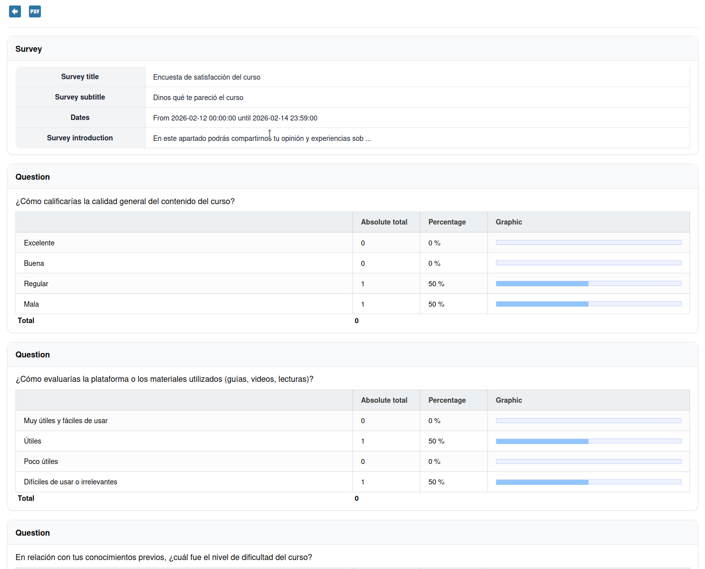

# Enquêtes

L'outil d'enquête vous permet de créer des questionnaires afin de recueillir les retours de vos apprenants. Les enquêtes sont utiles pour les évaluations de cours, les analyses des besoins et les sondages d'opinion.

## Créer une enquête

1. Ouvrez l'outil **Enquêtes**  depuis la page d'accueil du cours
2. Cliquez sur **Créer une enquête**
3. Renseignez les détails de l'enquête :
   * **Code** — Il s'agit d'un code unique pour l'enquête. Il sera utilisé dans les courriels et les liens.
   * **Titre** — Le nom de l'enquête
   * **Sous-titre** — Un intitulé secondaire facultatif
   * **Date de début** — À partir de quand cette enquête sera ouverte à la participation
   * **Date de fin** — Jusqu'à quand cette enquête sera ouverte à la participation
   * **Anonyme** — Indique si les réponses sont anonymes ou associées à des apprenants individuels
   * **Visibilité des résultats** — Qui peut voir les résultats (tuteur uniquement, tuteur et étudiants, tout le monde)
   * **Introduction** — Un message affiché aux apprenants avant qu'ils ne commencent l'enquête
   * **Message de remerciement** — Un message affiché après l'envoi
4. Enregistrer

### Paramètres avancés

* **Note dans l'outil d'évaluation** — Indique s'il faut inclure l'état de réponse de cette enquête dans l'outil d'évaluation (carnet de notes). Toute personne ayant terminé l'enquête obtient 100 %, toute autre personne obtient 0 %
* **Enquête parente** — Peu utilisée à ce stade (fonctionnalité héritée)
* **Une question par page** — Style de présentation des questions
* **Activer le mode mélange** — Indique s'il faut mélanger les questions
* **Afficher le numéro de question** — Indique s'il faut afficher les numéros de question (générés automatiquement)

### Modèles créés par un administrateur

Les administrateurs de la plateforme peuvent créer des **modèles d'enquête** réutilisables avec leurs propres questions. Lorsque l'administrateur rend un modèle **Visible comme modèle**, un enseignant peut le choisir lors de la création d'une enquête dans un cours ou une session autorisé. L'enquête copiée peut ensuite être relue et publiée selon le processus d'invitation habituel. Les enseignants ne peuvent pas attribuer des modèles à d'autres cours ou sessions en dehors de leur contexte d'enseignement.

Les administrateurs peuvent également attribuer un modèle directement à un cours choisi ou à une session contenant ce cours. Consultez [Modèles d'enquête](../../admin-guide/survey-templates.md) pour le processus administrateur (PR #9208, issue #8760).

### Résultats masqués aux enseignants et aux tuteurs

Pour les enquêtes dont les données de réponse doivent rester confidentielles vis-à-vis du personnel enseignant, un administrateur de la plateforme peut activer **Résultats masqués à l'enseignant/tuteur** dans la configuration de l'enquête. Les enseignants et les tuteurs peuvent toujours voir le nombre de réponses et envoyer des rappels, mais **ne peuvent pas ouvrir ni exporter les résultats**. Cette restriction s'applique également aux téléchargements de rapports ; seul un administrateur de la plateforme peut accéder aux résultats restreints. Elle est indépendante de la sélection habituelle **Visibilité des résultats** et du paramètre global du bouton de rapport.

### Modèle de satisfaction de formation

Si vous souhaitez un questionnaire standard de fin de formation, utilisez l'action **Créer une enquête de satisfaction** dans la barre d'outils Enquêtes. Chamilo crée une **enquête de satisfaction de formation** anonyme à partir du modèle intégré de sept questions et ouvre immédiatement son éditeur de questions.

L'enquête est créée dans le contexte du cours ou de la session de cours en cours et n'est pas publiée automatiquement. Relisez ou modifiez d'abord les questions générées, puis publiez-la et choisissez les destinataires de la manière habituelle. Cette action n'est disponible que pour les utilisateurs autorisés à créer des enquêtes, et elle est masquée lorsque la création d'enquêtes est désactivée par la configuration de la plateforme.

## Ajouter des questions

Une fois l'enquête créée, ajoutez des questions :

1. Choisissez le type de question :
   * **Oui/Non** — Un simple choix binaire
   * **Choix multiple** — Sélectionner une réponse parmi plusieurs options
   * **Réponses multiples** — Sélectionner une ou plusieurs réponses parmi plusieurs options
   * **Question ouverte** — Réponse en texte libre
   * **Liste déroulante** — Sélectionner dans une liste déroulante
   * **Pourcentage** — Choisir une valeur en pourcentage
   * **Score** — Noter sur une échelle numérique
   * **Commentaire** — Un bloc de texte (pas une question) pour ajouter des consignes entre les questions
   * **Choix multiple avec option « autre »** — Sélectionner une réponse parmi plusieurs options, avec un choix alternatif
   * **Affichage sélectif** — Type spécial permettant d'adapter le déroulement des questions en fonction des réponses précédentes
   * **Saut de page** — Ajouter des sauts de page dans le déroulement des questions. Utile uniquement si « Une question par page » n'a **pas** été sélectionné à l'étape précédente
2. Configurez le texte de la question et les options de réponse
3. Enregistrer

Chaque question peut être marquée comme obligatoire. Si vous ne le faites pas, ignorer une question sera un comportement acceptable.

## Publication d'une enquête

Après avoir ajouté toutes les questions :

1. Cliquez sur **Publier**
2. Choisissez les destinataires — Sélectionnez des apprenants ou des groupes spécifiques (vous les sélectionnez). Le bouton **Ajouter des apprenants** ajoute tous les apprenants en une seule action et laisse les enseignants de côté
3. Ajouter des utilisateurs supplémentaires — Permet d'inviter des utilisateurs extérieurs à Chamilo à participer à l'enquête. Ils recevront un e-mail contenant un lien et apparaîtront sous leur adresse e-mail dans les détails de l'enquête
4. Objet du message
5. Texte du message — Expliquez l'objet de l'enquête et quand/comment y répondre
6. Différentes options de relance des invitations sont disponibles
7. Confirmer

Les apprenants reçoivent une invitation (par e-mail) pour répondre à l'enquête.

Un lien est disponible au bas de la page de publication pour inviter encore davantage d'utilisateurs externes à participer. Les participants qui utilisent ce lien ne seront pas identifiés et apparaîtront comme anonymes dans les résultats de l'enquête.

## Consultation des résultats

Après que les apprenants ont répondu :

1. Ouvrez l'enquête
2. Cliquez sur **Résultats** ou **Rapport**
3. Consultez les synthèses des réponses :
   * Graphiques et pourcentages pour les questions fermées
   * Réponses textuelles individuelles pour les questions ouvertes
   * Taux de participation (nombre d'invités ayant répondu)

Vous pouvez exporter les résultats vers un tableur pour une analyse plus approfondie.

## Conseils

* **Restez concis** — Les apprenants sont plus susceptibles de terminer des enquêtes plus courtes
* **Utilisez le mode anonyme** — Pour obtenir des retours sincères, activez les réponses anonymes
* **Choisissez le bon moment** — Envoyez des enquêtes en cours de formation pour pouvoir ajuster, et pas seulement des évaluations de fin de formation