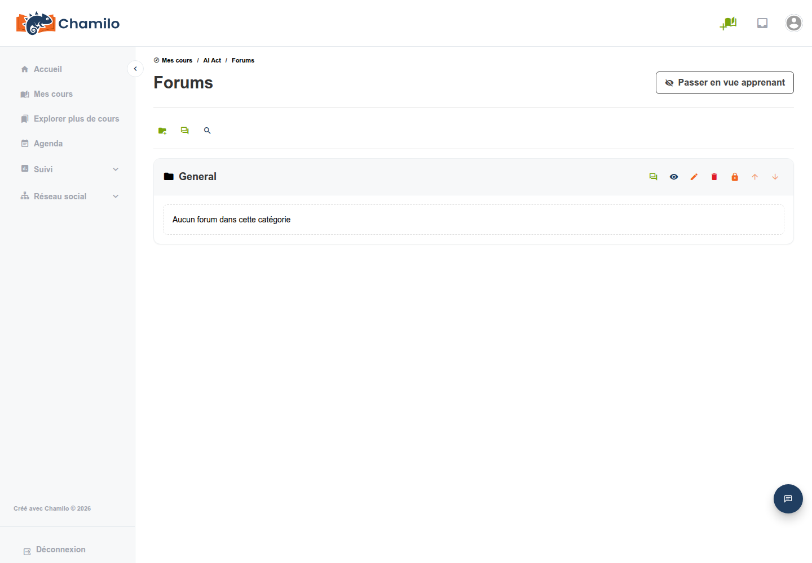

# Forums

L'outil forum vous permet d'héberger des discussions structurées au sein de votre cours. Les apprenants peuvent publier des messages, se répondre mutuellement et participer à des conversations en fils de discussion.

## Structure du forum

Les forums dans Chamilo sont organisés en trois niveaux :

1. **Catégories de forums** — Regroupements de premier niveau (par ex. « Discussions générales », « Questions du module 1 »)
2. **Forums** — Espaces de discussion individuels au sein d'une catégorie
3. **Sujets (fils de discussion)** — Sujets de discussion individuels au sein d'un forum, chacun comportant une chaîne de réponses

## Création d'une catégorie de forum

1. Ouvrez l'outil **Forums**  depuis la page d'accueil de votre cours
2. Cliquez sur **Ajouter une catégorie de forum**
3. Saisissez un **Nom de catégorie** et une description facultative
4. Enregistrez

## Création d'un forum

Vous ne pouvez ajouter un forum que lorsqu'au moins une catégorie existe.

1. Au sein d'une catégorie, cliquez sur **Ajouter un forum**
2. Renseignez les informations de base :
   * **Titre** — Le nom de cet espace de discussion
   * **Description** — Une description facultative de l'objet du forum
   * **Créer dans la catégorie** — La catégorie à laquelle ce forum appartient
3. Ouvrez **Paramètres avancés** pour configurer :
   * **Date de publication** / **Date de clôture** — Fenêtre temporelle facultative pendant laquelle le forum est ouvert
   * **Forum modéré** — Exiger que les nouveaux messages soient approuvés par un enseignant avant de devenir visibles
   * **Les apprenants peuvent-ils modifier leurs propres messages ?** — Autoriser ou empêcher les apprenants de modifier leurs messages après les avoir soumis
   * **Autoriser les utilisateurs à créer de nouveaux fils** — Lorsqu'il est défini sur Non, les apprenants ne peuvent que répondre aux fils existants
   * **Type d'affichage par défaut** — Choisissez comment les messages sont affichés : **Plat**, **En fils** ou **Imbriqué**
   * **Pour le groupe** — Associer ce forum à un groupe de cours
   * **Accès public / Accès privé** — Pour les forums de groupe, décider si tout membre du cours peut le lire ou uniquement les membres du groupe
4. Enregistrez

Si la visibilité du cours est définie sur « Ouvert au monde », le formulaire affiche également une option **Autoriser les messages anonymes ?**. Cette option est masquée dans les cours à visibilité restreinte.

## Gestion des sujets

Les apprenants (et vous) peuvent créer de nouveaux sujets au sein d'un forum. En tant qu'enseignant, vous pouvez :

* **Épingler un sujet (message épinglé)** — Marquer un fil comme épinglé lors de sa création ou de sa modification afin qu'il apparaisse toujours en haut
* **Verrouiller un sujet** — Empêcher toute nouvelle réponse
* **Modifier ou supprimer des messages** — Modérer la discussion
* **Déplacer un sujet** — Transférer un sujet vers un autre forum
* **Lister les messages du plus récent** — Un fil liste ses messages du plus ancien. Le bouton flèches de la barre d'outils du fil (**Plus récents d'abord**) les liste du plus récent, afin de suivre l'activité récente d'un long fil ; cliquez à nouveau (**Plus anciens d'abord**) pour revenir en arrière. Dans les vues en fils et imbriquée, les réponses de chaque message sont listées du plus récent. Les apprenants lisent toujours le fil à partir du message le plus ancien, et dans un parcours d'apprentissage tout le monde voit d'abord les messages les plus récents.

Sur les fils très longs, votre plateforme peut n'afficher qu'une partie des messages de chaque fil à tout le monde, à l'exception des administrateurs de la plateforme — vous y compris — lorsque l'administrateur définit **Nombre maximal de messages affichés dans un fil de forum** (`thread_max_posts_for_non_admins`, voir [Paramètres des forums](../../admin-guide/platform-settings/forum-settings.md)). Dans les vues en fils et imbriquée, la limite s'applique aux réponses de chaque message : vous voyez les premières réponses dans l'outil Forums, et les plus récentes dans un parcours d'apprentissage, où la limite s'applique également aux administrateurs. Lister les messages du plus récent vous montre les plus récents à la place. Demandez à un administrateur si vous devez lire les autres messages d'un tel fil.

## Notation des forums

Lors de la création d'un nouveau fil en tant qu'enseignant, vous pouvez activer **Noter ce fil** dans les paramètres avancés. Vous définissez ensuite une note maximale, un en-tête de colonne pour le carnet de notes et un poids dans le rapport. Vous pouvez également activer **Fil noté par les pairs**, ce qui exige que chaque apprenant évalue au moins deux autres apprenants avant que sa propre note ne soit prise en compte.

Pour noter, cliquez sur **Noter le fil** sur le fil dans la liste des fils du forum. La fenêtre liste les apprenants qui ont publié dans le fil, avec un champ de note pour chacun. Cliquez sur le nom d'un apprenant pour ouvrir sa participation avant de la noter : le nombre d'utilisateurs du cours, le nombre de messages dans le fil, combien d'entre eux sont ceux de l'apprenant et sa part du fil, puis chaque message rédigé par l'apprenant, avec ses pièces jointes. Vous pouvez également enregistrer la note de l'apprenant depuis cette fenêtre. Une corbeille rouge à côté de chaque message le supprime après confirmation, par exemple pour retirer un message hors sujet ou en double avant la notation ; les compteurs sont mis à jour, et un apprenant qui ne conserve aucun message disparaît de la liste. La corbeille n'est plus affichée une fois que le carnet de notes a verrouillé la note du fil.

## Exigences de participation et informations sur les catégories

Les administrateurs peuvent éventuellement activer trois comportements à l'échelle des forums sous **Administration > Paramètres de configuration > Forums** :

* **Afficher les réponses du fil uniquement après participation** (`show_thread_replies_after_participation`) — Un apprenant voit le message d'ouverture du fil, mais pas les réponses des autres personnes tant qu'il n'a pas publié un message. Les enseignants, les administrateurs, les coachs de session et les tuteurs de groupe ne sont pas soumis à cette restriction. Un message d'apprenant en attente de modération compte toujours comme une participation, bien que les règles habituelles de modération s'appliquent toujours.
* **Afficher la description de la catégorie de forum dans les fils** (`show_category_description_in_thread`) — Le titre de la catégorie et un extrait de sa description apparaissent au-dessus de la discussion. **Lire la suite** développe les descriptions longues.
* **Messages requis pour terminer un fil de forum** (`thread_participation_progress_posts`) — Lorsqu'elle est supérieure à `0`, une barre de progression affiche le nombre de messages d'un apprenant par rapport à l'objectif configuré. Les messages en attente de modération sont comptabilisés. La définir sur `0` masque la barre.

L'objectif de progression est un indicateur informatif, **et non** le seuil de déverrouillage des réponses : si les réponses conditionnées à la participation sont activées, publier une fois suffit à lever cette restriction. Ces paramètres sont désactivés par défaut. Voir [Paramètres des forums](../../admin-guide/platform-settings/forum-settings.md).

Ces trois paramètres s'appliquent à tous les cours de la plateforme, sauf si l'administrateur active également **Les paramètres de participation aux forums peuvent être modifiés par cours** (`forum_participation_can_be_modified_in_course`). Chaque cours choisit alors ses propres valeurs dans la section **Paramètres du forum** de ses [paramètres de cours](../creating-your-course/course-settings.md#forum-settings) — par exemple pour masquer les réponses jusqu'à ce que les apprenants publient dans certains cours seulement, tandis que les paramètres de la plateforme restent désactivés. Un cours qui conserve **Utiliser le paramètre de la plateforme** suit la valeur de la plateforme.

## Discussions de forum dans un parcours d'apprentissage

Lorsque les apprenants ouvrent une discussion de forum **depuis une étape de parcours d'apprentissage**, ses réponses sont affichées **de la plus récente à la plus ancienne**. Dans les vues en fils et imbriquées, le message d'ouverture reste en haut et les dernières réponses apparaissent juste en dessous, chaque réponse étant suivie de ses propres réponses, également de la plus récente à la plus ancienne — afin que les apprenants voient leur réponse juste après l'avoir publiée. Un message sans parent dans le fil est affiché comme une réponse au message d'ouverture. La navigation habituelle dans le forum, en dehors du parcours d'apprentissage, conserve son ordre normal. La page du forum masque les actions redondantes **Retour aux fils** et **Retour au parcours d'apprentissage** dans ce contexte intégré ; les apprenants doivent utiliser la navigation du lecteur de parcours d'apprentissage pour passer à une autre étape.

Si les apprenants ouvrent la même discussion depuis l'outil **Forums** habituel, ils utilisent la navigation normale du forum et l'ordre chronologique des messages. Ce comportement contextuel a été corrigé dans la [PR #9163](https://github.com/chamilo/chamilo-lms/pull/9163).

## Notifications

Chaque forum et chaque fil dispose d'un interrupteur **M'avertir** que vous et vos apprenants pouvez utiliser pour vous abonner aux notifications par e-mail concernant les nouveaux messages. Les notifications sont un abonnement par utilisateur et ne sont pas configurées lors de la création du forum.