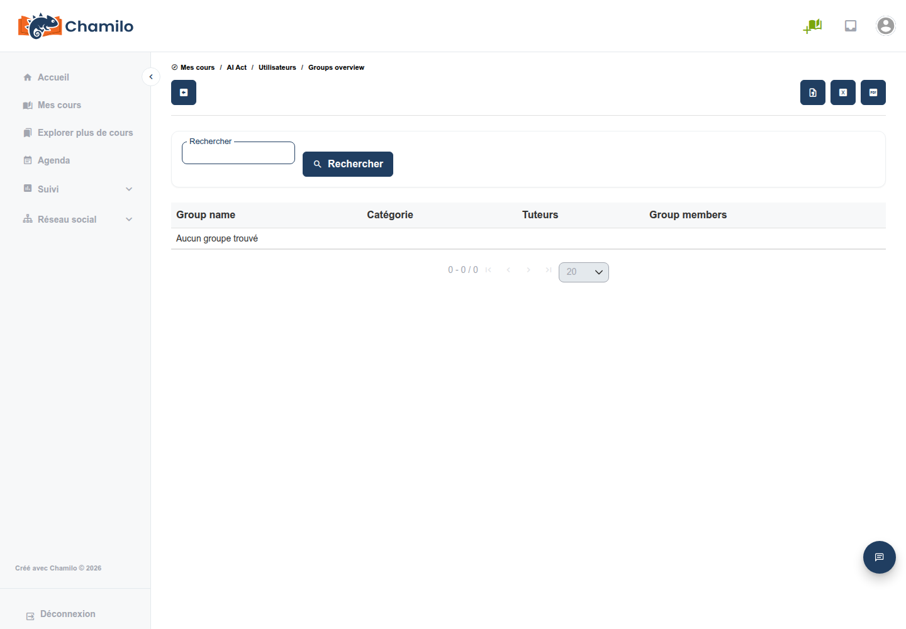

# Groupes

Les groupes vous permettent de répartir vos apprenants en équipes plus petites pour le travail collaboratif. Chaque groupe peut disposer de ses propres outils partagés, tels que des documents, des forums et un wiki.

## Création de groupes

1. Ouvrez l'outil **Groupes** depuis la page d'accueil du cours
2. Cliquez sur **Créer des groupes**
3. Configurez les paramètres des groupes :
   * **Nombre de groupes** — Nombre de groupes à créer
   * **Nombre maximal de membres par groupe** — Limite de taille de chaque groupe (0 pour illimité)
   * **Auto-inscription** — Indique si les apprenants peuvent rejoindre des groupes par eux-mêmes
   * **Auto-désinscription** — Indique si les apprenants peuvent quitter un groupe par eux-mêmes

## Outils de groupe

Chaque groupe peut avoir accès à un sous-ensemble d'outils du cours, partagés uniquement entre les membres du groupe :

* **Documents** — Un espace de fichiers partagé pour le groupe
* **Forum** — Un forum de discussion propre au groupe
* **Wiki** — Un wiki collaboratif pour le groupe
* **Chat** — Un espace de discussion instantanée pour le groupe
* **Agenda** — Événements de calendrier limités au groupe
* **Annonces** — Envoyer des annonces uniquement aux membres du groupe
* **Travaux** — Recueillir les travaux du groupe

Pour chaque outil, vous pouvez choisir son niveau d'accès : **Non disponible**, **Public** (tout membre du cours) ou **Privé** (membres du groupe uniquement). Ces paramètres peuvent être appliqués au niveau de la catégorie de groupes, de sorte que plusieurs groupes de la même catégorie partagent la même configuration d'outils.

## Gestion des membres du groupe

Vous pouvez gérer l'appartenance aux groupes de plusieurs façons :

* **Affectation manuelle** — Ajouter des apprenants spécifiques à chaque groupe
* **Remplir les groupes sélectionnés** — Répartir automatiquement les apprenants non inscrits dans les groupes sélectionnés, en respectant la capacité de chaque groupe et la limite de groupes par utilisateur
* **Auto-inscription** — Permettre aux apprenants de choisir leur propre groupe
* **Importer depuis les classes** — Créer automatiquement des groupes à partir des classes déjà inscrites au cours

Pour gérer manuellement les membres, cliquez sur le nom d'un groupe, puis utilisez la section **Membres** pour ajouter ou retirer des apprenants.

## Tuteurs de groupe

Vous pouvez attribuer des **tuteurs** aux groupes. Un tuteur est généralement un apprenant ou un assistant qui aide à gérer le travail du groupe. Les tuteurs peuvent disposer de permissions supplémentaires au sein du groupe, comme la modération du forum du groupe.

## Suivi du travail de groupe

En tant qu'enseignant du cours, vous pouvez accéder à tous les groupes et à leurs outils partagés, indépendamment de votre appartenance. Cela vous permet de :

* Consulter les documents déposés par chaque groupe
* Lire les discussions des forums de groupe
* Vérifier les contributions au wiki
* Évaluer la collaboration au sein du groupe