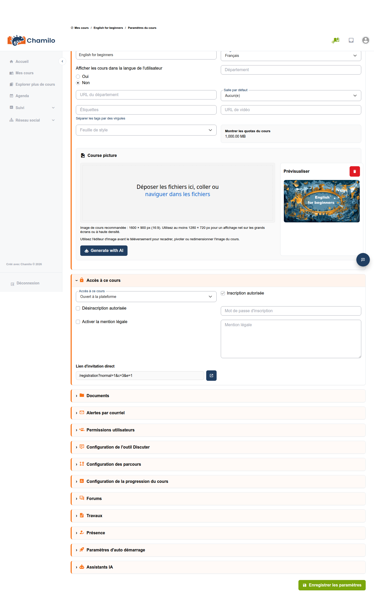

# Paramètres du cours

Les paramètres du cours vous permettent de contrôler le comportement de votre cours — qui peut y accéder, comment il apparaît et quelles fonctionnalités sont activées.

Pour accéder aux paramètres du cours, entrez dans votre cours et cliquez sur l’icône **Paramètres**  située à côté du bouton **Passer en vue étudiant**.

## Paramètres généraux

### Informations sur le cours

* **Titre du cours** — Le nom d’affichage de votre cours
* **Langue du cours** — La langue principale de l’interface du cours
* **Catégorie du cours** — La catégorie sous laquelle le cours apparaît dans le catalogue
* **Image du cours** — Téléversez une vignette qui représente votre cours dans les listes de cours (elle sera redimensionnée selon le contexte)

Le code du cours (l’identifiant unique court) est défini lors de la création du cours et n’est pas modifiable depuis cette page.

Par défaut, tous les utilisateurs qui entrent dans votre cours voient l’ensemble de l’interface Chamilo dans la langue de votre cours. Il s’agit d’une fonctionnalité immersive. Les administrateurs peuvent modifier ce comportement, mais vous pouvez également le changer grâce à l’une des premières options : **Afficher le cours dans la langue de l’utilisateur** (définie sur Non par défaut) si vous estimez que cela rend l’utilisation trop difficile pour vos utilisateurs.

Le département et l’URL du département sont des champs obsolètes. Ils ne sont conservés que pour des raisons de compatibilité avec les versions antérieures.

Si l’option est activée, vous pouvez changer le style à l’intérieur de votre cours grâce à l’option **Feuilles de style**, en utilisant les feuilles de style existantes sur votre portail. Cette option est souvent désactivée par les administrateurs, afin d’obtenir une conception globale plus intégrée.

### Quota disque

Chaque cours dispose d’une limite de stockage (quota disque) pour les fichiers téléversés. Le quota est défini par l’administrateur de la plateforme. Vous pouvez consulter votre limite actuelle dans les paramètres du cours, et l’utilisation actuelle dans l’outil **Documents**.

> Si vous manquez d’espace, contactez l’administrateur de votre plateforme pour demander une augmentation du quota, ou supprimez les fichiers inutilisés dans l’outil Documents.

### Visibilité du cours

Contrôlez qui peut accéder à votre cours :

| Paramètre | Description |
|---------|-------------|
| **Public** | Toute personne, y compris les visiteurs anonymes, peut accéder au cours |
| **Ouvert à la plateforme** | Tous les utilisateurs inscrits sur la plateforme peuvent accéder au cours |
| **Privé — accès accordé par des utilisateurs privilégiés** | Seuls les utilisateurs explicitement inscrits au cours peuvent y accéder |
| **Fermé** | Le cours est verrouillé ; personne ne peut y accéder, sauf l’enseignant |

#### Paramètres d’inscription

Selon la configuration de votre plateforme, vous pouvez contrôler :

* **Autoriser l’auto-inscription** — Indique si les apprenants peuvent s’inscrire eux-mêmes via le catalogue de cours
* **Autoriser le désabonnement autonome** — Indique si les apprenants peuvent quitter le cours de leur propre initiative
* **Mot de passe d’inscription** — Exiger un mot de passe pour l’auto-inscription (utile pour restreindre l’accès à un groupe spécifique), mais le niveau de sécurité est faible, car le même mot de passe d’accès au cours est partagé entre tous les utilisateurs.

Ces paramètres ne concernent que l’auto-inscription. Pour une vue d’ensemble — y compris l’inscription par vous-même d’un utilisateur existant, ou l’invitation d’une personne qui ne dispose pas encore d’un compte sur la plateforme — voir [Inscrire des utilisateurs](../assessing-learners/subscribing-users.md).

### Paramètres des documents

Choisissez d’afficher ou de masquer les dossiers système dans l’outil **Documents** (masqués par défaut ; vous n’en avez généralement pas besoin dans la plupart des cas, et les afficher peut poser des problèmes avec le contenu masqué et les apprenants).

* **Visibilité par défaut des nouveaux documents** — Décidez si les documents, dossiers et fichiers que vous créez ou téléversez sont visibles immédiatement pour les apprenants, ou invisibles jusqu’à ce que vous les publiiez. Cette option n’apparaît que lorsque l’administrateur de la plateforme autorise chaque cours à choisir ; sinon, la valeur par défaut de la plateforme s’applique (visible, sauf modification).

### Paramètres de notification par e-mail

Configurez la manière dont l’activité du cours déclenche des notifications :

* **Notifications par e-mail pour les nouveaux contenus** — Informer les utilisateurs inscrits lorsque vous ajoutez de nouveaux documents, des annonces ou d’autres contenus

### Paramètres du chat

Contrôlez la manière dont l’outil **Chat** s’affiche.

### Paramètres des parcours d’apprentissage

* **Activer les thèmes de cours** — Permettre aux parcours d’apprentissage de modifier l’apparence (non recommandé pour une expérience utilisateur intégrée)
* **Lien de retour du parcours d’apprentissage** — Décidez où les utilisateurs arrivent lorsqu’ils cliquent sur l’icône **Accueil** dans un parcours d’apprentissage : la liste des parcours d’apprentissage, la page d’accueil du cours, *Mes cours*, *Mes sessions* ou la page d’accueil du portail
* **Visibilité par défaut des nouveaux parcours d’apprentissage** — Décidez si un parcours d’apprentissage que vous créez (ou importez depuis un paquet SCORM) est visible immédiatement pour les apprenants, ou invisible jusqu’à ce que vous le publiiez. Cette option n’apparaît que lorsque l’administrateur de la plateforme autorise chaque cours à choisir ; sinon, la valeur par défaut de la plateforme s’applique (invisible, sauf modification).

### Paramètres des tests

* **Visibilité par défaut des nouveaux tests** — Décidez si un test que vous créez (ou importez) est visible pour les apprenants immédiatement, ou invisible jusqu’à ce que vous le publiiez. Cette section n’apparaît que lorsque l’administrateur de la plateforme autorise chaque cours à choisir ; sinon, la valeur par défaut de la plateforme s’applique (visible, sauf modification).

### Paramètres de l’avancement thématique

Configurez la manière dont les messages d’avancement thématique apparaîtront sur la page d’accueil du cours.

### Paramètres du forum

Contrôlez le comportement de l’outil forum de ce cours.

Lorsque l’administrateur de la plateforme autorise chaque cours à les choisir (`forum_participation_can_be_modified_in_course`), cette section affiche également les options de participation au forum. Sinon, les paramètres de la plateforme s’appliquent à tous les cours, comme décrit dans [Forums](../collaboration-and-communication/forums.md#participation-requirements-and-category-information).

* **Afficher les réponses du fil uniquement après participation** — **Oui** pour n’afficher aux apprenants que le message d’ouverture d’un fil tant qu’ils n’y ont pas publié, **Non** pour toujours afficher toutes les réponses, ou **Utiliser le paramètre de la plateforme**
* **Afficher la description de la catégorie de forum dans les fils** — **Oui** pour afficher le titre et une description abrégée de la catégorie de forum en haut de chaque fil, **Non** pour les masquer, ou **Utiliser le paramètre de la plateforme**
* **Messages requis pour terminer un fil de forum** — Le nombre de messages qu’un apprenant doit rédiger dans un fil pour que sa barre de progression de participation atteigne 100 %. Définissez `0` pour masquer la barre, ou laissez vide pour utiliser le paramètre de la plateforme

### Paramètres des travaux

* **Paramètre par défaut pour la visibilité des fichiers nouvellement publiés** — Décidez si les nouveaux documents déposés par les apprenants dans l’outil **Travaux** sont partagés avec tous les autres apprenants (Non par défaut)
* **Autoriser les apprenants à supprimer leurs propres publications** — Autorisez les apprenants à supprimer les travaux qu’ils ont déjà déposés (au cas où ils souhaiteraient déposer une correction).

### Temps passé dans le cours

Lorsque l’administrateur de la plateforme autorise chaque cours à le choisir (`show_clock_time_spent_can_be_modified_in_course`), cette section vous permet de décider si les apprenants voient, sur chaque page du cours, y compris les parcours d’apprentissage, une horloge indiquant le temps total qu’ils ont passé dans le cours. Sinon, le paramètre de la plateforme (`show_clock_time_spent_on_all_course_page_for_learner`) s’applique à tous les cours.

* **Afficher aux apprenants le temps passé dans le cours** — **Oui** pour afficher l’horloge aux apprenants de ce cours, **Non** pour la masquer, ou **Utiliser le paramètre de la plateforme**

L’horloge apparaît en bas à gauche de la page. Elle indique le temps enregistré par le suivi du cours, le même que dans les rapports du cours, et cesse de compter lorsque l’apprenant est resté inactif plus longtemps que ce que la plateforme autorise. Les enseignants ne la voient jamais, même dans la vue apprenant.

### Paramètres de lancement automatique

Un cours peut être configuré pour adopter un comportement de lancement automatique, ce qui raccourcit le chemin des apprenants pour accéder aux parties importantes de votre cours. Si cette option est activée, les apprenants qui entrent dans votre cours sont envoyés directement vers l’outil sélectionné et ne voient pas la page d’accueil du cours comme étape intermédiaire. Vous pouvez même sélectionner des parcours d’apprentissage ou des exercices spécifiques à lancer à l’arrivée dans le cours. Dans ce cas, vous devez sélectionner l’option ici, puis aller à la liste des parcours d’apprentissage ou des exercices et cliquer sur l’icône fusée  de l’élément sélectionné.

### Paramètres des assistants IA

Cette section n’apparaît que si votre administrateur a activé les outils d’IA sur la plateforme. Elle vous permet d’affiner la sélection des services d’assistance par IA disponibles dans les différents outils de votre plateforme Chamilo. Désactivez-les si vous ne souhaitez pas les utiliser, mais ce serait probablement une mauvaise idée, car ils sont très puissants.

Ces fonctionnalités sont expliquées dans la section **Outils d’IA** de ce guide.

### Outils externes (LTI)

S’ils sont activés sur votre plateforme, Learning Tools Integration vous permet d’intégrer à ce cours des activités externes compatibles, sous forme d’icônes individuelles sur la page d’accueil du cours. L’explication de LTI dépasse le cadre de ce guide, mais il s’agit d’un système d’intégration puissant pour les enseignants.

### Autres

Des sections ou options supplémentaires peuvent apparaître sur cette page selon les options et les versions de Chamilo.