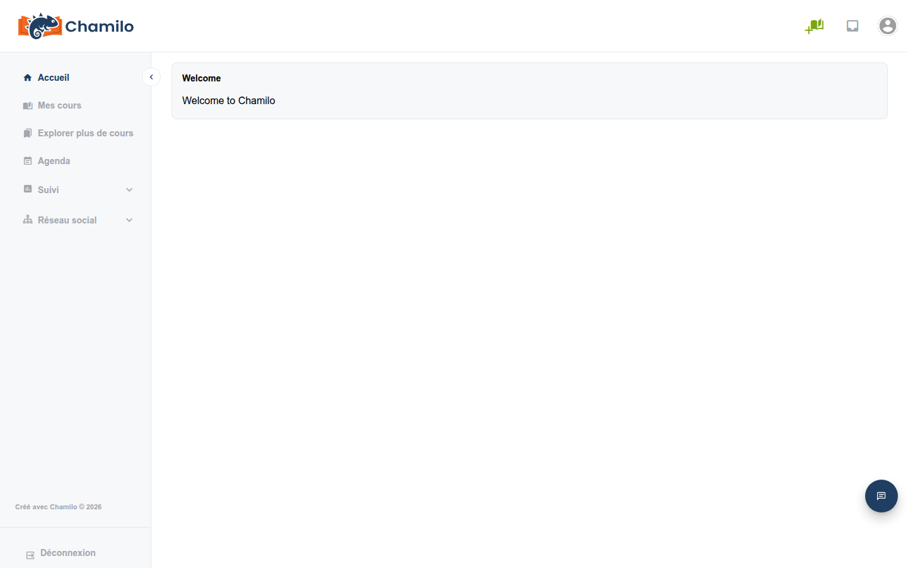
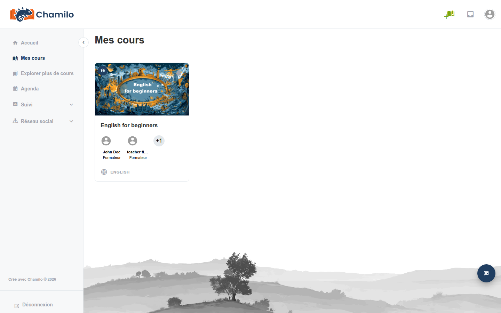

# Premiers pas

Cette section vous aide à vous familiariser avec Chamilo 3.0. Vous apprendrez à vous connecter, à naviguer dans l'interface principale et à configurer votre profil.

## Connexion

Pour accéder à Chamilo, ouvrez votre navigateur et accédez à l'URL fournie par votre établissement (par exemple, `https://chamilo.yourschool.edu`). Saisissez votre nom d'utilisateur et votre mot de passe sur la page de connexion, puis cliquez sur **Se connecter**.

Si votre établissement utilise une authentification externe (telle qu'Azure, Keycloak ou un système d'authentification unique universitaire), des boutons de connexion supplémentaires peuvent apparaître sous le formulaire de connexion standard. Cliquez sur le bouton approprié pour vous authentifier via le fournisseur d'identité de votre établissement.

> Si vous avez oublié votre mot de passe, cliquez sur le lien **Mot de passe oublié ?** de la page de connexion. Vous recevrez un e-mail contenant les instructions pour le réinitialiser.

## Premier aperçu

Après vous être connecté, vous verrez la page d'accueil de Chamilo. L'interface est organisée en trois zones principales :

* **Barre supérieure** — Affiche le logo de la plateforme, votre boîte de réception (avec un badge indiquant les messages non lus) et votre avatar utilisateur. Cliquez sur votre avatar pour accéder à votre profil et aux paramètres de votre compte.
* **Barre latérale** — Le panneau de navigation de gauche vous donne un accès rapide à vos cours, sessions, agenda, réseau social, et plus encore. Vous pouvez la réduire en cliquant sur le bouton bascule situé sur son bord.
* **Zone de contenu principal** — C'est ici que s'affiche le contenu de la page en cours. Sur la page d'accueil, vous verrez les annonces système et vos cours mis en avant.

## Vos cours

Dans la barre latérale, cliquez sur **Mes cours** pour voir tous les cours auxquels vous êtes inscrit en tant qu'enseignant ou étudiant. Chaque cours apparaît sous forme de carte affichant :

* L'image ou la vignette du cours
* Le titre du cours
* Les actions d'accès rapide

Si votre établissement utilise des **sessions** (périodes de formation limitées dans le temps), vous verrez également un lien **Mes sessions** dans la barre latérale, organisé en sessions en cours, passées et à venir.

Les sessions dans Chamilo permettent de proposer le même cours à différents groupes d'apprenants à des moments différents, sans dupliquer le contenu du cours. Considérez une session comme une édition planifiée ou une cohorte d'un cours. Nous reviendrons sur ce sujet plus tard.

## Prochaines étapes

* [Comprendre l'interface](understanding-the-interface.md) — Un examen détaillé de chaque partie de l'interface de Chamilo
* [Votre profil](your-profile.md) — Comment gérer vos informations personnelles et vos préférences
* [Cours de démonstration](demo-courses.md) — Les deux cours prêts à l'emploi (AI Act et Using Chamilo) inclus dans chaque nouvelle installation