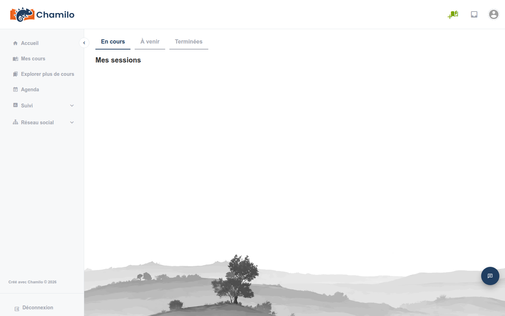

# Sessions

Les sessions dans Chamilo permettent de proposer le même cours à différents groupes d'apprenants à des moments différents, sans dupliquer le contenu du cours. Considérez une session comme une édition planifiée ou une cohorte d'un cours.

## Fonctionnement des sessions

Un **cours** est un conteneur de contenus et d'outils. Une **session** attribue ce cours à un groupe spécifique d'apprenants pour une période donnée. Cela signifie :

* Le même cours peut être réutilisé dans plusieurs sessions
* Chaque session possède ses propres apprenants inscrits ainsi que ses propres dates de début et de fin
* Chaque session possède ses propres résultats — les notes, la progression et les données de suivi sont conservées séparément pour chaque session
* Le contenu du cours de base est partagé, mais les enseignants peuvent personnaliser certains éléments par session

## Vos sessions

Dans la barre latérale, cliquez sur **Mes sessions** pour afficher vos sessions. Elles sont organisées en trois vues :

* **Sessions en cours** — Sessions actuellement actives
* **Sessions passées** — Sessions terminées
* **Sessions à venir** — Sessions qui n'ont pas encore commencé

Chaque session affiche les cours qu'elle contient. Cliquez sur un cours au sein d'une session pour y accéder.

## Enseigner dans une session

Lorsque vous accédez à un cours via une session, l'expérience est similaire à celle d'un cours classique, avec quelques différences :

* Le **nom de la session** apparaît à côté du titre du cours, afin que vous sachiez toujours dans quelle session vous travaillez
* Les données des apprenants (progression, notes, travaux remis) sont propres à cette session
* Certains paramètres (comme la possibilité de modifier la visibilité des outils) peuvent être verrouillés par l'administrateur de session

## Rôles de session

Les sessions introduisent des rôles supplémentaires :

| Rôle | Description |
|------|-------------|
| **Administrateur de session** | Gère la création et la configuration des sessions |
| **Tuteur de session** | Supervise tous les cours d'une session (peut accéder au suivi de l'ensemble des cours) |
| **Tuteur de cours** | Enseigne un cours spécifique au sein d'une session |

Si vous êtes désigné comme **tuteur de cours** dans une session, vous pouvez gérer le contenu de ce cours et suivre la progression des apprenants de la session.

> Les sessions sont généralement gérées par les administrateurs. Si vous devez créer ou modifier une session, contactez l'administrateur de votre plateforme ou l'administrateur de session.