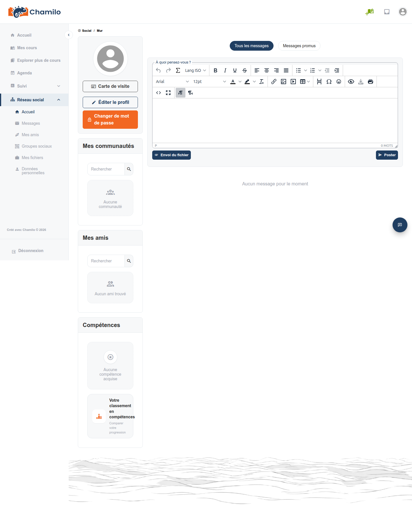

# Réseau social

Chamilo inclut un réseau social intégré qui vous permet de vous connecter avec d'autres utilisateurs de la plateforme. Cette fonctionnalité peut être activée ou désactivée par l'administrateur de votre plateforme.

## Accéder au réseau social

Cliquez sur **Réseau social** dans la barre latérale pour accéder aux fonctionnalités sociales. Si vous ne voyez pas cette option, votre administrateur l'a peut-être désactivée.

## Votre mur social

Le mur social affiche un fil d'activité vous concernant ainsi que vos connexions. Vous pouvez :

* **Publier des mises à jour** — Partager du texte et des liens avec vos connexions
* **Aimer et commenter** — Interagir avec les publications des autres utilisateurs
* **Consulter l'activité** — Voir les publications récentes des personnes avec lesquelles vous êtes connecté

## Connexions

Vous pouvez vous connecter avec d'autres utilisateurs de la plateforme :

* **Rechercher des utilisateurs** — Trouver des collègues et des apprenants par leur nom
* **Envoyer des demandes de connexion** — Inviter d'autres utilisateurs à se connecter
* **Gérer les connexions** — Accepter, refuser ou supprimer des connexions

> **Remarque :** Les apprenants ne peuvent rechercher et ajouter comme amis que d'autres apprenants — ils ne peuvent pas envoyer de demandes d'amitié aux enseignants. En tant qu'enseignant, vous pouvez toutefois rechercher des apprenants et demander à les ajouter comme amis.

## Messagerie

Le réseau social s'intègre au système de messagerie de la plateforme :

* **Envoyer des messages**  — Rédiger des messages directs destinés à d'autres utilisateurs
* **Boîte de réception**  — Lire les messages reçus et y répondre
* **Messages envoyés**  — Consulter les messages que vous avez envoyés

### Rédiger et répondre

Lorsque vous rédigez un nouveau message, vous pouvez l'adresser à plusieurs destinataires à la fois. De même, lorsque vous répondez à un message, vous pouvez inclure plusieurs utilisateurs dans votre réponse — ce qui est utile pour la coordination de groupe sans groupe social formel.

### Réponses par e-mail et statut d'ouverture

Si les réponses par e-mail entrant sont activées par l'administrateur, les destinataires des notifications de messages directs peuvent répondre depuis leur client de messagerie, et la réponse est ajoutée à la conversation Chamilo. La réponse doit provenir de l'adresse e-mail enregistrée sur le compte Chamilo du destinataire.

Si le suivi d'ouverture des e-mails est activé, vos **Messages envoyés** peuvent également afficher un horodatage **Notifications par e-mail**. Cela signifie uniquement que l'image de suivi de la notification a été demandée et ne prouve pas que le message a été lu.

### Chat flottant et appels vidéo individuels

Le panneau de chat flottant est distinct à la fois de la boîte de réception et de l'outil **Chat** du cours. Sélectionnez un contact en ligne pour échanger des messages directs en temps réel. Si l'administrateur a activé le chat vidéo et que votre navigateur prend en charge WebRTC, un contact en ligne affiche également **Démarrer un appel vidéo**.

Les appels sont individuels. Le destinataire peut **Accepter** ou **Refuser** un appel entrant. Pendant un appel connecté, chaque participant peut couper ou réactiver le microphone, allumer ou éteindre la caméra, et raccrocher. Le navigateur peut demander l'autorisation d'accéder à la caméra et au microphone la première fois.

### Étiquettes de messages

Si la configuration de votre plateforme utilise des étiquettes de messages (généralement gérées au niveau de la plateforme), votre boîte de réception affiche une liste d'étiquettes sur lesquelles vous pouvez cliquer pour filtrer les messages selon cette étiquette, ce qui accélère la localisation des fils de discussion associés à mesure que votre boîte de réception s'agrandit.

## Groupes sociaux

Les groupes sociaux permettent aux utilisateurs de se rassembler autour d'intérêts ou de projets communs :

* **Rejoindre des groupes** — Parcourir et rejoindre des groupes existants
* **Créer des groupes** — Créer un nouveau groupe social (si cela est autorisé)
* **Discussions de groupe** — Partager des publications dans le contexte d'un groupe

> Les groupes sociaux sont différents des **groupes de cours** (traités dans la section [Groupes](collaboration-and-communication/groups.md)). Les groupes de cours sont liés à un cours spécifique, tandis que les groupes sociaux sont à l'échelle de la plateforme.