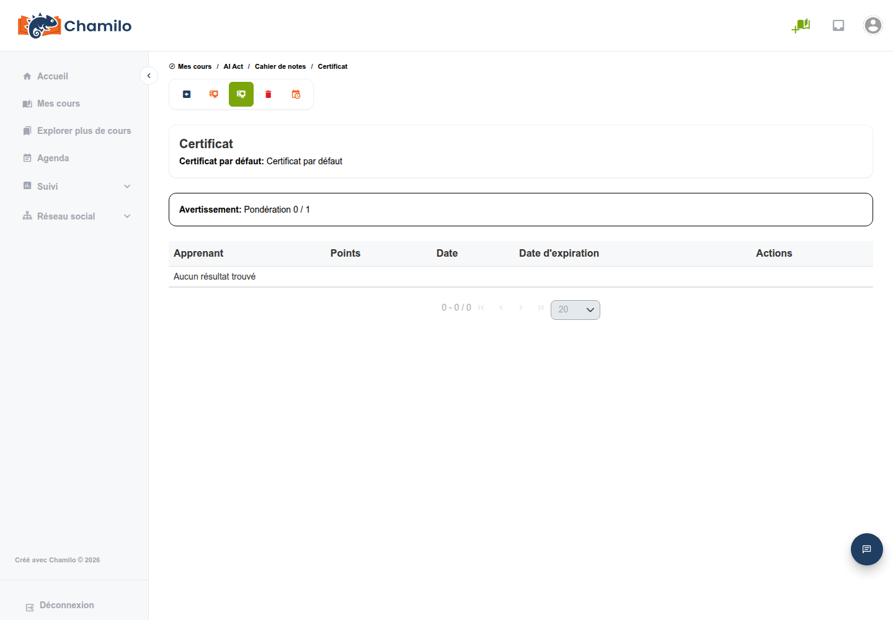
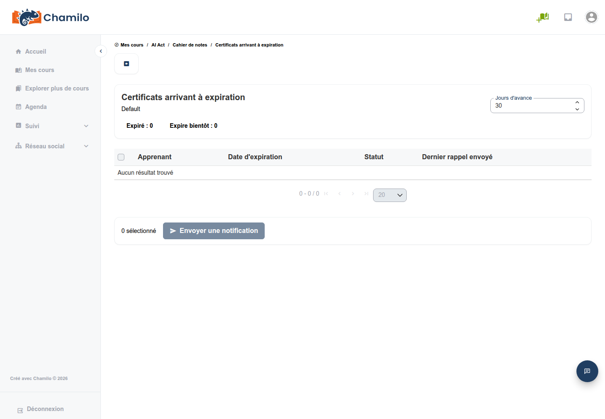
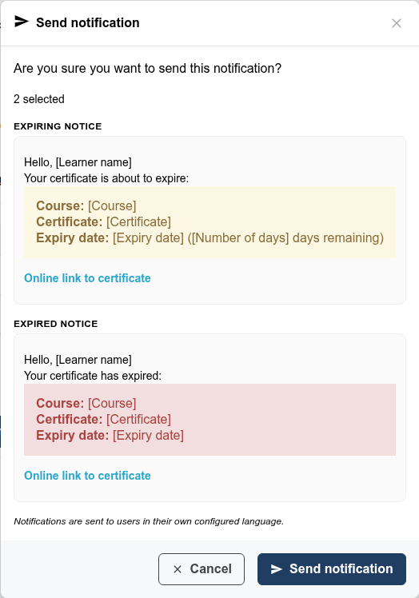

# Certificats et compétences

Chamilo vous permet de décerner des certificats aux apprenants qui remplissent des critères de réussite précis, et de valider les compétences associées à ces réussites.

## Fonctionnement des certificats

Les certificats sont liés aux **Évaluations** (également appelées Gradebook). Lorsqu'une note d'apprenant atteint ou dépasse le seuil minimal que vous définissez, un certificat devient disponible au téléchargement.

Le processus est le suivant :

1. Configurez les [Évaluations](../assessing-learners/gradebook.md) avec vos exercices, travaux et autres activités notées
2. Définissez un **score minimal de certification** (par exemple, 70 %)
3. Lorsqu'un apprenant atteint ce score, il peut télécharger son certificat (soit dans l'outil Évaluations lui-même, soit depuis un parcours d'apprentissage si vous avez configuré l'étape finale à cet effet). En tant qu'enseignant, vous pouvez également utiliser l'action **Générer les certificats** dans le carnet de notes pour créer les PDF par lot pour tous les apprenants éligibles.

## Modèles de certificats

Les certificats utilisent des modèles définis par l'administrateur de la plateforme. Le modèle comprend généralement :

* Le nom de l'apprenant
* Le nom du cours
* La date d'achèvement
* Le score obtenu
* Un code QR ou une URL pour la vérification en ligne

La première fois que vous ouvrez le gestionnaire de modèles de certificats pour les Évaluations d'un cours (l'icône **Joindre un certificat** dans le carnet de notes), Chamilo duplique automatiquement le modèle de certificat par défaut de la plateforme dans le cours, de sorte que vous n'arrivez jamais sur une page vide — la copie vous appartient et vous pouvez la personnaliser librement à partir de là. Si vous la détachez ensuite (**Utiliser le certificat par défaut du système à la place**), la réouverture du gestionnaire ne le recrée pas une seconde fois ; seul un cours qui n'a véritablement jamais eu de document de certificat joint en reçoit un généré automatiquement.

### Espaces réservés de suivi de cours dans les modèles

Les modèles de certificats peuvent inclure des espaces réservés de suivi en plus des champs relatifs à l'apprenant, au cours et à la note. Les espaces réservés suivants sont renseignés lorsque Chamilo génère un certificat :

| Espace réservé | Valeur |
|-------------|-------|
| `((time_in_course))` | Temps passé par l'apprenant dans le cours pour le contexte cours/session actuel, formaté en temps écoulé. |
| `((time_in_course_in_all_sessions))` | Somme du temps suivi de l'apprenant pour ce cours **sur l'ensemble de ses sessions**. Il s'agit d'un agrégat de sessions, pas nécessairement identique au temps du contexte actuel. |
| `((start_date_and_end_date))` | Dates de première et de dernière connexion au cours pour le contexte actuel. Si les deux tombent le même jour, le libellé est l'équivalent localisé de **Le [date]** ; sinon, il s'agit de **Du [première date] au [dernière date]**. |

Ces valeurs proviennent du suivi des apprenants et représentent l'**activité enregistrée**, et non la durée prévue du cours ni les heures de crédit académique. Les balises de temps écoulé utilisent désormais le formatage horaire normal de Chamilo, sans le formatage abrégé précédent. Prévisualisez le certificat généré avec des données de suivi représentatives, en particulier lorsqu'un cours est réutilisé dans plusieurs sessions.

## Validité et expiration des certificats

Les certificats peuvent être configurés pour expirer après un nombre de jours donné. Dans les paramètres des [Évaluations](../assessing-learners/gradebook.md) de la catégorie racine, une fois **Générer les certificats** activé, un champ **Validité du certificat (jours)** apparaît. Laissez-le à `0` (la valeur par défaut) pour les certificats qui n'expirent jamais, ou indiquez un nombre de jours pour qu'un certificat expire autant de jours après son émission.

La date d'expiration propre à chaque certificat est calculée automatiquement à partir de ce paramètre lors de sa génération (ou de sa régénération) — vous ne la définissez pas certificat par certificat. La liste **Certificats** affiche une colonne **Date d'expiration** pour chaque apprenant, indiquant **N'expire jamais** lorsqu'aucune période de validité ne s'applique.

Si la catégorie n'a aucune période de validité configurée, vous pouvez toujours définir (ou modifier) manuellement la date d'expiration d'un apprenant individuel : cliquez sur le bouton crayon **Modifier la date d'expiration** à côté de son entrée et choisissez une date. Ce bouton n'est disponible que lorsque la catégorie elle-même n'a aucune période de validité — une fois une période de validité définie, les dates d'expiration sont gérées automatiquement et ne peuvent plus être modifiées certificat par certificat.

### Rappeler aux apprenants une expiration à venir ou passée

Ouvrez la liste **Certificates** de votre évaluation et cliquez sur le bouton **Expiring certificates**  pour voir quels certificats d'apprenants ont expiré ou sont sur le point d'expirer. La page affiche, pour chaque apprenant : la **Expiry date** du certificat, son **Status** (**Expired** ou **Expiring soon**) et la date à laquelle un rappel à ce sujet a été **Last reminder sent** (ou **Never**). Utilisez **Days ahead** pour élargir ou réduire l'horizon futur pris en compte par « arrivant bientôt à expiration ».

Pour notifier vous-même les apprenants :

1. Sélectionnez les apprenants que vous souhaitez rappeler (ou sélectionnez-les tous)
2. Cliquez sur **Send notification**
3. Examinez l'aperçu de l'e-mail qui sera envoyé — des aperçus distincts sont affichés pour les formulations « arrivant bientôt à expiration » et « expiré », selon le cas dans lequel se trouvent les apprenants sélectionnés
4. Confirmez en cliquant à nouveau sur **Send notification** dans la boîte de dialogue

Chaque apprenant est notifié dans la langue qu'il a configurée, à la fois par e-mail et par un message interne Chamilo. Renvoyer un rappel pour le même certificat et la même date d'expiration est sans risque — Chamilo suit ce qui a déjà été envoyé pour chaque certificat et n'enverra pas de rappels en double à un apprenant, sauf si vous renvoyez explicitement le message.

Les administrateurs peuvent également planifier ces mêmes rappels automatiquement, de façon récurrente, sans qu'un enseignant ait à les déclencher manuellement — voir [Paramètres des tâches cron](../../admin-guide/platform-settings/crons-settings.md#certificate-expiry-reminders).

## Identifiants de certificats signés (facultatif)

Lorsque l'administrateur active la vérification des certificats signés, les apprenants peuvent approuver ou retirer la publication d'un identifiant vérifiable depuis **My Certificates**. Après approbation, un administrateur peut émettre l'identifiant signé et, éventuellement, ancrer son empreinte sur le réseau de test Sepolia. Un lien de vérification public contrôle la signature de l'identifiant, le consentement actuel, la révocation et le statut du certificat sous-jacent ; l'ancrage sur Sepolia est facultatif et utilise un réseau de test.

Voir [Vérification des certificats signés](../../admin-guide/maintenance/signed-certificate-verification.md) pour le flux de travail de l'administrateur et les limites importantes liées au consentement.

## Importation de modèles de certificats à partir de fichiers ZIP

Vous pouvez téléverser un paquet ZIP contenant un modèle de certificat HTML et ses images lors de l'association d'un certificat à une évaluation de cours. Dans la vue de téléversement du modèle de certificat, choisissez un fichier `.html` ou une archive `.zip`. Chamilo importe le modèle HTML et intègre les ressources image prises en charge afin que le certificat puisse être prévisualisé et généré sans exposer les images extraites comme fichiers publics.

Le ZIP doit contenir au moins un fichier `.html` ou `.htm`. Les modèles HTML peuvent se trouver dans des sous-répertoires ; les formats d'image pris en charge sont PNG, JPEG, GIF et WebP. Les autres types de fichiers, les chemins d'archive non sûrs, les liens symboliques et les archives trop volumineuses sont rejetés. Si un paquet contient plusieurs modèles, examinez les documents importés et sélectionnez le modèle de certificat souhaité avant de générer les certificats pour les apprenants.

Prévisualisez un certificat avec un apprenant de test avant la génération en masse, en particulier lorsque la mise en page fait référence à des chemins d'image relatifs ou à des espaces réservés de suivi de cours. Voir [PR d'importation ZIP de certificats n° 9371](https://github.com/chamilo/chamilo-lms/pull/9371).

## Rapport de la plateforme pour les certificats expirés

Les administrateurs du portail disposent d'un rapport **Expired certificates** dans Global Reporting. Il permet de filtrer par mot-clé, session, cours, mois et année, et liste la date d'expiration de chaque certificat correspondant. Il est distinct de la vue de rappel **Expiring certificates** de l'enseignant décrite ci-dessus. Voir [PR du rapport global des certificats expirés n° 9372](https://github.com/chamilo/chamilo-lms/pull/9372) et le [guide des statistiques globales](../../admin-guide/analytics/global-statistics.md).

## Compétences

Les compétences représentent les aptitudes que les apprenants acquièrent. Dans Chamilo :

* Les compétences peuvent être liées aux réalisations du carnet de notes
* Lorsqu'un apprenant obtient un certificat, toutes les compétences associées sont automatiquement validées
* Les compétences s'accumulent sur le profil de l'apprenant, constituant un dossier de compétences
* Les compétences peuvent être organisées de façon hiérarchique (par exemple, « Analyse de données » sous « Méthodes de recherche »)
* Les compétences peuvent en outre être évaluées par les pairs (évaluation à 360°)

---
## Consultation du statut des certificats et des compétences

En tant qu'enseignant, vous pouvez consulter :

* Quels apprenants ont obtenu des certificats dans votre cours
* Quelles compétences ont été validées
* La progression des apprenants vers le seuil de certification
* Quels certificats ont expiré ou expirent bientôt, et si un rappel a déjà été envoyé pour ceux-ci

Les apprenants peuvent consulter leurs propres certificats et compétences validées depuis leur profil, et accéder à la Roue des compétences pour vérifier quelles compétences sont recherchées dans leur organisation.

Si votre plateforme utilise des relevés de notes, chaque certificat obtenu par un apprenant devient également une ligne de son relevé, avec le score et la lettre de l'échelle de notation — voir [Relevés de notes](../../admin-guide/users/academic-transcripts.md).

## Conseils

* **Fixez des attentes claires** — Indiquez aux apprenants, dès le début du cours, ce qu'ils doivent accomplir pour obtenir un certificat
* **Utilisez des noms de compétences significatifs** — Les compétences doivent décrire ce que l'apprenant sait faire, et non pas seulement le nom du cours
* **Combinez avec les portfolios** — Encouragez les apprenants à ajouter leurs certificats à leur portfolio
* **Étendez les certificats** — Demandez à votre administrateur d'activer le plugin [Custom Certificate](../plugins/custom-certificate.md) pour décupler les possibilités de modèles de certificats
* **Définissez une période de validité pour les certifications liées à la conformité** — Si une certification doit être renouvelée périodiquement (p. ex. formation à la sécurité), définissez **Validité du certificat (jours)** afin que les apprenants soient rappelés avant son expiration