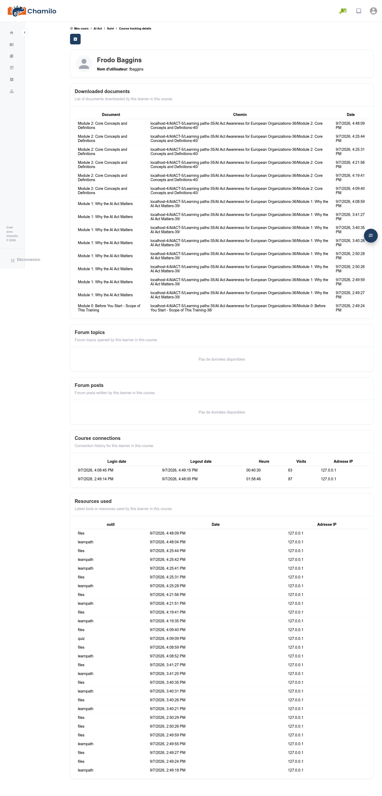

# Suivi des apprenants

Chamilo suit l'activité des apprenants sur l'ensemble de la plateforme et vous fournit des informations détaillées sur la manière dont chaque apprenant interagit avec votre cours.

## Accéder au suivi des apprenants

Ouvrez l'outil **Suivi**  depuis la page d'accueil du cours, ou cliquez sur **Rapports** dans la barre latérale.

## Ce qui est suivi

Pour chaque apprenant, Chamilo enregistre (dans la vue principale de suivi par apprenant) :

* **Activité de connexion** — Date et heure de la dernière connexion de l'apprenant et durée totale de connexion
* **Temps passé dans le cours** — Temps total que l'apprenant a passé dans votre cours
* **Premier et dernier accès** — Date et heure de la première entrée et de la dernière visite du cours
* **Progression dans le cours** — Pourcentage de progression agrégé sur l'ensemble du cours
* **Résultats des exercices** — Notes et tentatives pour chaque exercice
* **Progression dans les parcours d'apprentissage** — Pourcentage d'achèvement et temps passé sur chaque parcours d'apprentissage
* **Remises de travaux** — Travaux remis et notés

Les détails d'accès par ressource (documents ou pages précis ouverts par un apprenant) et l'activité au niveau des outils sont disponibles dans les vues dédiées **Ressources**, **Outils** et **Événements** de la section de suivi, et non dans la ligne principale de l'apprenant.

## Consulter les données d'un apprenant

Cliquez sur le nom d'un apprenant pour afficher son rapport d'activité détaillé. Celui-ci présente :

* Un résumé de son engagement global
* La progression dans chaque parcours d'apprentissage
* Les notes des exercices et l'historique des tentatives
* L'état des remises de travaux

## Rapport de l'apprenant sur l'ensemble des cours

**Rapports** > **Apprenants**, puis les détails d'un apprenant, ouvre le rapport de l'apprenant (`/reporting/learners/{id}`), qui couvre tous les cours suivis par l'apprenant. Sous le profil de l'apprenant et les compétences acquises, il affiche :

* **Classes** — Les classes auxquelles l'apprenant appartient, lorsqu'il y en a
* **Cours** — Les cours auxquels l'apprenant est inscrit directement
* **Un tableau par session** — Le titre de la session et les dates d'accès, puis les cours de l'apprenant dans cette session

Les administrateurs, les responsables des ressources humaines, les responsables d'étudiants et les administrateurs de session voient toutes les inscriptions de l'apprenant. Les enseignants, les tuteurs et les coachs ne voient que les cours qu'ils enseignent ou tutorent, les sessions qu'ils encadrent en tant que coach général, et les cours qu'ils encadrent dans une session ; un enseignant de cours voit également ce cours dans les sessions de l'apprenant.

Les dates sont affichées dans le fuseau horaire de l'utilisateur lorsque les utilisateurs peuvent en choisir un, sinon dans le fuseau horaire de la plateforme.

Chaque tableau de cours indique le temps passé, la progression, la note, les absences (feuilles de présence manquées sur le total) et la note du carnet de notes pour chaque cours, suivis d'une ligne **Total**. Le titre du cours ouvre le cours, et le bouton de détails ouvre le rapport de l'apprenant dans ce cours. Un cours suivi à la fois directement et dans une session apparaît dans les deux tableaux, avec les chiffres de chaque inscription.

Chaque tableau peut être exporté séparément au format CSV ou Excel. Les tableaux de session proposent également un export PDF de la présence de la session et un **Certificat de réussite**. Les boutons d'export en haut de la page exportent tous les tableaux en une seule fois.

### Compétences acquises

Le bloc **Compétences acquises** affiche les compétences que l'apprenant a acquises. Cliquer sur une compétence ouvre son badge. La disposition des compétences dépend de deux paramètres de la catégorie **Compétences** dans les paramètres de la plateforme :

* Lorsque **Noms des niveaux de compétence** (`skill.skill_levels_names`) est vide, les compétences acquises sont listées les unes après les autres.
* Sinon, les compétences sont placées dans l'arbre des compétences : chaque compétence acquise apparaît sous ses compétences parentes, jusqu'au sommet de l'arbre. Les compétences parentes que l'apprenant n'a pas acquises sont estompées, et seules les branches contenant au moins une compétence acquise sont dessinées.
  * Lorsque **Afficher les compétences sous forme de tableau hiérarchique** (`skill.skills_hierarchical_view_in_user_tracking`) est activé, chaque branche de premier niveau est une colonne, avec ses compétences imbriquées en dessous.
  * Lorsqu'il est désactivé, chaque branche de premier niveau est un titre, suivi de ses compétences côte à côte : le premier niveau sous le titre présente des badges plus grands, et les niveaux plus profonds affichent leur badge sans titre.

Une compétence affiche son code court à la place de son titre lorsqu'elle en possède un. Une compétence non rattachée à un parent apparaît en haut de l'arbre.

Le rapport de l'apprenant dans un cours dispose les compétences acquises dans ce cours de la même manière.

### Messages concernant l'apprenant

Lorsque **Autoriser les messages privés entre enseignants au sujet d'un apprenant** (`message.private_messages_about_user`) est activé dans les paramètres de la plateforme, un bloc **Messages** en bas du rapport liste les messages de suivi rédigés au sujet de l'apprenant. Cliquez sur un message pour le lire. **Nouveau message** en rédige un nouveau, avec un objet et un texte. Lorsqu'un message est envoyé, les supérieurs de l'apprenant reçoivent une notification contenant un lien vers le rapport. Vous ne pouvez supprimer que les messages que vous avez rédigés ; chaque suppression est enregistrée dans le journal des événements de la plateforme.

Le rapport de l'apprenant dans un cours, ouvert avec le bouton de détails, affiche également les classes de l'apprenant et le même bloc **Messages**.

## Scores des parcours : la meilleure tentative compte

> **Changement de comportement.** Les statistiques des parcours utilisent désormais la **meilleure tentative** de chaque apprenant par élément, au lieu de la moyenne de toutes les tentatives.

Lorsqu'un apprenant ouvre plusieurs fois un élément de parcours (élément SCORM ou test), le score affiché dans les statistiques du parcours est le score de la meilleure tentative de l'apprenant pour cet élément. Auparavant, chaque tentative était ajoutée au total et comptée comme un élément supplémentaire, de sorte que le score affiché était la moyenne de toutes les tentatives : un apprenant ayant obtenu 9/10 puis 4/10 sur le même élément voyait s'afficher 65 % ; il voit désormais 90 %.

* Il existe une valeur par élément et par apprenant : la tentative présentant le ratio score/maximum le plus élevé. Lorsque deux tentatives ont le même ratio, la plus récente est utilisée. Une tentative de test est comparée à son propre maximum (des questions aléatoires peuvent le modifier) ; ainsi, 8/10 l'emporte sur 9/20.
* Les colonnes « dernière tentative » de la page de suivi de l'apprenant restent inchangées (elles affichent toujours la dernière tentative) ; les colonnes « meilleur score » concordent désormais avec le score par défaut.
* Cela s'applique partout où le score du parcours est affiché ou exporté : rapports de cours et de session, page de suivi de l'apprenant (« Mes étudiants »), rapport du parcours, portail utilisateur, vue d'ensemble du tableau de bord Reporting et leurs exports CSV/Excel.
* Les données de suivi existantes ne sont pas modifiées ; seule la manière dont elles sont synthétisées change, de sorte que les chiffres des tentatives passées sont recalculés à l'affichage.

## Vues de suivi

Vous pouvez consulter les données de suivi selon différentes perspectives :

* **Par apprenant** — Sélectionnez un apprenant pour voir toute son activité
* **Par ressource** — Sélectionnez un document, un exercice ou un parcours pour voir comment tous les apprenants ont interagi avec celui-ci
* **Par outil** — Consultez l'utilisation agrégée de chaque outil de cours

## Conseils

* **Repérer les apprenants en difficulté** — Recherchez les apprenants présentant un faible engagement, plusieurs tentatives d'exercice échouées ou des parcours incomplets
* **Suivre la progression régulièrement** — Consultez les données de suivi chaque semaine afin de détecter les problèmes tôt
* **Utiliser les données pour le retour** — Partagez les données de suivi pertinentes avec les apprenants afin de les aider à comprendre leur propre progression