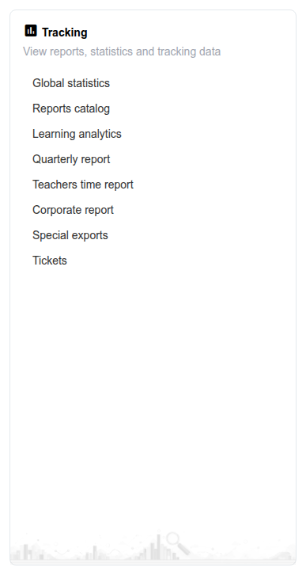

# Analytics

Het blok **Analytics** op het beheerdersdashboard groepeert platformbrede statistieken, learning analytics, bedrijfs-/HR-rapportage en hulpmiddelen voor bulkexport. Afhankelijk van uw Chamilo-versie kan dit blok op het dashboard zelf het label **"Tracking"** hebben — het is in beide gevallen hetzelfde blok. In deze handleiding wordt het overal Analytics genoemd om verwarring te voorkomen met [Trackinginstellingen](../platform-settings/tracking-settings.md), de afzonderlijke instellingencategorie die bepaalt wat wordt vastgelegd in plaats van de rapporten zelf.

## Analytics openen

Vanuit het beheerpaneel verschijnt het blok **Analytics** naast de andere dashboardblokken. Klik op een van de koppelingen om het bijbehorende rapport te openen.

## Wat het blok bevat

* **[Globale statistieken](global-statistics.md)** — Platformbrede statistieken: cursussen, gebruikers, aanmeldingen, sessies en schijfgebruik
* **[Rapportencatalogus](reports-catalog.md)** — Blader door elk geregistreerd rapport, wie er toegang toe heeft en waarom
* **[Learning analytics](learning-analytics.md)** — Het klassieke trackingdashboard: detailweergaven van gebruikers, cursussen en sessies met gemiddelden van bestede tijd en scores
* **[Bedrijfsrapporten](corporate-reports.md)** — Kwartaalsamenvattingen, tijdsregistratie van docenten en op HR gerichte rapportage over cursussen en gebruikers
* **[Tickets](tickets.md)** — Ga rechtstreeks naar de lijst met ondersteuningstickets

## Wie er toegang toe heeft

Voor de meeste van deze rapporten is toegang als **portaalbeheerder** vereist. Het bedrijfsrapport vormt de uitzondering: het is ook toegankelijk voor de rollen **HR-manager** en **Student Boss**, omdat het specifiek voor dat publiek is gebouwd.