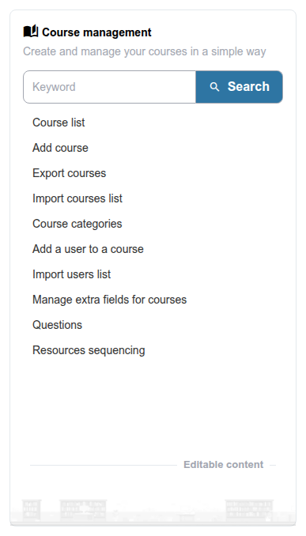

# Cursussen

Dit gedeelte behandelt cursusbeheer vanuit het perspectief van een beheerder: het toezicht houden op de cursuscatalogus, het beheren van categorieën en het afhandelen van importen en exporten.

* **[Cursussen beheren](managing-courses.md)** — Cursussen bekijken, aanmaken, bewerken en verwijderen
* **[Cursuscategorieën](course-categories.md)** — De cursuscatalogus organiseren met categorieën
* **[Cursus importeren en exporteren](course-import-export.md)** — Cursussen importeren en exporteren tussen platforms
* **[Democursussen](demo-courses.md)** — De cursussen The AI Act en Using Chamilo die bij elke nieuwe installatie worden meegeleverd