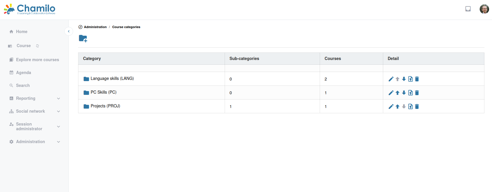

# Cursuscategorieën

Cursuscategorieën helpen uw cursuscatalogus te organiseren, zodat cursisten relevante cursussen gemakkelijker kunnen vinden.

## Een categorie aanmaken

1. Ga vanuit het beheerpaneel naar **Cursuscategorieën**
2. Klik op **Categorie toevoegen**
3. Vul in:
   * **Categoriecode** — Een korte unieke identificatie
   * **Categorienaam** — De weergavenaam (bijv. "Informatietechnologie", "Managementvaardigheden")
   * **Cursussen toevoegen in deze categorie toestaan?** — Of cursussen deze als categorie mogen instellen, of dat deze alleen als tussenliggend niveau in een hiërarchie dient
   * **Bovenliggende categorie** — (Optioneel) Plaats deze categorie onder een andere categorie om een hiërarchie te maken
   * **Beschrijving** — (Optioneel)
   * **Afbeelding** — (Optioneel) Vertegenwoordigt deze categorie, hoewel deze bijna nergens wordt weergegeven
4. Druk op *Categorie toevoegen*

Chamilo maakt standaard 3 categorieën aan: *Taalvaardigheden*, *PC-vaardigheden* en *Projecten*. Deze kunnen worden hernoemd, verwijderd of behouden, afhankelijk van uw behoeften.

## Categoriehiërarchie

Categorieën kunnen worden genest om een boomstructuur te maken:

* Bedrijfsleven
  * Management
  * Marketing
  * Financiën
* Technologie
  * Programmeren
  * Netwerken
  * Cyberbeveiliging

Cursisten die de cursuscatalogus doorbladeren, kunnen door deze hiërarchie navigeren om cursussen te vinden.

## Categorieën beheren

* **Bewerken** — Wijzig de categorienaam, code of bovenliggende categorie
* **Verplaatsen** — Wijzig de positie van een categorie in de lijst
* **Verwijderen** — Verwijder een categorie. Cursussen in een verwijderde categorie worden verplaatst naar "niet gecategoriseerd".

## Tips

* **Houd het eenvoudig** — Gebruik brede categorieën die cursisten in één oogopslag begrijpen
* **Beperk de diepte** — Vermijd diep geneste categorieën. Twee of drie niveaus zijn doorgaans voldoende.
* **Wijs categorieën toe tijdens het aanmaken van cursussen** — Moedig docenten aan een categorie te selecteren bij het aanmaken van cursussen, zodat de catalogus georganiseerd blijft