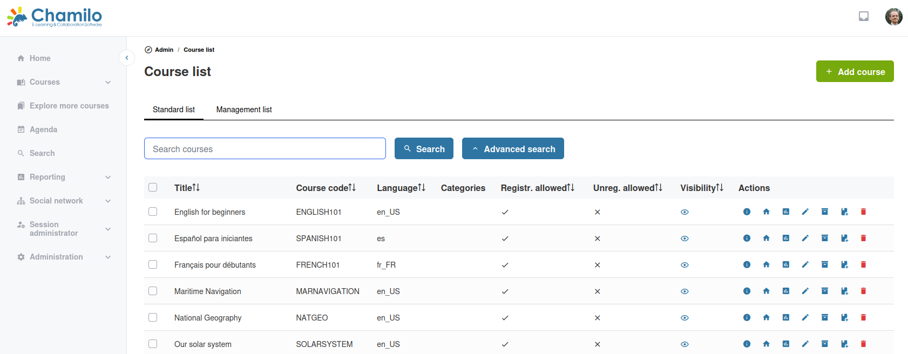

# Cursussen beheren

Als beheerder kunt u alle cursussen op het platform beheren, ongeacht wie ze heeft aangemaakt.

## Cursuslijst

Vanuit het beheerpaneel klikt u op **Cursuslijst** om alle cursussen te zien. De lijst toont:

* Cursustitel en -code
* Taal
* Categorieën
* Zichtbaarheidsstatus

Gebruik het hulpmiddel **Geavanceerd zoeken** om specifieke cursussen te vinden.

## Een cursus aanmaken

Als beheerder kunt u cursussen aanmaken en deze aan elke docent toewijzen:

1. Klik op **Cursus toevoegen** in het beheerpaneel
2. Vul de cursusgegevens in (titel, code, categorie, taal)
3. Wijs een docent aan de cursus toe
4. Opslaan

Opmerking: In Chamilo 1.11.x werd de cursuscode weergegeven als onderdeel van de cursus-URL en was het onmogelijk om deze na het aanmaken van de cursus te wijzigen. Dit gedrag is gewijzigd vanaf 2.x. De cursuscode is niet meer zichtbaar in de URL en toekomstige versies kunnen docenten mogelijk toestaan de cursuscode achteraf te wijzigen, omdat deze minder essentieel wordt voor het platform.

## Een bestaande cursus beheren

Zoek een cursus in de lijst om de beheeropties in de kolom *Acties* te openen:

* **Informatie** — Informatie over de cursus weergeven 
* **Cursusstartpagina** — Brengt u rechtstreeks naar de startpagina van de cursus 
* **Rapportage** — Bekijk betrokkenheids- en prestatiegegevens
* **Bewerken** — Wijzig de cursustitel, categorie, zichtbaarheid en andere instellingen
* **Een back-up maken** — Ga naar het onderhoudsgedeelte van de cursus, waar u kopieën kunt maken en andere handelingen kunt uitvoeren
* **Toevoegen aan catalogus** — Voeg deze cursus toe aan de cursuscatalogus
* **Verwijderen** — Verwijder de cursus en alle inhoud ervan permanent

> Het verwijderen van een cursus verwijdert alle inhoud, leerlinggegevens, cijfers en trackinginformatie permanent. Overweeg eerst de cursus te exporteren als back-up.

## Integraties voor beheerders

Beheerders kunnen ook geselecteerde cursusmetagegevens synchroniseren met `PATCH /api/courses/{id}`, of cursusverwijdering aanvragen met `DELETE /api/courses/{id}`. Deze API-bewerkingen vereisen een platformbeheerder; een docent kan ze niet gebruiken om de interface voor cursusinstellingen te omzeilen. Cursusverwijdering via de API kan zich anders gedragen in installaties met meerdere URL's en maakt geen gebruik van de optionele verwijdering van exclusieve documenten op het onderhoudsscherm. Zie [API voor cursusbeheer](../../developer-guide/api/course-administration.md) voordat u destructieve bewerkingen automatiseert.

## Bulkbewerkingen

Selecteer meerdere cursussen in de lijst om batchacties uit te voeren, zoals het verwijderen ervan. Om een cursus te exporteren, opent u de cursus en gebruikt u het hulpmiddel **Onderhoud** — er is geen bulkexportactie in de beheerderscursuslijst.

## Instellingen voor cursuszichtbaarheid

Beheerders kunnen de door docenten ingestelde zichtbaarheid overschrijven:

| Zichtbaarheid | Effect |
|-----------|--------|
| **Openbaar** | Toegankelijk voor iedereen, inclusief anonieme bezoekers |
| **Open** | Toegankelijk voor alle aangemelde gebruikers |
| **Privé** | Alleen ingeschreven gebruikers hebben toegang tot de cursus |
| **Gesloten** | Niemand heeft toegang tot de cursus (behalve de docent en beheerders) |
| **Verborgen** | Niemand kan de cursus bekijken of openen (behalve de beheerders) |