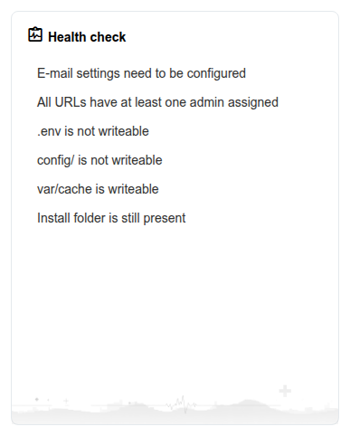

# Statuscontrole

Statuscontrole is een klein blok op het beheerdersdashboard dat een handvol livecontroles op uw installatie uitvoert en alles markeert dat aandacht nodig heeft — u hoeft niet door configuratiebestanden te zoeken om veelvoorkomende configuratiefouten te ontdekken.

## Toegang tot Statuscontrole

Vanuit het beheerpaneel verschijnt het blok **Statuscontrole** naast de andere dashboardblokken — er is geen klik nodig, de resultaten worden direct getoond.

## De controles

* **E-mailinstellingen** — Controleert of een connection string voor de mailer en een "from"-e-mailadres/-naam zijn geconfigureerd. Zo niet, dan linkt de controle naar E-mailinstellingen om dit te herstellen.
* **Alle URL's hebben minstens één toegewezen beheerder** — Bij een installatie met meerdere URL's wordt gecontroleerd of elke toegangs-URL minstens één beheerder heeft die deze kan beheren. Als dat niet het geval is, linkt de controle naar de pagina voor toewijzing van toegangs-URL's/gebruikers.
* **`.env` is niet schrijfbaar** — `.env` bevat geheimen en mag na de installatie niet schrijfbaar zijn voor de webserver. Dit wordt als fout gemarkeerd als dat wel het geval is; er wordt een koppeling naar de Beveiligingsgids getoond.
* **`config/` is niet schrijfbaar** — Dezelfde redenering als bij `.env`: deze map mag bij normaal gebruik niet via het web schrijfbaar zijn. Omdat deze map historisch een doelwit van aanvallen is geweest, verwijdert u deze met `rm -rf public/main/install`. Koppeling naar de [Beveiligingsgids](appendix/security-guide.md#remove-the-install-folder).
* **`var/cache` is schrijfbaar** — De tegenovergestelde controle: Symfony moet naar zijn cachemap kunnen schrijven, dus deze wordt als fout gemarkeerd als de map *niet* schrijfbaar is. Koppeling naar de handleiding Prestatieafstemming / optimalisatie.
* **Installatiemap is niet aanwezig** — De map `public/main/install` is alleen nodig tijdens de installatie en moet daarna worden verwijderd. Dit wordt als waarschuwing gemarkeerd (geen harde fout) als de map nog bestaat, omdat het een lager risico is dan de twee schrijfbaarheidscontroles hierboven. Omdat deze map historisch een doelwit van aanvallen is geweest, verwijdert u deze met `rm -rf public/main/install`. Koppeling naar de [Beveiligingsgids](appendix/security-guide.md#remove-the-install-folder).

## Wat u ermee doet

Elke controle linkt rechtstreeks naar de plek waar u het onderliggende probleem oplost — een instellingenpagina of de relevante handleiding. Doorloop deze lijst direct na de installatie en daarna periodiek (bijvoorbeeld na een handmatige bestandsoverdracht of een wijziging van rechten), want een controle die vandaag slaagt, garandeert niet dat dat zo blijft. Voor een bredere checklist voor het harden van de productieomgeving, naast deze zes controles, zie de [Beveiligingsgids](appendix/security-guide.md).