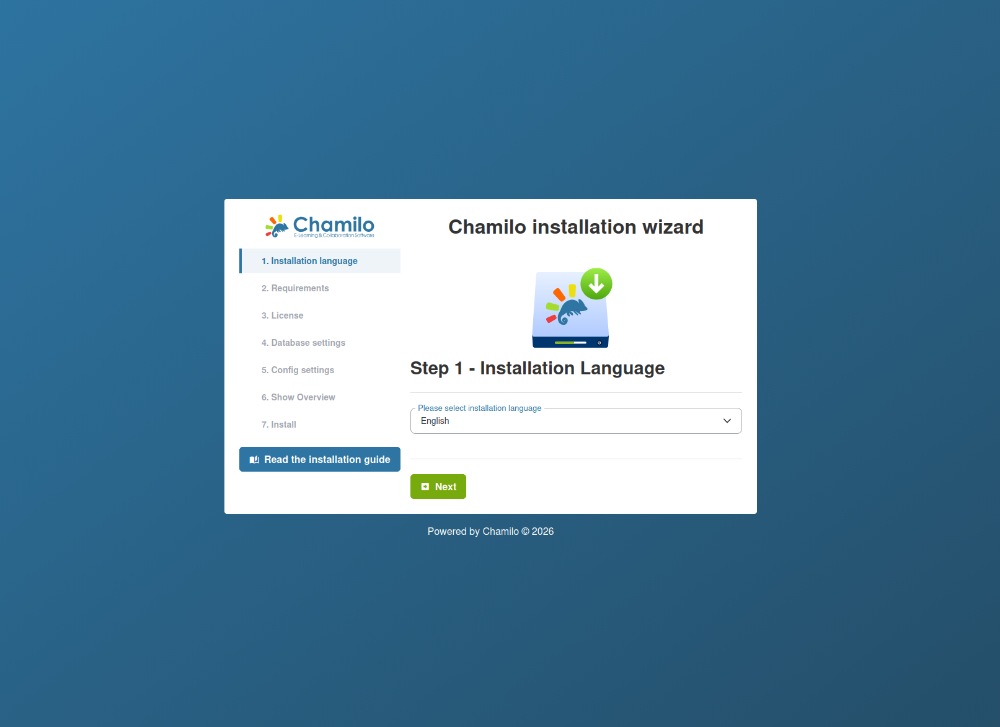
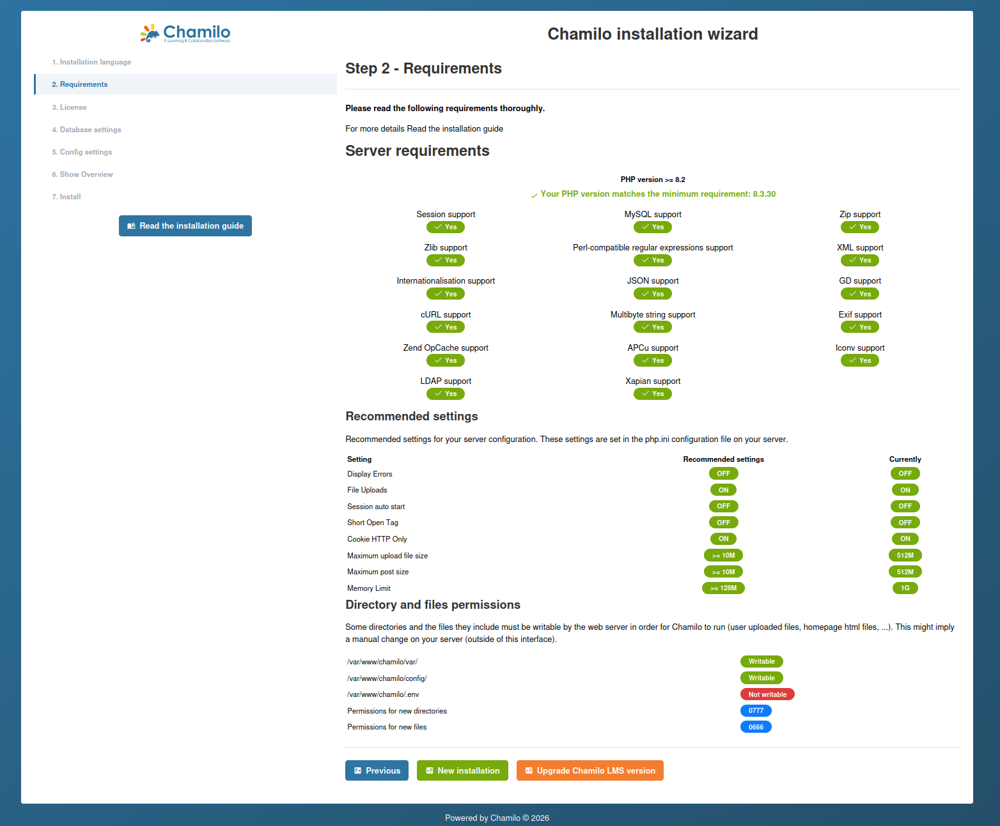
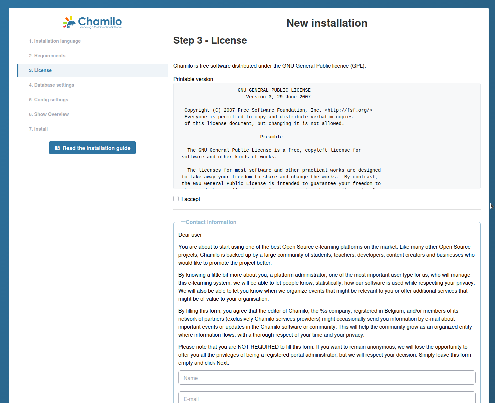
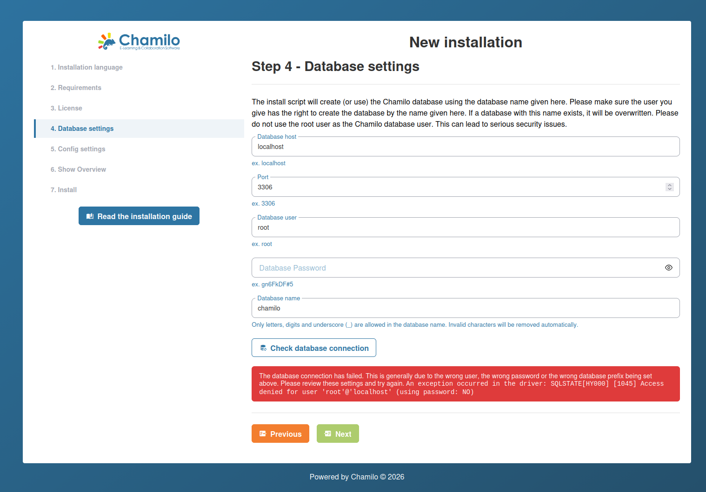
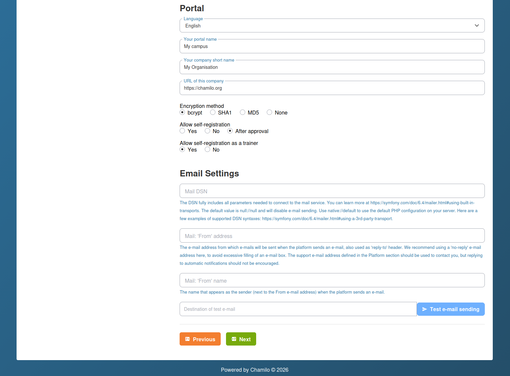
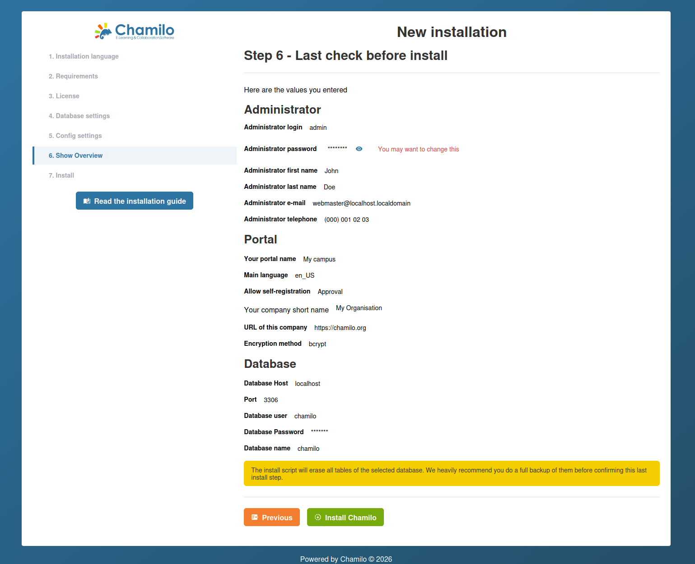
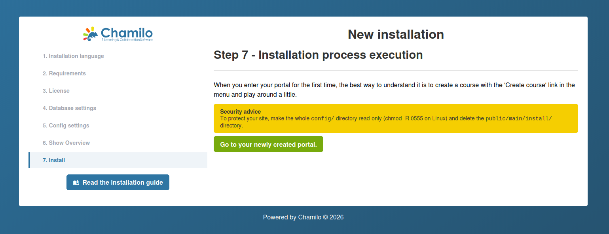

# Installatiewizard

Chamilo 3.0 bevat een webgebaseerde installatiewizard die u door de initiële configuratie leidt. De wizard start automatisch wanneer u het platform voor het eerst opent.

## Voordat u begint

Zorg ervoor dat aan de volgende vereisten is voldaan:

1. Uw server voldoet aan alle [serververeisten](server-requirements.md).
2. U hebt een verpakte (zip of tar.gz) versie van Chamilo gedownload.
3. Uw webserver is geconfigureerd om de map `public/` als document root te serveren.
4. Uw `.env`-bestand bestaat en is leeg (de wizard begeleidt de databaseconfiguratie).

## Stap 1: Installatietaal

In de eerste stap selecteert u de taal voor het installatieproces. Kies uw voorkeurstaal in de vervolgkeuzelijst.

Als Chamilo een bestaande installatie detecteert (voor een upgrade), wordt de migratiestatus weergegeven en wordt een upgradepad aangeboden in plaats van een nieuwe installatie.

## Stap 2: Controle van vereisten

De wizard controleert uw serveromgeving:

* **PHP-versie** is 8.3, 8.4 of 8.5
* **Vereiste PHP-extensies** zijn geïnstalleerd (intl, gd, curl, zip, mbstring, xml, enz.)
* **Aanbevolen PHP-instellingen** — `date.timezone` is geconfigureerd, adequate upload-/geheugenlimieten
* **Map- en bestandsmachtigingen** — `var/`, `config/` en `public/upload/` zijn beschrijfbaar door de webserver

Als niet aan alle vereisten is voldaan, toont de wizard waarschuwingen of fouten. Los deze op voordat u verdergaat.

## Stap 3: Licentie

In deze stap wordt de GNU/GPLv3-licentie weergegeven. U moet het selectievakje **"Ik ga akkoord"** aanvinken om verder te gaan.

Optioneel kunt u de sectie **Contactgegevens** uitklappen om gegevens over uw organisatie op te geven (naam, e-mail, bedrijf, land). Dit is vrijwillig en helpt de Chamilo-gemeenschap te begrijpen wie het platform gebruikt, maar stelt ons ook in staat u *zeer zelden* te contacteren over evenementen bij u in de buurt.

## Stap 4: Database-instellingen

Voer de gegevens van uw databaseverbinding in:

| Veld | Beschrijving |
|-------|-------------|
| **Databasehost** | De hostnaam of het IP-adres van uw databaseserver (bijv. `localhost` of `127.0.0.1`) |
| **Databasepoort** | Standaard: 3306 voor MySQL/MariaDB |
| **Databasenaam** | De naam van de te gebruiken database (alleen alfanumerieke tekens en onderstrepingstekens) |
| **Databasegebruiker** | Een databasegebruiker met volledige rechten op de opgegeven database |
| **Databasewachtwoord** | Het wachtwoord van de databasegebruiker |

Klik op **Databaseverbinding controleren** om te testen. De wizard laat u pas verdergaan als de verbinding is geslaagd. Als de database al bestaat, wordt een waarschuwing weergegeven.

## Stap 5: Configuratie-instellingen

In deze stap worden het aanmaken van het beheerdersaccount, de portaalinstellingen en de e-mailconfiguratie gecombineerd.

### Beheerdersaccount

| Veld | Beschrijving |
|-------|-------------|
| **Gebruikersnaam** | De gebruikersnaam van de beheerder |
| **Wachtwoord** | Kies een sterk wachtwoord — dit account heeft volledige toegang tot het platform |
| **Voornaam** | De voornaam van de beheerder |
| **Achternaam** | De achternaam van de beheerder |
| **E-mail** | Wordt gebruikt voor systeemmeldingen en het opnieuw instellen van wachtwoorden |
| **Telefoon** | Optioneel contactnummer |

Deze beheerdersgegevens worden door Chamilo ook gebruikt om de contactgegevens voor ondersteuning in te vullen. Zorg er dus voor dat u deze na afloop van de installatie opnieuw configureert in de instellingen.

### Portaalinstellingen

| Veld | Beschrijving |
|-------|-------------|
| **Taal** | De standaardtaal van de interface |
| **Portaalnaam** | De naam van uw platform (bijv. "LMS van mijn organisatie") |
| **Korte bedrijfsnaam** | De afgekorte naam van uw organisatie |
| **Bedrijfs-URL** | De website van uw organisatie |
| **Versleutelingsmethode** | Algoritme voor wachtwoordhashing — **bcrypt** wordt aanbevolen |
| **Zelfregistratie toestaan** | Ja / Nee / Na goedkeuring |
| **Zelfregistratie als trainer toestaan** | Ja / Nee |

### E-mailconfiguratie

In de sectie e-mailinstellingen configureert u het mailtransport (SMTP, Amazon SES, Mailjet, enz.) en test u de e-mailbezorging. Zie [E-mailconfiguratie](email-configuration.md) voor details.

Al deze instellingen kunnen later worden gewijzigd via het beheerpaneel.

## Stap 6: Laatste controle vóór installatie

Deze stap toont een samenvatting van alles wat u hebt ingevoerd ter controle:

* Beheerdersgegevens (het wachtwoord is standaard verborgen — klik op het oogpictogram om het te tonen)
* Portaalinstellingen
* Gegevens van de databaseverbinding

Controleer zorgvuldig en klik vervolgens op **Install Chamilo** om de installatie uit te voeren. De wizard maakt alle databasetabellen aan, vult de initiële gegevens in en configureert het platform.

## Stap 7: Installatie voltooid

Nadat de installatie succesvol is voltooid, toont de wizard:

* **Aan de slag** — Stelt voor om uw eerste cursus aan te maken om het platform te verkennen (als beheerder moet u dit doen via het beheerpaneel)
* **Beveiligingsaanbevelingen**:
  * Maak de map `config/` alleen-lezen (`chmod 0555`)
  * Verwijder de map `public/main/install/`
* Een **koppeling naar uw portaal** om in te loggen met de beheerdersgegevens die u zojuist hebt aangemaakt

## Na de installatie

Na het voltooien van de wizard:

* **Verwijder de installer of beperk de toegang ertoe** -- De wizard mag na de installatie niet meer toegankelijk zijn. Chamilo vergrendelt deze doorgaans automatisch, maar controleer of het opnieuw bezoeken van de installatie-URL doorverwijst naar de aanmeldpagina.
* **E-mailbezorging configureren** -- Zie [E-mailconfiguratie](email-configuration.md).
* **Back-ups instellen** -- Configureer, voordat u inhoud toevoegt, geautomatiseerde back-ups van de database en bestanden (Chamilo biedt hiervoor geen oplossing, maar het kopiëren van de map var/ en de database zijn de 2 belangrijkste elementen).
* **Beveiligingsinstellingen controleren** -- Zie [Beveiligingsinstellingen](../platform-settings/security-settings.md).

## Probleemoplossing

| Probleem | Oplossing |
|---------|----------|
| Lege pagina op de installatie-URL | Controleer de PHP-foutlogboeken. Wijzig tijdelijk naar `APP_ENV=dev` in .env om fouten in de browser te zien. |
| Databaseverbinding mislukt | Controleer de gegevens, bevestig dat de database bestaat en controleer of de databaseserver verbindingen toestaat vanaf de host van de webserver. |
| Fouten met geweigerde toegang | Zorg ervoor dat `var/` schrijfbaar is voor de gebruiker van de webserver. |
| Assets worden niet geladen (geen CSS/JS) | Voer `yarn install && yarn build` uit om de frontend-assets te compileren. |