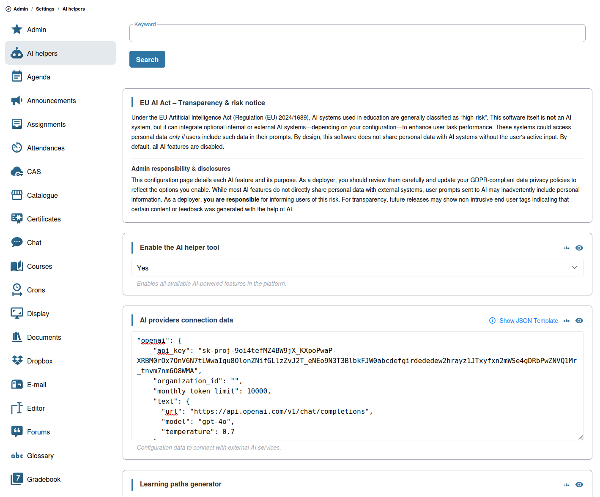

# AI-configuratie

Chamilo 3.0 bevat AI-gestuurde functies die configuratie vereisen voordat ze beschikbaar worden voor docenten en cursisten.

## Ondersteunde AI-providers

Chamilo ondersteunt meerdere AI-providers:

| Provider | Mogelijkheden |
|----------|-------------|
| **Claude (Anthropic)** | Tekstgeneratie, documentanalyse |
| **DeepSeek** | Tekstgeneratie |
| **Google Gemini** | Tekst-, afbeelding- en videogeneratie |
| **Grok** | Tekst-, afbeelding- en videogeneratie |
| **Mistral** | Tekstgeneratie |
| **OpenAI** | Tekst-, afbeelding- en videogeneratie |

Elke provider kan worden geconfigureerd voor verschillende typen AI-taken:

* **Tekst** — Gebruikt voor het genereren van oefeningen, het genereren van leerpaden, AI-beoordeling en de AI-tutor
* **Afbeelding** — Gebruikt voor AI-afbeeldingsgeneratie
* **Video** — Gebruikt voor AI-videogeneratie (indien ondersteund)
* **Document** — Gebruikt voor AI-documentanalyse

## Configuratiestappen

### 1. API-sleutels verkrijgen

Registreer een account bij de gekozen AI-provider en verkrijg een API-sleutel:

* **Claude (Anthropic)**: [console.anthropic.com](https://console.anthropic.com/)
* **DeepSeek**: [platform.deepseek.com](https://platform.deepseek.com/)
* **Google Gemini**: Google AI Studio of Google Cloud
* **Grok**: [console.x.ai](https://console.x.ai/)
* **Mistral**: [console.mistral.ai](https://console.mistral.ai/)
* **OpenAI**: [platform.openai.com](https://platform.openai.com/)

### 2. Providers configureren in Chamilo



Ga in de platforminstellingen naar de sectie **AI Helpers**:

1. **AI-helpers inschakelen** — Schakel de AI-functies globaal in
2. **AI-providers configureren** — Voeg een of meer providers toe met:
   * **Providernaam** (`claude`, `deepseek`, `gemini`, `grok`, `mistral`, `openai`). `anthropic` wordt geaccepteerd als alias van `claude`
   * **API-sleutel** — Uw API-sleutel voor de provider
   * **Model** — Het specifieke model dat moet worden gebruikt (bijv. `gpt-4o`, `claude-sonnet-4-6`, `gemini-pro`, `mistral-large`)
   * **API-URL** — De endpoint-URL (vooraf geconfigureerd voor standaardproviders)

U kunt meerdere providers configureren. De eerste provider in de configuratie wordt de standaard.

### 3. Functies per cursus inschakelen

AI-functies kunnen op cursusniveau worden in- of uitgeschakeld. Docenten kunnen het volgende in- of uitschakelen:

* **AI Tutor-chatbot** — De AI-assistent voor cursisten
* **Opdrachtbeoordelaar** — Door AI gegenereerde beoordelingsaanbeveling
* **Oefeningengenerator** — Door AI gegenereerde toetsvragen
* **Leerpadgenerator** — Door AI gegenereerde leerreeksen
* **Afbeeldings-/videogenerator** — Door AI gegenereerde afbeeldingen en video's in documenten

Hierdoor kunnen verschillende cursussen verschillende AI-configuraties gebruiken op basis van hun behoeften.

## Elk compatibel model of endpoint gebruiken

**U bent niet beperkt tot de hierboven vermelde providers.** Chamilo communiceert met elke provider via een standaard-API-*interface*, en de endpoint-URL is configureerbaar. Elk model of elke dienst die compatibel is met een van deze interfaces kan worden gebruikt door eenvoudig de overeenkomende provider te kiezen en de **API-URL** (endpoint), de **API-sleutel** en de **model**naam te wijzigen.

| Als uw model/dienst compatibel is met... | Gebruik deze provider | Typisch endpointpad |
|---|---|---|
| De **OpenAI API** (Chat Completions) | `openai` | `.../chat/completions` |
| De **Anthropic (Claude) Messages API** | `claude` | `.../v1/messages` |
| De **Gemini API** | `gemini` | providerspecifiek |
| De API's van **Mistral**, **DeepSeek** of **Grok** | `mistral`, `deepseek`, `grok` | providerspecifiek |

De OpenAI-compatibele interface is verreweg de meest geïmplementeerde. Deze wordt onder andere gebruikt door GLM (Z.ai / Zhipu), Qwen, Kimi, Together AI, Groq, OpenRouter, Perplexity en door zelf gehoste servers zoals Ollama, vLLM, LM Studio of LiteLLM. Al deze diensten kunnen via de provider `openai` aan Chamilo worden gekoppeld.

---
### Voorbeeld: GLM (Z.ai) gebruiken via de OpenAI-provider

GLM-modellen van Z.ai bieden een OpenAI-compatibel eindpunt, zodat geen aparte GLM-provider nodig is:

1. Haal een API-sleutel op uit uw Z.ai-account.
2. Voeg in de instellingen van **AI Helpers** de provider `openai` toe (of bewerk deze).
3. Stel de **API-URL** van de tekstservice in op het GLM-eindpunt, stel het **model** in op een GLM-model en plak de Z.ai-sleutel als de **API-sleutel**.

```json
{
  "openai": {
    "api_key": "YOUR_ZAI_API_KEY",
    "text": {
      "url": "https://api.z.ai/api/paas/v4/chat/completions",
      "model": "glm-4.6",
      "temperature": 0.7,
      "max_tokens": 1000
    }
  }
}
```

Dezelfde aanpak werkt voor een lokaal model dat door Ollama wordt aangeboden (`"url": "http://localhost:11434/v1/chat/completions"`, `"model": "llama3.1"`), of voor elke andere dienst: raadpleeg de documentatie van de leverancier voor de OpenAI-compatibele basis-URL en de exacte modelnamen.


Het eindpunt moet het volledige verzoek-/antwoordformaat van de gekozen interface implementeren, en het model moet de gebruikte functionaliteit ondersteunen (beeldgeneratie werkt bijvoorbeeld alleen als het eindpunt ook de OpenAI-image-API implementeert). Modelnamen, eindpunt-URL's en beschikbaarheid worden door de leverancier bepaald en kunnen wijzigen: raadpleeg altijd hun documentatie. Als een functie niet werkt, test dan eerst met een configuratie die alleen tekst gebruikt.


Hetzelfde principe geldt voor de Claude-provider: elke Anthropic-compatibele gateway of proxy kan worden gebruikt door de API-URL te wijzigen.

## Time-outs voor generatie in AI Toolbox

Voor tekstgeneratie in **AI Toolbox** bepaalt de instelling `text.timeout` van een provider hoe lang dat providerverzoek mag duren. De Grok-tekstprovider gebruikt een **standaard van 180 seconden** wanneer geen numerieke time-out is geconfigureerd (zie [PR #9198](https://github.com/chamilo/chamilo-lms/pull/9198)). Dit is geen garantie dat het browserverzoek 180 seconden kan duren: reverse proxies, de webserver of een andere gateway kunnen een kortere limiet opleggen.

Als het Toolbox-formulier **HTTP 504** weergeeft, controleer dan de time-out van het reverse-proxy-/gatewayverzoek en de PHP- en applicatielogboeken; alleen `text.timeout` verhogen lost het mogelijk niet op. Wanneer de fout de AI-provider noemt, controleer dan de `text.timeout`, inloggegevens, modelbeschikbaarheid en verzoeklimieten van die provider. Verhoog time-outs niet zonder rekening te houden met servercapaciteit en gelijktijdige verzoeken.

## Kostenoverwegingen

AI-API-aanroepen brengen kosten met zich mee. Houd rekening met het volgende:

* **Gebruikslimieten instellen** — Bewaak en beperk het gebruik van de AI-API om de kosten te beheersen
* **Modellen verstandig kiezen** — Kleinere, goedkopere modellen kunnen voor veel onderwijstaken volstaan
* **Gebruik bijhouden** — Chamilo registreert AI-verzoeken zodat u het verbruik kunt bewaken

## Tips

* **Begin met één provider** — Configureer en test één provider voordat u er meer toevoegt
* **Test met een cursus** — Schakel AI-functies eerst in een testcursus in om te controleren of ze werken zoals verwacht
* **Communiceer met docenten** — Informeer docenten over welke AI-functies beschikbaar zijn en hoe ze deze kunnen gebruiken
* **Bewaak de kwaliteit** — Controleer regelmatig door AI gegenereerde inhoud om te waarborgen dat deze aan uw onderwijsnormen voldoet