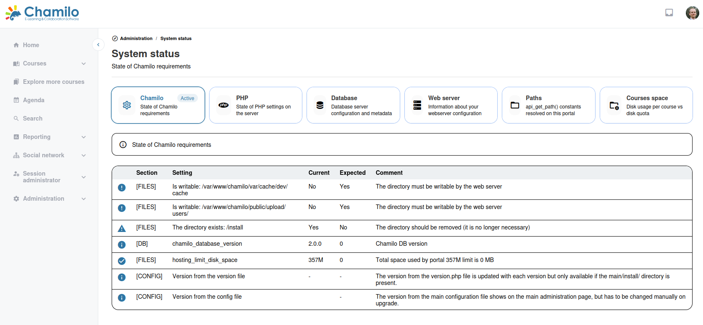

# Systeemstatus

De pagina Systeemstatus helpt u te controleren of uw Chamilo-server correct is geconfigureerd en mogelijke problemen te identificeren.

## Systeemstatus openen

Klik in het beheerpaneel op **Systeemstatus** (of **Systeeminformatie**).

## Wat wordt weergegeven

### PHP-configuratie

* **PHP-versie** — Chamilo 3.0 ondersteunt PHP 8.3, 8.4 en 8.5
* **Vereiste extensies** — Controleert of alle benodigde PHP-extensies zijn geïnstalleerd
* **PHP-instellingen** — Controleert belangrijke PHP-instellingen zoals geheugenlimiet, uploadlimieten en uitvoeringstijd

### Databasestatus

* **Databaseverbinding** — Bevestigt dat de database bereikbaar is
* **Databaseversie** — Toont de versie van de databaseserver

### Bestandsrechten

* **Beschrijfbare mappen** — Controleert of Chamilo naar de vereiste mappen kan schrijven (cache, uploads, logs)

### Serverinformatie

* **Besturingssysteem** — Details van het serverbesturingssysteem
* **Webserver** — Apache, Nginx of een andere
* **Schijfruimte** — Beschikbare opslagruimte

## Aanbevolen controles

Voer deze controles regelmatig uit:

* **Na installatie** — Controleer of aan alle vereisten is voldaan
* **Na upgrades** — Zorg ervoor dat de PHP-versie en extensies nog steeds compatibel zijn
* **Bij problemen** — Controleer eerst de systeemstatus bij het oplossen van problemen