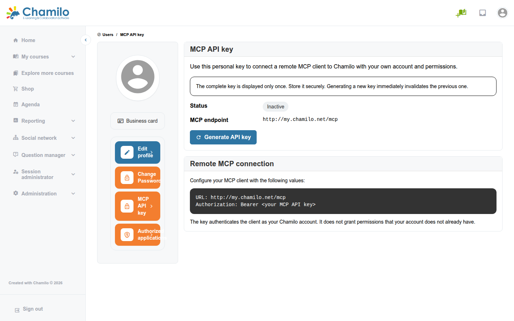

# MCP (Model Context Protocol)

Chamilo 3.0 stelt een MCP-server beschikbaar zodat AI-assistenten en agents (Claude, ChatGPT-connectors of elke MCP-compatibele client) namens een geauthenticeerde gebruiker binnen het platform kunnen handelen, met de eigen rechten van die gebruiker — er is geen afzonderlijk serviceaccount of verhoogde toegang.

## Wat MCP toevoegt aan Chamilo

MCP (Model Context Protocol) is een open standaard waarmee AI-clients een gedefinieerde set "tools" kunnen aanroepen die door een server worden aangeboden. De MCP-server van Chamilo is bereikbaar via één endpoint, `/mcp`, en biedt een zorgvuldig geselecteerde set cursusbeheertools voor docenten in plaats van het volledige API-oppervlak.

## Beschikbare mogelijkheden

Elke aanroep wordt uitgevoerd als de verbonden gebruiker, zodat een tool uitsluitend cursussen ziet en wijzigt die die gebruiker beheert. De huidige toolset:

| Tool | Wat het doet |
|------|---------------|
| Huidige gebruiker | Geeft de identiteit en rollen van de geauthenticeerde gebruiker terug |
| Docentencursussen | Toont de cursussen die de gebruiker als docent beheert |
| Cursusoverzicht | Geeft basiscursusinformatie en aantallen bronnen terug |
| Cursus aanmaken | Maakt een nieuwe cursus aan volgens de cursusaanmaakregels van het platform |
| Cursusopdracht aanmaken | Maakt een concept- of gepubliceerde opdracht aan met een beschrijving en maximale score |
| Cursustest aanmaken | Maakt een door AI ondersteunde meerkeuzetest op basis van een onderwerpbeschrijving of een bestaand document |
| Status van cursustestantwoorden ophalen | Rapporteert welke studenten hebben geantwoord, bezig zijn of nog in afwachting zijn van een test |
| Cursustestscore van gebruiker ophalen | Geeft de laatste en beste voltooide scores van een student op een test terug |
| Tevredenheidsenquête over training aanmaken | Maakt een tevredenheidsenquête met zeven vragen aan |
| Leerpad van cursus aanmaken | Maakt een leerpad aan op basis van pagina's die door de MCP-client worden aangeleverd |
| Voorwaarde voor leerpaditem instellen | Maakt een leerpaditem pas beschikbaar nadat een eerder item van hetzelfde leerpad is voltooid (met een scorebereik wanneer dat item een test is), of verwijdert de voorwaarde; werkt voor leerpaden die aan een sessie zijn gekoppeld wanneer de sessie is opgegeven |
| Cursusintroductie instellen | Vervangt of wist de introductiesectie die op de startpagina van de cursus wordt getoond, voor de basiscursus of voor één sessie ervan (de sessie-introductie vervangt dan de basisintroductie binnen die sessie) |
| Toolbox-toepassing van cursus aanmaken | Genereert een versiebeheerde SCORM 1.2-toepassing in de AI Toolbox van de cursus en publiceert deze optioneel |
| Toolbox-toepassing van cursus bijwerken | Genereert een nieuwe door AI ondersteunde versie van een bestaande Toolbox-toepassing en behoudt eerdere versies |
| Documenten weergeven | Toont de documenten in de tool Documenten van een cursus |
| Cursusdocument lezen | Geeft de HTML-inhoud, titel en metagegevens van een bewerkbaar document terug |
| Cursusdocument bewerken | Vervangt de volledige HTML-inhoud van een bestaand bewerkbaar document |
| Cursusdocument aanmaken | Maakt een door AI ondersteund HTML-document aan in de hoofdmap Documenten |
| Cursusillustratie aanmaken | Genereert een AI-illustratie voor een onderwerp en slaat deze op als document |
| Documentalinea illustreren | Voegt een bestaande afbeelding of video vóór of na een alinea in een document in |
| Recente forumactiviteit van cursus zoeken | Zoekt recente, zichtbare forumberichten die verband houden met een onderwerp |
| Cursuskwaliteit beoordelen | Analyseert de leerpaden, documenten, tests, opdrachten en enquêtes van een cursus en geeft verbeteraanbevelingen terug |
| Student Success-feedback genereren | Voert dezelfde privacygefilterde analyse van de Student Success AI Coach uit die beschikbaar is via cursusrapportage voor een lerende in een beheerde cursus |

Deze lijst wordt samengesteld door het kernteam van Chamilo en is niet door gebruikers uitbreidbaar vanuit het platform — docenten kunnen geen eigen tools toevoegen.

## MCP inschakelen

MCP is **standaard uitgeschakeld**. Totdat het is ingeschakeld, weigert het endpoint `/mcp` elke referentie en verschijnt de knop **MCP API-sleutel** niet op de pagina **Sociaal netwerk** van gebruikers.

Ga naar **Beheer > Configuratie-instellingen > Beveiliging** en stel in:

* **MCP-server inschakelen** (`mcp_enabled`) op **Ja**.
* **MCP toestaan per rol** (`mcp_allowed_roles`) op de rollen die MCP mogen gebruiken. Dit is een JSON-map; standaard zijn alleen beheerders en docenten toegestaan:

  ```json
  {"ADMIN":true,"COURSEMANAGER":true,"STUDENT":false,"HRM":false,"SESSIONADMIN":false,"STUDENT_BOSS":false,"INVITEE":false}
  ```

  Gebruik `HRM` in nieuwe configuraties. Een eerder opgeslagen `DRH`-vermelding blijft ondersteund wanneer `HRM` niet aanwezig is; als beide aanwezig zijn, heeft `HRM` voorrang.

  Een gebruiker heeft ten minste één ingeschakelde rol nodig om de knop **MCP API-sleutel** te zien en MCP te gebruiken. Ongeldige JSON weigert MCP voor elke rol. De beperking geldt ook voor eerder aangemaakte sleutels en OAuth-verbindingen, zodat het verwijderen van een rol de bestaande toegang daarvan afsnijdt.

Zie [Beveiligingsinstellingen](platform-settings/security-settings.md) voor de volledige beschrijving van beide instellingen.

## Hoe gebruikers verbinding maken

### Persoonlijke MCP API-sleutel

Elke gebruiker genereert een eigen sleutel onder **Sociaal netwerk** > **MCP API-sleutel**:



* Door op **API-sleutel genereren** te klikken wordt een sleutel aangemaakt en eenmalig weergegeven — Chamilo bewaart daarna alleen een gemaskeerde versie, dus de volledige sleutel moet onmiddellijk worden gekopieerd en veilig worden opgeslagen.
* Het genereren van een nieuwe sleutel trekt de vorige onmiddellijk in.
* De pagina toont de status van de sleutel (actief/inactief), het MCP-endpoint dat in de client moet worden geconfigureerd, en de aanmaakdatum en de datum van laatste gebruik.
* Het paneel **Externe MCP-verbinding** geeft exact aan wat in de MCP-client moet worden ingevuld: de endpoint-URL en een header `Authorization: Bearer <your MCP API key>`.

Zoals de pagina zelf vermeldt, authenticeert de sleutel de client als het account van die gebruiker — ze verleent geen enkele machtiging die het account nog niet heeft.

### OAuth 2.1 (externe clients en connectors)

Voor MCP-clients die OAuth-discovery en dynamische clientregistratie ondersteunen (in plaats van een handmatig geplakte sleutel) fungeert Chamilo ook als een OAuth 2.1-autorisatieserver: de client ontdekt de endpoints van Chamilo, registreert zichzelf en leidt de gebruiker om naar `/oauth/authorize` om toegang goed te keuren. Goedgekeurde toepassingen verschijnen onder **Sociaal netwerk** > **Geautoriseerde toepassingen**, waar de gebruiker toepassingen kan intrekken die niet langer worden gebruikt of herkend.

## Beveiligingsoverwegingen

* **Geen privilege-escalatie.** Elke MCP-toolaanroep en elke door OAuth geautoriseerde app draait met de eigen Chamilo-machtigingen van de verbindende gebruiker — een persoonlijke API-sleutel of een geautoriseerde app kan nooit meer doen dan die gebruiker al handmatig kon doen.
* **Alleen Bearer, met snelheidsbeperking.** `/mcp` accepteert alleen een Bearer-credential — een persoonlijke MCP API-sleutel, een OAuth-toegangstoken of (in ontwikkeling) een JWT. Authenticatiepogingen zijn per IP-adres snelheidsbeperkt om het raden van credentials te vertragen.
* **Beperkt publiek oppervlak.** Het enige niet-geauthenticeerde verkeer dat `/mcp` accepteert, is de `OPTIONS`-preflight; elke daadwerkelijke aanroep vereist `ROLE_USER`. De endpoints voor OAuth-discovery, dynamische clientregistratie en tokens zijn bewust publiek, zoals vereist door de specificaties van OAuth 2.1 / MCP — dit verleent op zichzelf geen toegang, maar laat een client alleen leren hoe de autorisatiestroom kan worden gestart.
* **DNS-rebindingbescherming is bewust uitgeschakeld voor `/mcp`.** De bundle die MCP implementeert, beperkt het endpoint normaal tot `localhost`, tenzij een statische lijst van toegestane hostnamen is geconfigureerd — een slechte match voor een Chamilo-portaal met meerdere URL's dat onder veel hostnamen bereikbaar is. Chamilo schakelt die controle uit omdat ze hier overbodig is: elk `/mcp`-verzoek vereist al een Bearer-credential, ongeacht de header `Host`/`Origin`, en een DNS-rebindingaanval (die steunt op omgevingsauthenticatie in cookiestijl die meereist met een vervalste Host) kan geen bearer-token vervalsen dat de aanvaller nog niet heeft.

## De MCP-server configureren

Naast de twee platforminstellingen die worden beschreven in [MCP inschakelen](#enabling-mcp), wordt de MCP-server zelf op bestandsniveau geconfigureerd, in `config/packages/mcp.yaml`, waarvoor shelltoegang tot de server vereist is:

| Sleutel | Doel |
|-----|---------|
| `app`, `version`, `description` | Identiteit die Chamilo rapporteert aan verbindende MCP-clients |
| `client_transports.stdio` / `client_transports.http` | Welke transports actief zijn; Chamilo schakelt beide standaard in |
| `http.path` | Het MCP HTTP-endpoint (`/mcp` standaard) |
| `http.allowed_hosts` | Toelatingslijst van hosts tegen DNS-rebinding — ingesteld op `false` in Chamilo (zie Beveiligingsoverwegingen hierboven) |
| `http.session.store`, `.directory`, `.ttl` | Waar de MCP-sessiestatus wordt bewaard en hoe lang |

Om MCP voor iedereen uit te schakelen, zet u **MCP-server inschakelen** terug op **Nee**. Om het HTTP-transport zelf te verwijderen, stelt u `client_transports.http: false` in (en `stdio: false` als het CLI-transport ook moet worden uitgeschakeld) en wist u de cache:

```bash
php bin/console cache:clear --env=prod
php bin/console cache:warmup --env=prod
```

## Tips

* Behandel een MCP API-sleutel als een wachtwoord — iedereen die de sleutel bezit, kan via elke MCP-client als die gebruiker handelen.
* Moedig gebruikers aan om **Geautoriseerde toepassingen** periodiek te controleren en alles in te trekken wat ze niet herkennen.
* Zie [AI-configuratie](integrations/ai-configuration.md) voor de AI-providers die de hierboven vermelde tools voor contentgeneratie ondersteunen (toetsen maken, documenten maken, illustraties).