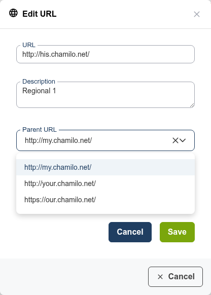
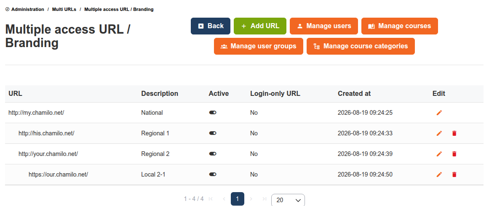

# Toegangs-URL's

Toegangs-URL's maken het mogelijk dat één Chamilo-installatie meerdere afzonderlijke portalen bedient.

Deze tool is ook bereikbaar vanuit het blok [Platform](../platform/README.md) van het beheerdersdashboard, als **Meerdere toegangs-URL's configureren**.

## Gebruiksscenario's

* **Multi-tenantimplementaties** — Afzonderlijke trainingsportalen voor verschillende organisaties hosten op één server
* **Afdelingsportalen** — Geef elke afdeling een eigen portaal met eigen huisstijl (bijv. `hr.training.company.com`, `it.training.company.com`)
* **Regionale portalen** — Afzonderlijke portalen voor verschillende regio's of talen

## Hoe het werkt

Elke toegangs-URL is een afzonderlijk toegangspunt tot dezelfde Chamilo-installatie:

* Gebruikers kunnen aan een of meer toegangs-URL's worden toegewezen
* Cursussen en sessies behoren tot specifieke toegangs-URL's
* Platforminstellingen kunnen per toegangs-URL worden aangepast
* Huisstijl en thema's kunnen per URL verschillen
* Gebruikers op het ene portaal kunnen geen gebruikers of cursussen op een ander portaal zien (tenzij expliciet gedeeld)

## Configuratie

### Multi-URL inschakelen

Multi-URL moet worden ingeschakeld in de Chamilo-configuratie (doorgaans in de omgevingsinstellingen). Dit gebeurt meestal tijdens de initiële installatie.

### Een toegangs-URL aanmaken

1. Ga vanuit het beheerpaneel naar **Toegangs-URL's**
2. Klik op **URL toevoegen**
3. Voer de URL in (bijv. `https://portal2.yoursite.com`) en een beschrijving
4. Kies optioneel een **bovenliggende URL** om deze URL onder een andere te nesten — zie [URL-hiërarchie](#url-hierarchy) hieronder
5. Opslaan

### Gebruikers en cursussen toewijzen

* **Gebruikers** — Wijs gebruikers toe aan specifieke toegangs-URL's. Een gebruiker kan tot meerdere URL's behoren.
* **Cursussen** — Wijs cursussen toe aan specifieke toegangs-URL's
* **Sessies** — Wijs sessies toe aan specifieke toegangs-URL's

### Instellingen per URL

Elke toegangs-URL kan een eigen hebben:

* **Kleurenthema** — Andere visuele huisstijl
* **Platformnaam en logo** — Eigen identiteit
* **Instellingsoverschrijvingen** — Bepaalde platforminstellingen kunnen per URL worden aangepast

## URL-hiërarchie

Toegangs-URL's kunnen worden georganiseerd in een boomstructuur van bovenliggende/onderliggende URL's in plaats van een platte lijst. Bij het aanmaken of bewerken van een URL kan een onbeperkte globale beheerder (zie [Beheerders van subbomen](#subtree-administrators) hieronder) elke andere URL kiezen als **bovenliggende URL**:

* De vervolgkeuzelijst biedt nooit de URL die wordt bewerkt, of een van de eigen afstammelingen, aan als mogelijke bovenliggende URL — dit voorkomt het ontstaan van een cyclus. De backend valideert dit opnieuw, ongeacht wat de interface toont.
* Als een URL wordt aangemaakt zonder een bovenliggende URL te kiezen, wordt standaard de **alleen-aanmelden-URL** gebruikt als die bestaat (zie [Instellingen per URL](#per-url-settings) hierboven), of anders de eerste toegangs-URL — hetzelfde standaardgedrag als voordat deze functie bestond.
* De bovenste URL van een boom — degene zonder bovenliggende URL — is de **wortel** van die boom. Eén Chamilo-installatie kan meer dan één onafhankelijke boom hosten.

Overal waar toegangs-URL's worden vermeld — het Multi-URL-dashboard en de beheerpagina Toegangs-URL's — wordt de boom weergegeven via inspringing, waarbij een bovenliggende URL onmiddellijk wordt gevolgd door de eigen onderliggende URL's (broers/zussen alfabetisch gesorteerd), in plaats van een aparte kolom "Bovenliggend":

## Beheerders van subbomen

De URL-hiërarchie bepaalt ook wat een [globale beheerder](../users/user-roles.md) kan beheren:

* Een beheerder die is geregistreerd op de **wortel**-URL van een boom is **onbeperkt**: deze beheert elke toegangs-URL, precies zoals voordat deze functie bestond.
* Een beheerder die alleen is geregistreerd op een **niet-wortel**-URL is **begrensd**: de pagina's Multi-URL en Toegangs-URL's tonen alleen die URL en de afstammelingen, en de aanmeldgrafiek op het Multi-URL-dashboard toont "Aanmeldingen (uw URL's)" in plaats van "Aanmeldingen (alle URL's gecombineerd)".

Ongeacht de reikwijdte blijven de volgende handelingen voorbehouden aan een **onbeperkte** globale beheerder — een begrensde beheerder kan deze niet uitvoeren, zelfs niet voor URL's binnen de eigen subboom:

* Een nieuwe toegangs-URL aanmaken
* De eigen URL, beschrijving of bovenliggende URL van een toegangs-URL bewerken
* Een toegangs-URL activeren of deactiveren
* Een toegangs-URL verwijderen (de wortel-URL van de hele installatie kan nooit door iemand worden verwijderd)
* Zichzelf in één keer registreren bij elke toegangs-URL

Een begrensde beheerder kan nog steeds alles beheren dat *is toegewezen aan* de URL's in de eigen subboom — gebruikers, cursussen, sessies, huisstijl en instellingen — alleen niet de toegangs-URL-vermeldingen zelf.

## Tips

* **Beslis vroeg** — Kiest u voor een multi-URL-configuratie, doe dat dan aan het begin van uw Chamilo-project, omdat de eerste URL relatief leeg van inhoud moet blijven. Multi-URL achteraf inschakelen is lastiger (vereist handmatige databasewijzigingen).
* **Plan de URL-structuur** — Bepaal uw URL-schema voordat u toegangs-URL's aanmaakt, omdat het later wijzigen van URL's alle bestaande links en bladwijzers beïnvloedt
* **DNS-configuratie** — Elke toegangs-URL moet naar dezelfde Chamilo-server verwijzen. Configureer de DNS-records dienovereenkomstig.
* **Globale beheerder** — Gebruik de rol Globale beheerder om beheer over alle toegangs-URL's uit te voeren. Om in plaats daarvan het beheer van slechts één tak te delegeren, registreert u de beheerder op een niet-hoofd-URL — zie [Subboombeheerders](#subtree-administrators)