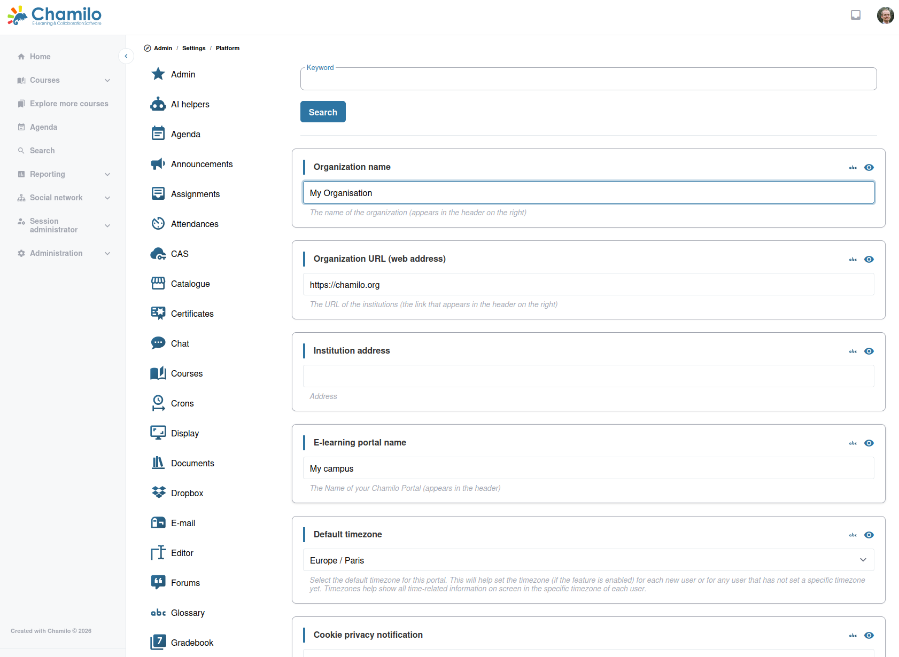

# Platforminstellingen

Chamilo beschikt over een uitgebreid configuratiesysteem met instellingen die in categorieën zijn georganiseerd. De volledige set categorieën hieronder weerspiegelt de pagina **Configuratie-instellingen** in het beheerpaneel — en het onderliggende `SettingsCurrentFixtures.php` in de broncode, dat de bron van waarheid is voor variabelenamen, titels en beschrijvingen.

Open de platforminstellingen vanuit het beheerpaneel door op **Configuratie-instellingen** te klikken.

## Alle categorieën

Er zijn in totaal **39 configuratiecategorieën**, hieronder alfabetisch vermeld. Het getal na elke link is het aantal instellingen in die categorie.

### Platformbreed

* **[Identiteit van de beheerder](admin-settings.md)** (12) — Identiteit en contactgegevens van de platformbeheerder.
* **[Platform](platform-settings.md)** (30) — Identiteit op platformniveau, tijdzone, registratiebeleid, online gebruikers, prestatievlaggen.
* **[Weergave](display-settings.md)** (24) — Indeling van de startpagina, gravatar, menu's, huisstijlgedrag.
* **[Editor](editor-settings.md)** (26) — Werkbalken, plug-ins en AI-hulpmiddelen van de rich-texteditor (TinyMCE).
* **[Talen](language-settings.md)** (12) — Beschikbare talen, standaardtaal, terugvaltalen.
* **[E-mail](mail-settings.md)** (22) — Opmaak van uitgaande e-mail, afzenderidentiteit, handtekening.
* **[Workflows](workflows-settings.md)** (23) — Overkoepelende workflowschakelaars (cursusaanmaak, validatie van inschrijvingen…).

### Authenticatie, beveiliging en privacy

* **[Beveiliging](security-settings.md)** (31) — Aanmeldbeveiliging, wachtwoordbeleid, headers, 2FA, IDS.
* **[Registratie](registration-settings.md)** (20) — Beleid voor zelfregistratie en omleidingen na registratie.
* **[Privacy](privacy-settings.md)** (6) — Toestemming, gegevensexport, verzoeken tot accountverwijdering.
* **[CAS](cas-settings.md)** (7) — Oude CAS-configuratie overgenomen uit 1.x.

### Levenscyclus van cursussen en sessies

* **[Cursus](course-settings.md)** (45) — Standaardwaarden en beleidsregels die platformbreed op cursussen van toepassing zijn.
* **[Sessies](session-settings.md)** (68) — Levenscyclus van sessies, toegangstijdvensters voor tutoren, zichtbaarheid.
* **[Cursuscatalogus](catalog-settings.md)** (13) — Gedrag van de openbare cursuscatalogus.
* **[Profiel](profile-settings.md)** (29) — Welke velden op het gebruikersprofiel verschijnen.

### Cursustools

* **[Agenda](agenda-settings.md)** (11)
* **[Aankondigingen](announcement-settings.md)** (9)
* **[Opdrachten (Werk)](work-settings.md)** (12)
* **[Aanwezigheid](attendance-settings.md)** (4)
* **[Chat](chat-settings.md)** (5)
* **[Documenten](document-settings.md)** (29)
* **[Dropbox](dropbox-settings.md)** (10)
* **[Oefeningen (Toetsen)](exercise-settings.md)** (63)
* **[Forums](forum-settings.md)** (9)
* **[Woordenlijst](glossary-settings.md)** (3)
* **[Groepen](group-settings.md)** (3)
* **[Leerpaden](lp-settings.md)** (51)
* **[Enquêtes](survey-settings.md)** (12)

### Beoordeling en erkenning

* **[Cijferboek (Beoordelingen)](gradebook-settings.md)** (34) — Weergave van scores, decimalen, drempels voor certificaten.
* **[Certificaten](certificate-settings.md)** (9) — Standaardwaarden die worden toegepast wanneer een cursist een certificaat behaalt.
* **[Vaardigheden](skill-settings.md)** (13) — Vaardighedenboom, toekenningsregels, profielintegratie.
* **[Tracking](tracking-settings.md)** (14) — Wat wordt vastgelegd en welke rapporten beschikbaar worden gesteld.

### Communicatie en gemeenschap

* **[Berichten](message-settings.md)** (7)
* **[Sociaal netwerk](social-settings.md)** (7)

### AI

* **[AI-hulpmiddelen](ai-helpers-settings.md)** (13) — Aanbieders per taaktype (tekst, afbeelding, video, tutor, beoordeling).

### Beheer en integratie

* **[Cronjobs](crons-settings.md)** (3)
* **[Zoeken](search-settings.md)** (3) — Configuratie van Xapian-zoeken in volledige tekst.
* **[Tickets](ticket-settings.md)** (8) — Helpdesksysteem.
* **[Webservices](webservice-settings.md)** (7) — Oude SOAP/REST-eindpunten.

## Hoe instellingen werken

* Instellingen worden opgeslagen in de database (tabel `settings`) en beheerd via de webinterface
* Sommige instellingen zijn **URL-vergrendeld** in configuraties met meerdere URL's (hun waarde geldt platformbreed en kan niet per URL worden overschreven — zie de kolommen `access_url_locked` en `access_url_changeable` in de tabel `settings`); andere (de meeste) kunnen per toegangs-URL worden overschreven
* Wijzigingen worden onmiddellijk van kracht (geen herstart van de server vereist), hoewel uw gebruikerssessie sommige ervan in het geheugen kan bewaren. Als wijzigingen niet onmiddellijk zichtbaar zijn, meld u af en weer aan om uw sessie te legen.
* Sommige instellingen hebben afhankelijkheden — het wijzigen van de ene kan het gedrag van andere beïnvloeden
* De variabelenamen die op elke pagina worden getoond (bijv. `2fa_enable`) komen overeen met de rij in de databasetabel `settings` (kolom `variable`) en met de sleutels die worden gebruikt in overschrijvingen (`config/settings_overrides.yaml`), waar van toepassing.

Raadpleeg voor meer informatie [Configuraties](https://github.com/chamilo/chamilo-lms/wiki/Configurations) op onze wiki.

## Inlinevalidatie voor JSON-instellingen

Sommige instellingen vereisen een JSON-waarde. In deze JSON-specifieke tekstvelden controleert Chamilo de syntaxis ongeveer **drie seconden** nadat u stopt met typen. Als de waarde ongeldig is, verschijnt onder het veld het bericht **Ongeldige JSON-syntaxis**, en het formulier kan niet worden verzonden totdat de syntaxis is gecorrigeerd.

Hetzelfde gedrag is beschikbaar bij het bewerken van een JSON-instelling via de zoekresultaten voor instellingen. Gewone tekstvelden en uitgeschakelde instellingen worden niet als JSON behandeld. Deze controle aan de browserzijde helpt typefouten op te sporen; validatie aan de serverzijde blijft van kracht. Zie [PR #9411](https://github.com/chamilo/chamilo-lms/pull/9411).

## Tips

* **Documenteer uw instellingen** — Houd een overzicht bij van niet-standaardinstellingen en waarom u deze hebt gewijzigd
* **Wijzig één ding tegelijk** — Wijzig bij het oplossen van problemen één instelling tegelijk, zodat u het effect kunt vaststellen
* **Test in een stagingomgeving** — Test bij ingrijpende wijzigingen van instellingen eerst op een stagingserver