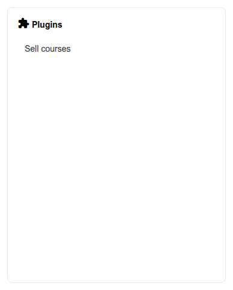

# Plugins

Plugins breiden de functionaliteit van Chamilo uit zonder de kerncode te wijzigen. Chamilo 3.0 wordt geleverd met meer dan 50 plugins die naar behoefte kunnen worden geactiveerd.

## Het Plugins-blok

Het beheerdersdashboard heeft ook een eigen **Plugins**-blok, los van het algemene pluginbeheer in dit hoofdstuk. Het toont niet elke geïnstalleerde plugin — alleen de plugins waarvan de configuratie aangeeft dat ze in het gebied van het beheerdersmenu moeten verschijnen, zodat elke dergelijke plugin een directe snelkoppeling naar de eigen beheerpagina op het dashboard krijgt.

Als een plugin die u hebt geactiveerd hier niet verschijnt, is dat verwacht — het betekent dat die specifieke plugin zich niet heeft aangemeld voor het gebied van het beheerdersmenu, niet dat er iets defect is. Zie [Plugins beheren](managing-plugins.md) voor de volledige lijst van geïnstalleerde plugins, ongeacht of ze op het dashboard verschijnen.

## In dit hoofdstuk

* **[Plugins beheren](managing-plugins.md)** — Plugins installeren, activeren, configureren en deactiveren
* **[BuyCourses-betalingen en terugkerende diensten](buycourses.md)** — Betalingsgateways, verlengingen en de betalingsgeschiedenis van diensten configureren